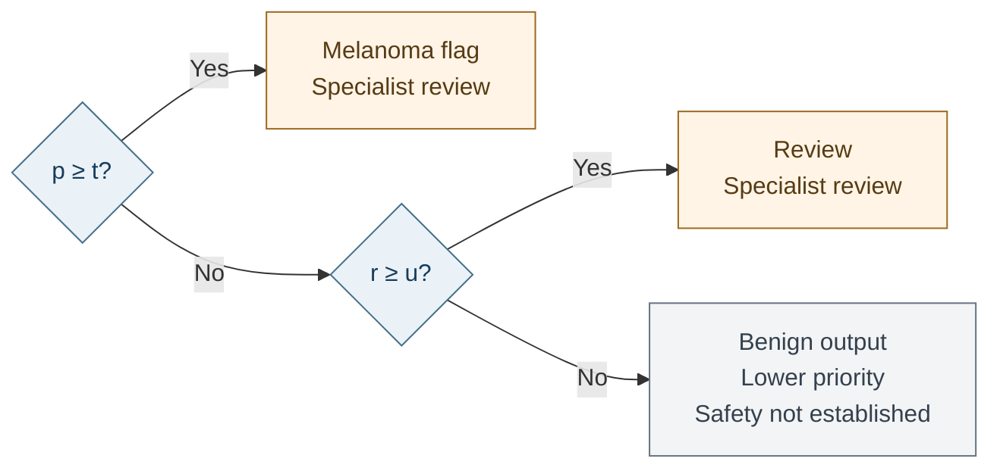
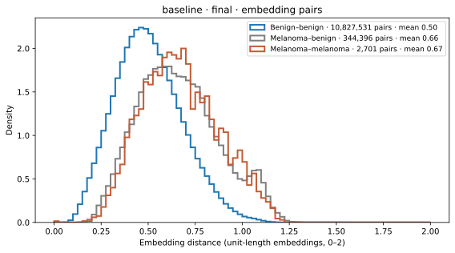
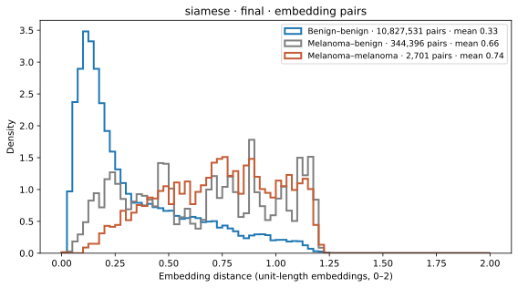

# Melanoma Classification with Siamese Learning

**Author:** Alex Anderson (student 47472442) | COMP3710 Pattern Recognition, 2026 | Hard difficulty: Siamese network on ISIC 2020

## Executive Summary

This project uses ISIC 2020 to investigate whether Siamese metric learning improves melanoma classification and helps identify cases needing specialist review. A shared ResNet-18 produces a class probability and an embedding for comparison with labelled training images. The baseline uses the same architecture and training recipe, with the contrastive loss weight set to zero.

Five training seeds were evaluated for each model on 4,728 images from 288 patients, including 74 melanomas. Mean accuracy was 0.824 for the baseline and 0.830 for Siamese. Melanoma average precision was 0.195 and 0.176, respectively. The reference-based review policy sent about 32% of images to a specialist and captured 88.9% of melanomas with the baseline and 90.5% with Siamese. Neither met the 95% capture target on final patients.

The recommendation is to keep the baseline as the classification model and use the two-step rule in the recommendation section to prioritise specialist review, never to clear lesions automatically. Contrastive training halved the distance between benign embeddings (0.57 to 0.29 on average) but did not draw melanomas together, which explains why it gave no consistent classification gain. ImageNet initialisation was essential: the same baseline trained from random weights reached an AP of only 0.056, against 0.19 when pretrained.

## Feasibility Review

### 1. User Need, Scope and Acceptance Criteria

Can Siamese similarity scores expose ambiguous or incorrect melanoma decisions better than the same CNN trained only to classify, at an acceptable local computational cost? The intended user is a specialist reviewing dermoscopic images. The prototype classifies lesions and prioritises cases for review. It uses existing labelled images and does not measure human diagnostic accuracy or clinical effectiveness.

| Criterion          | Testable target                                                                     |
| ------------------ | ----------------------------------------------------------------------------------- |
| Patient separation | No patient shared between training, selection, calibration and final groups         |
| Classification     | About 0.8 accuracy; report both classes, macro-F1, AUROC and PR-AUC                 |
| Review policy      | At least 95% melanoma capture on calibration patients                               |
| Added value        | Compare confidence-based and reference-based review; inspect three to five failures |
| Local resources    | A full run below two hours and 24 GiB peak memory; report latency and parameters    |

### 2. Model Choice and Course Concepts

The Hard-difficulty Siamese task uses ISIC 2020 [1, 2] and PyTorch. A ResNet-18 [4] encoder is shared by every image, the Siamese principle [11], so one network both classifies and embeds. Contrastive loss [3] shapes the embedding; cross-entropy, class-balanced sampling, augmentation [9] and AdamW [10] are the course concepts used for the classifier. The baseline is the same network and recipe with the contrastive term switched off, so any difference is attributable to metric learning.

### 3. Preliminary Feasibility Evidence

A data audit found 33,126 labelled images from 2,056 patients, of which 584 (1.76%) are melanoma. Patients contribute 2–115 images each, and all 425 published duplicate pairs share a patient and label, so splits must be made by patient and the reference gallery must come from training patients only. The JPEG archive is about 23 GB. Early five-epoch pilot runs on Apple MPS took about 28 minutes and 1.2 GiB of process memory, within the local budget.

### 4. Risks, Budget, Next Experiment and Fallback

The main risks are memorisation of the small melanoma class, overconfident errors and thresholds fitted on few calibration melanomas. Patient grouping, separate selection and calibration groups, repeated seeds and rules fixed before final scoring address them. About six GPU-hours were budgeted for the comparison. The next experiment after the pilot was a matched baseline–Siamese pair reporting melanoma recall, false-positive rate, review workload, parameters, memory and latency. The fallback is the classification-only baseline if metric learning adds nothing.

### Post-Experiment Criteria Analysis

| Criterion          | Status after the final experiments                                                             |
| ------------------ | ---------------------------------------------------------------------------------------------- |
| Patient separation | Met; `load_splits` asserts that no patient appears in two groups.                              |
| Classification     | Met: final accuracy 0.82–0.83 across seeds. Melanoma precision stays near 6.5%.                |
| Review policy      | Met on calibration; final mean capture 88.9–90.5%, below the 95% target.                       |
| Added value        | Done. Reference scores rank errors far better than confidence; no consistent contrastive gain. |
| Local resources    | Met: about 17 minutes per run and 4.38 GiB peak accelerator memory.                            |

## Symbols, Abbreviations and Key Terms

Definitions follow their use in this report. Unless stated otherwise, metrics describe individual images, with melanoma as the positive class and benign as the negative class.

### Abbreviations and Evaluation Measures

| Term | Meaning |
| --- | --- |
| ISIC | International Skin Imaging Collaboration; the source of the dermoscopic image dataset. |
| CNN / ResNet-18 | Convolutional neural network / the 18-layer residual network used to extract image features. |
| RGB | Red, green and blue; the three input image channels. |
| BN / ReLU | Batch normalisation / rectified linear unit; operations inside the encoder. |
| AUROC | Area under the receiver operating characteristic curve. Measures ranking across thresholds; 0.5 is chance and 1 is perfect ranking. |
| AP / PR-AUC | Average precision / area under the precision–recall curve. This report uses AP as its precision–recall summary. |
| Precision / recall | Fraction of melanoma flags that are correct / fraction of actual melanomas flagged. Recall is also called sensitivity. |
| Specificity | Fraction of actual benign images labelled benign by the classifier. |
| F1 / macro-F1 | F1 is the harmonic mean of precision and recall; macro-F1 averages the two class F1 scores equally. |
| TP / TN / FP / FN | Correct melanoma / correct benign / benign incorrectly flagged / melanoma missed by the classifier. |
| Brier score | Mean squared difference between predicted probabilities and binary labels; lower is better. |
| PCA | Principal component analysis; the method used to project embeddings into two dimensions. |
| SD | Standard deviation; the spread across training seeds in the mean ± SD tables. |
| GPU / VRAM | Graphics processing unit / graphics memory; the accelerator and its memory. |
| MPS / CUDA | Apple's Metal Performance Shaders / NVIDIA's GPU computing platform; supported accelerator backends. |
| RSS / GiB | Resident set size, meaning process memory held in RAM / gibibyte, equal to $2^{30}$ bytes. |

### Symbols

| Symbol | Meaning |
| --- | --- |
| $p$ | Calibrated classifier probability of melanoma. |
| $r$ | Reference similarity score; larger values mean relatively closer melanoma references. It is not a probability. |
| $t$, $u$ | Classifier probability cutoff and reference review cutoff, respectively. |
| $\hat y$ | Binary classifier prediction: 1 for melanoma and 0 for benign. |
| $d_{ij}$ | Distance between the unit-length embeddings of images $i$ and $j$. |
| $\bar d_b$, $\bar d_m$ | Mean distances to the nearest benign and melanoma references, respectively. |
| $P$, $N$ | Sets of same-class and different-class image pairs. $\lvert P\rvert$ and $\lvert N\rvert$ count their members. |
| $m$ | Contrastive margin: the target minimum distance for different-class pairs, set to 1. |
| $L$, $L_{\mathrm{CE}}$ | Total training loss and its cross-entropy classification term. |
| $\lambda$ | Weight of the contrastive loss: 0 for the baseline and 0.5 for Siamese. |

### Model and Experiment Terms

| Term | Meaning |
| --- | --- |
| Encoder / embedding | Network that extracts features / the numerical vector representing an image for comparison. |
| Siamese learning | Learning image comparisons using the same encoder weights for every image in a pair. |
| Contrastive loss | Training penalty that pulls same-class embeddings together and separates different-class embeddings. |
| Logit / logit margin | Raw classifier score / the melanoma logit minus the benign logit. |
| Batch / epoch | Group of images processed in one training step / one configured round of training-image draws. |
| Seed / checkpoint | Number controlling random choices / a saved trained model that can be restored for prediction. |
| Reference gallery | Labelled training images whose embeddings are compared with each query image. |
| Calibration / Platt scaling | Adjustment of output scores towards meaningful probabilities / the logistic mapping fitted for that purpose. |
| Review capture / workload | Fraction of melanomas sent to review / fraction of all images sent to review. Both include melanoma flags. |
| Patient-cluster bootstrap | Resampling whole patients with all their images to estimate uncertainty in evaluation results. |

## Methodology

### Dataset and Patient Groups

The SIIM-ISIC 2020 dataset [1, 2] contains 33,126 JPEG images from 2,056 patients, including 584 melanomas. Whole patients are assigned to groups, stratified by whether they have melanoma. The metadata audit found that all 425 published duplicate pairs share patient identity, so patient grouping keeps them together.

| Group       | Patients | Images | Melanomas | Purpose                                         |
| ----------- | -------: | -----: | --------: | ----------------------------------------------- |
| Training    |    1,460 | 23,584 |       419 | Learn weights and build the reference gallery   |
| Selection   |      154 |  2,438 |        41 | Choose the checkpoint                           |
| Calibration |      154 |  2,376 |        50 | Fit probability scaling and decision thresholds |
| Final       |      288 |  4,728 |        74 | Evaluate the fixed current models and rules     |

The manifest uses seeds 42, 20261007 and 20261008. All patient groups are disjoint. Evaluation retains the natural melanoma prevalence of approximately 1.6–2.1%.

### Image Preparation

Images use JPEG draft decoding, EXIF orientation correction and RGB conversion. Evaluation resizes the shorter side to 384 pixels and takes a 384 × 384 centre crop. ImageNet normalisation uses means (0.485, 0.456, 0.406) and standard deviations (0.229, 0.224, 0.225).

Training uses random resized crops covering 35–100% of the image, horizontal and vertical flips, rotations within ±45°, and colour jitter of 0.2 for brightness, contrast and saturation and 0.02 for hue. These transformations vary orientation, scale and colour [9]. They can also remove lesion edges or alter useful detail.

### Model Architecture

ResNet-18 [4, 6] maps each image to 512 features. A linear head produces benign and melanoma logits. The same features, scaled to unit length, form the embedding used for distance comparisons. Pair members share all encoder weights, following the Siamese principle [11]. Prediction restores the encoder and classifier learned during training.


The baseline uses cross-entropy alone; Siamese adds the purple contrastive-loss term with weight 0.5. Both terms feed the total loss. Dashed arrows show backpropagation and AdamW updates: the encoder receives total-loss gradients, while the classifier receives cross-entropy gradients only. Prediction uses the learned logits and embeddings, followed by calibration and reference comparison.

### Pair Generation Strategy

Pairs are generated inside each batch rather than stored as a fixed pair list. Each batch contains 32 sampled images and forms all $\binom{32}{2}=496$ unordered pairs, so every image is compared with 31 others at the cost of one forward pass. Sampling targets 15% melanoma images, or 4.8 per batch on average; a melanoma is not guaranteed in every batch. Expected pair counts are approximately 11 melanoma–melanoma, 126 mixed-class and 358 benign–benign pairs.

This design was chosen over offline positive/negative pair lists for three reasons. Raw ISIC 2020 has 1.8% melanoma, so random pairs would almost never contain two melanomas; the 15% sampler raises melanoma–melanoma pairs from about 0.2 to 11 per batch. Pairs are re-drawn every step, so the 419 training melanomas meet different partners instead of a memorised fixed set. Finally, the matching and different-class terms are averaged separately (below), so the 126 informative mixed pairs are not swamped by benign–benign pairs. Pairs never cross patient groups because each batch is drawn only from training patients.

### Training Objective

Cross-entropy learns image labels, while the contrastive loss [3] pulls same-class embeddings together and separates different-class embeddings. For distance $d_{ij}$, matching pairs $P$, different-class pairs $N$ and margin $m=1$:

$$
L = L_{\mathrm{CE}}^{\text{smooth}=0.1} + \lambda\left[\frac{1}{|P|}\sum_{(i,j)\in P}d_{ij}^{2} + \frac{1}{|N|}\sum_{(i,j)\in N}\max(0,m-d_{ij})^{2}\right].
$$

The baseline uses $\lambda=0$ and Siamese uses $\lambda=0.5$. Matching and different-class pair terms are averaged separately. Within the matching term, benign pairs still dominate; melanoma–melanoma pairs account for about 3% under the sampling distribution.

| Training setting       | Value                                                    |
| ---------------------- | -------------------------------------------------------- |
| Initialisation         | ImageNet V1 ResNet-18 with a new binary head             |
| Image size and batch   | 384 × 384; 32 images                                    |
| Sampling budget        | 23,584 draws per epoch; 15% melanoma target              |
| Epochs                 | 8                                                        |
| Optimiser              | AdamW [10], peak learning rate 0.0002, weight decay 0.05 |
| Regularisation         | Label smoothing 0.1 and image augmentation               |
| Schedule and precision | One-cycle schedule with 10% warmup; bfloat16 autocast    |
| Checkpoint selection   | Highest selection AUROC                                  |
| Training seeds         | 42, 43, 44, 67 and 69, matched across objectives         |

ImageNet initialisation is deliberate. Only 419 training images are melanoma, too few to learn general colour, texture and edge filters from scratch. Earlier versions of this project trained ResNet-18 from random weights with 15 epochs and a five-times higher learning rate, reached a final AP of 0.056 and AUROC of 0.830, against 0.190 and 0.889 for the pretrained baseline on matching seeds (see [Ablations](#ablations-contrastive-weight-and-initialisation)). Longer training does not help either: four 30-epoch from-scratch runs from an earlier version of the pipeline plateaued at selection AP 0.06–0.10, while matched ImageNet runs reached 0.26–0.32.

### Reference Score and Review Policy

The gallery contains all 419 training melanomas and 419 sampled benign training images. For each query, the model measures mean distance to the 15 nearest references in each class. If these means are $\bar d_b$ for benign and $\bar d_m$ for melanoma, the reference score is

$$
r = \frac{\bar d_b}{\bar d_b + \bar d_m}.
$$

Higher values indicate greater relative similarity to melanoma references. A score of 0.5 means equal mean distances; the review cutoff is fitted separately and can be below 0.5. The score is a similarity measure, not a calibrated melanoma probability.

Platt scaling [5] fits a logistic transformation of classifier logit margins on calibration patients. The binary threshold $t$ is the 80th percentile of benign calibration probabilities, targeting 80% specificity. Because benign images dominate the dataset, overall accuracy is also near 80%, but that value is not guaranteed on new patients. A reference cutoff $u$ targets at least 95% calibration melanoma capture. All values are stored in the checkpoint.

The decision tree applies these checks to each image in order. Here, $p$ is the calibrated melanoma probability and $r$ is the reference score; $t$ and $u$ are their stored thresholds. A classifier-positive image is referred immediately. Only classifier-negative images need the reference check to determine their output.



Workload counts both melanoma flags and review outputs. Capture is the proportion of true melanomas reaching either category; it does not measure correct human diagnosis. A probability-only review cutoff is retained as a comparator. Neither model nor policy was changed after the current final scoring.

## Experimental Results

### Learning Curves

For seed 42, selection AUROC peaks at epoch 5 for the baseline and epoch 3 for Siamese. Falling training loss does not ensure better selection performance. The baseline also computes contrastive loss as a diagnostic, with zero weight; its decline shows that classification alone changes embedding structure.


### Five-Seed Final Comparison

Each cell is the mean ± sample standard deviation across five trained seeds on the same final patients. Melanoma is the positive class. AP is the PR-AUC measure used here; AUROC measures ranking across thresholds. Precision–recall analysis is particularly useful when positive cases are rare [8]. Recall is the fraction of melanomas found, and precision is the fraction of melanoma flags that are correct.

| Final measure                |         Baseline |          Siamese |
| ---------------------------- | ---------------: | ---------------: |
| AUROC                        |   0.871 ± 0.033 |   0.865 ± 0.025 |
| Melanoma AP (PR-AUC)         |   0.195 ± 0.010 |   0.176 ± 0.027 |
| Decision accuracy            |   0.824 ± 0.011 |   0.830 ± 0.008 |
| Macro-F1                     |   0.511 ± 0.007 |   0.514 ± 0.007 |
| Benign precision             |   0.995 ± 0.001 |   0.995 ± 0.001 |
| Benign recall                |   0.825 ± 0.011 |   0.831 ± 0.008 |
| Benign F1                    |   0.902 ± 0.006 |   0.906 ± 0.005 |
| Melanoma precision           |   0.065 ± 0.006 |   0.066 ± 0.005 |
| Melanoma recall              |   0.765 ± 0.064 |   0.749 ± 0.051 |
| Melanoma F1                  |   0.120 ± 0.010 |   0.121 ± 0.010 |
| Reference-score AUROC        |   0.892 ± 0.011 |   0.889 ± 0.016 |
| Brier score                  | 0.0141 ± 0.0002 | 0.0143 ± 0.0004 |
| Images sent to review, %     |      31.6 ± 4.7 |      31.8 ± 2.8 |
| Melanomas reaching review, % |      88.9 ± 6.0 |      90.5 ± 4.6 |

Across the five baseline runs and five Siamese runs, classification accuracy ranges from approximately 81% to 84%, with about three-quarters of melanomas correctly flagged. Precision remains near 6.5%, reflecting the large benign false-positive burden. An always-benign classifier would achieve 98.4% accuracy and zero melanoma recall. The task's accuracy target therefore provides limited evidence of practical screening quality.

Baseline AP is higher on average, while the remaining measures show mixed differences. The seed standard deviations describe variation between retrained models; they are not confidence intervals or proof that the models are equivalent.

### Patient Uncertainty and Seed-42 Examples

The following intervals use 2,000 paired patient-cluster bootstrap draws [7], stratified by whether patients have melanoma. Each draw retains all images from each sampled patient. They apply to the seed-42 checkpoints and fixed rules, without incorporating uncertainty from retraining or calibration.

| Measure            |                Baseline |                 Siamese |        Siamese - baseline |
| ------------------ | ----------------------: | ----------------------: | ------------------------: |
| AUROC              | 0.8584 [0.8068, 0.9018] | 0.8243 [0.7663, 0.8763] | -0.0342 [-0.0836, 0.0133] |
| Melanoma AP        | 0.1891 [0.1107, 0.3096] | 0.1415 [0.0821, 0.2417] | -0.0475 [-0.1202, 0.0244] |
| Decision recall    | 0.6892 [0.5733, 0.7973] | 0.6622 [0.5507, 0.7662] | -0.0270 [-0.1286, 0.0800] |
| Decision precision | 0.0607 [0.0477, 0.0753] | 0.0584 [0.0462, 0.0730] | -0.0023 [-0.0116, 0.0073] |
| Decision accuracy  | 0.8283 [0.8021, 0.8515] | 0.8276 [0.7976, 0.8540] | -0.0006 [-0.0170, 0.0134] |
| Review workload    | 0.2673 [0.2325, 0.3067] | 0.2936 [0.2552, 0.3365] |  +0.0262 [0.0124, 0.0407] |
| Review capture     | 0.7973 [0.6944, 0.8904] | 0.8378 [0.7432, 0.9211] | +0.0405 [-0.0548, 0.1370] |

For this seed pair, Siamese workload is about 2.6 percentage points higher. Other difference intervals include zero, meaning that the Siamese model is not statistically better or worse than the baseline on these final patients.

| Seed-42 final confusion counts | True benign (TN) | Benign flagged (FP) | Missed melanoma (FN) | Found melanoma (TP) |
| ------------------------------ | ---------------: | ------------------: | -------------------: | ------------------: |
| Baseline                       |             3865 |                 789 |                   23 |                  51 |
| Siamese                        |             3864 |                 790 |                   25 |                  49 |

The ROC and PR panels compare classifier probability with reference score. Reliability uses eight quantile bins; the adjacent table lists each bin's mean probability and melanoma/image counts. The horizontal log scale separates low predicted probabilities. The Brier score is only modestly lower than the 0.0154 from predicting the final prevalence for every image.


### Embedding Structure

PCA is fitted only on the 838 training references, then applied to final queries. Many final melanoma images overlap the dense benign-query region in these projections. The two axes retain only about 61–67% of reference variance, so the plots do not establish separation or failure causes in the full 512-feature space. Original-space reference AUROC is reported above.


Pair distances measure the full 512-feature space directly. Every unordered pair of the 4,728 final images is grouped by its classes; distances between unit-length embeddings range from 0 to 2. The melanoma pair AUROC is the probability that a melanoma–melanoma pair is closer than a melanoma–benign pair; 0.5 means melanomas are not grouped together.

| Final embedding pairs, mean ± SD across five seeds |      Baseline |       Siamese |
| -------------------------------------------------- | ------------: | ------------: |
| Mean distance, benign–benign                       | 0.568 ± 0.055 | 0.291 ± 0.057 |
| Mean distance, melanoma–benign                     | 0.760 ± 0.065 | 0.648 ± 0.061 |
| Mean distance, melanoma–melanoma                   | 0.722 ± 0.062 | 0.713 ± 0.042 |
| Melanoma pair AUROC (same class closer)            | 0.552 ± 0.049 | 0.444 ± 0.031 |

Contrastive training clearly changed the embedding. Benign images moved about twice as close together, and the gap between melanoma–benign and benign–benign distances grew from 0.19 to 0.36. Melanomas, however, did not form their own cluster: in the Siamese model a melanoma is on average slightly closer to a benign image than to another melanoma. The cause is visible in the loss. About 97% of same-class pairs in a batch are benign–benign, so the pull term mostly tightens the benign class, while melanomas, a visually varied class, are only pushed away from it. This explains both results: the reference score works because it measures distance from the compact benign region, and classification does not improve because melanomas are not organised any better than in the baseline.





### Ablations: Contrastive Weight and Initialisation

Two further configurations were trained with the same recipe and scored once on final patients with fixed calibration rules: a light Siamese model with half the contrastive weight (`configs/siamese_light.yaml`, seeds 42–44) and the baseline from random weights (`configs/scratch.yaml`, seed 42, 15 epochs at learning rate 0.001, because random weights need longer training). The first two rows repeat the main models on the same three seeds so that all rows are comparable.

| Final model                              | Seeds |         AUROC |   Melanoma AP |      Accuracy | Melanoma recall | Workload (%) | Capture (%) |
| ---------------------------------------- | ----: | ------------: | ------------: | ------------: | --------------: | -----------: | ----------: |
| Baseline, ImageNet start, λ = 0          |     3 | 0.889 ± 0.027 | 0.190 ± 0.003 | 0.827 ± 0.001 |   0.775 ± 0.088 |   29.8 ± 4.6 |  89.2 ± 8.2 |
| Siamese, ImageNet start, λ = 0.5         |     3 | 0.865 ± 0.036 | 0.172 ± 0.027 | 0.828 ± 0.005 |   0.725 ± 0.056 |   31.3 ± 1.9 |  88.7 ± 5.5 |
| Light Siamese, ImageNet start, λ = 0.25  |     3 | 0.869 ± 0.015 | 0.214 ± 0.042 | 0.831 ± 0.007 |   0.739 ± 0.074 |   32.5 ± 8.0 |  90.1 ± 7.8 |
| Baseline, random start, λ = 0, 15 epochs |     1 |         0.830 |         0.056 |         0.832 |           0.635 |         40.1 |        90.5 |

A lighter contrastive weight gives the highest mean AP, but its spread (±0.042) overlaps with the baseline. Random initialisation performs poorly as well: AP falls to about a third and the review rule needs 40% of images to reach similar capture. These rows justify transfer learning and show that the contrastive weight is not a hidden source of the main result.

## Confidence and Referral Analysis

An error is an incorrect binary image label. Classifier uncertainty is the negative distance from the decision threshold in calibrated log-odds; reference disagreement is $|r-\hat y|$, where $\hat y$ is the binary prediction. Higher uncertainty should rank errors above correct decisions. Error-detection AUROC has an error as its positive outcome, unlike melanoma-classification AUROC.

| Error-ranking AUROC, mean ± SD across five seeds        |       Baseline |        Siamese |
| -------------------------------------------------------- | -------------: | -------------: |
| All binary errors: classifier uncertainty                | 0.565 ± 0.040 | 0.566 ± 0.065 |
| All binary errors: reference disagreement                | 0.971 ± 0.014 | 0.962 ± 0.034 |
| Missed melanomas among binary negatives: reference score | 0.814 ± 0.022 | 0.842 ± 0.028 |
| Missed melanomas among binary negatives: probability     | 0.724 ± 0.141 | 0.734 ± 0.091 |

Classifier uncertainty is only slightly better than chance for identifying all binary errors. Reference disagreement looks strong overall, but many of those errors are false positives already entering specialist review. Its added value is better assessed among images not flagged by the classifier, where reference score has higher observed missed-melanoma ranking than probability.

The subgroup rows use the saved decisions to define the binary-negative group and full-precision saved scores to rank it. These descriptive findings support further study of reference-assisted review; they do not establish a significant contrastive advantage or reliable 95% capture on new patients.

The calibration comparison below thresholds each score alone to capture 48 of 50 melanomas. These are single-score review rules; the deployed triage also includes classifier-positive flags. The in-sample results show lower observed workload variation for references, without establishing future workload.

| Calibration workload, mean ± SD (%) | Probability-only review | Reference-only review |
| ------------------------------------ | ----------------------: | --------------------: |
| Baseline                             |            51.0 ± 23.6 |           33.5 ± 6.1 |
| Siamese                              |             38.9 ± 8.9 |           36.5 ± 3.6 |

### Final Referral Trade-off

The following comparison uses the same final patients and the existing calibration cutoffs. Values are mean ± sample standard deviation. Probability-only review already includes classifier flags because its cutoff is lower than the binary decision threshold.

| Model    | Fixed final policy                  | Workload (%) | Melanoma capture (%) |
| -------- | ----------------------------------- | -----------: | -------------------: |
| Baseline | Classifier flags only               |  18.4 ± 1.1 |          76.5 ± 6.4 |
| Baseline | Probability-only review             | 47.2 ± 26.2 |          92.2 ± 6.7 |
| Baseline | Reference-only review               |  29.8 ± 5.5 |          88.1 ± 6.9 |
| Baseline | Classifier flags + reference review |  31.6 ± 4.7 |          88.9 ± 6.0 |
| Siamese  | Classifier flags only               |  17.8 ± 0.8 |          74.9 ± 5.1 |
| Siamese  | Probability-only review             |  33.6 ± 8.7 |          88.1 ± 6.9 |
| Siamese  | Reference-only review               |  31.6 ± 3.0 |          90.3 ± 5.1 |
| Siamese  | Classifier flags + reference review |  31.8 ± 2.8 |          90.5 ± 4.6 |

For the baseline, combined reference review reduces mean workload from 47.2% to 31.6%, alongside a capture decrease from 92.2% to 88.9%. For Siamese, it reduces mean workload from 33.6% to 31.8% while observed capture rises from 88.1% to 90.5%. Probability-only workload varies substantially between seeds, especially for the baseline. These are different achieved operating points, not a comparison at identical capture. The findings describe fixed-rule trade-offs; they do not establish a statistically reliable winner or justify choosing new thresholds from final labels.

## Failure Case Analysis

Five cases were selected from the saved seed-42 predictions: the two lowest-probability melanomas and two highest-probability benign images under the baseline, plus the lowest-baseline-probability melanoma labelled benign by both complete policies. Both models are compared on those same images, using the original and actual evaluation crop. Cases 1–2 show specialist referrals through reference comparison; cases 3–4 are false-positive melanoma classifications; case 5 is a melanoma missed by both complete policies. Visible features suggest possible failure triggers; no controlled intervention established their causes.

**1. Melanoma sent for specialist review by both models: `ISIC_0946787`.** A compact dark oval remains visible in the evaluation crop. Both classifiers miss it: baseline p≈0.0007 and Siamese p≈0.0101 are below their binary thresholds. Reference scores of 0.410 and 0.479 exceed their respective review cutoffs, so both models send the image for specialist review. A higher Siamese probability alone does not change the binary result.

**2. Melanoma sent for specialist review by Siamese only: `ISIC_7748311`.** The crop retains a low-contrast brown lesion, hair and ruler markings. The baseline outputs benign (p≈0.00516, r=0.384); Siamese sends it for specialist review (p≈0.01117, r=0.443). Both probabilities are below their binary cutoffs, so the difference comes from the reference rule. This illustrates a useful Siamese result for one seed pair, without proving that contrastive training or any particular artifact caused it.


**3. Benign lesion incorrectly classified as melanoma by both models: `ISIC_7194471`.** Dense hair and irregular pigmentation remain visible after cropping. Probability decreases from about 0.857 for the baseline to 0.278 for Siamese, but both still exceed their binary thresholds. The lower Siamese score therefore remains a false positive. The image suggests visual ambiguity; it does not establish hair as the cause.

**4. Benign lesion incorrectly classified as melanoma by both models: `ISIC_9743014`.** A dark centre and red surrounding area dominate the crop. Siamese probability is lower (about 0.098 versus 0.779), yet the decision remains an incorrect melanoma classification. Pigmentation and redness are plausible sources of confusion, but their individual effects were not isolated.


**5. Melanoma incorrectly labelled benign by both models: `ISIC_9785077`.** The crop retains a dark region within a red-pink lesion. Both classifiers miss the melanoma: baseline p≈0.00529 and Siamese p≈0.00331 are below their binary cutoffs. Reference scores of 0.373 and 0.424 also fall below the review cutoffs of approximately 0.402 and 0.431, respectively, so both models output `benign`. Reference comparison therefore fails to rescue this case even though the lesion remains visible in the input. The red-pink appearance and diffuse boundaries are possible sources of ambiguity, but their effects were not isolated.


## Computational Feasibility

Measurements use an Apple M5 Pro with 48 GB unified memory and the PyTorch MPS backend. Both objectives have the same parameter count and forward architecture.

| Measurement                                           |   Baseline |    Siamese |
| ----------------------------------------------------- | ---------: | ---------: |
| Parameters                                            | 11,177,538 | 11,177,538 |
| Training, minutes                                     |       16.9 |       16.9 |
| Peak MPS driver allocation, training (GiB)            |       4.38 |       4.38 |
| MPS driver allocation after inference benchmark (GiB) |       2.08 |       2.08 |
| Peak main-process RSS during training (GiB)           |       0.77 |       0.79 |
| Forward latency, 32-image batch (ms)                  |       43.8 |       42.8 |
| Image-scoring throughput (images/s)                   |       55.9 |       56.2 |

Latency covers ten preloaded 32-image batches after three warmups, with device synchronisation. Image-scoring throughput includes loader startup, JPEG decoding, preprocessing and encoder execution; it excludes reference search and plotting. Both runs compute contrastive loss for monitoring, so their similar training times do not isolate the cost of that term.

Peak training memory was measured in a separate one-epoch profiling run per model (`profile_baseline`, `profile_siamese`) with the same batch size, image size and loss, polling the MPS driver allocation after every optimiser step. The driver figure includes memory cached by the allocator, so it is an upper bound on what the model needs, comparable to CUDA's reserved memory. At 4.38 GiB it is well under the 24 GiB criterion. Main-process RSS excludes loader workers. The 838 reference embeddings occupy about 1.7 MB.

## Recommendation and Limitations

The baseline should remain the classification research benchmark because it has higher mean AP and a simpler objective. The Siamese model remains a useful comparison for referral research: its combined policy has slightly higher observed mean capture at similar workload, and it captures one of the melanomas that the baseline misses. Further validation should use data from new patients and additional evaluation runs.

The operating rule for the recommended baseline checkpoint (seed 42) is:

| Step | Rule                                                           | Threshold    |
| ---- | -------------------------------------------------------------- | ------------ |
| 1    | Flag as melanoma and refer if calibrated probability $p \ge t$ | $t = 0.0145$ |
| 2    | Otherwise refer for review if reference score $r \ge u$        | $u = 0.402$  |
| 3    | Otherwise report benign as lower priority, not cleared         | —            |

Across five seeds this rule sends about 32% of images to a specialist and captures about 89% of melanomas; the seed-42 checkpoint itself referred 26.7% and captured 79.7%. Thresholds belong to a checkpoint and must be refitted on calibration patients whenever the model is retrained. Because roughly one melanoma in nine still reaches step 3, the benign output must not be used to discharge patients.

The next experiment is to fit $u$ for 98% capture on the 91 selection and calibration melanomas combined, then score once on new patients, accepting the higher workload this implies. A second experiment is to weight melanoma–melanoma pairs separately in the contrastive loss so that melanomas, not only benign images, are pulled together.

The main limitations are the small melanoma sample and use of a single dataset. Further work should examine broader patient cohorts, stronger calibration evidence and controlled investigation of image artifacts.

## Reproducibility and Usage

### Environment and Data

Run commands from `PatternAnalysis-2026`. The recorded environment uses Python 3.14.6, PyTorch 2.13.0, Torchvision 0.28.0, NumPy 2.5.1, Pillow 12.3.0, scikit-learn 1.9.0, PyYAML 6.0.3 and Matplotlib 3.11.1. Device selection prefers CUDA, then MPS, then CPU.

```bash
python3 -m venv .venv
source .venv/bin/activate
pip install -r recognition/Siamese_ISIC2020_Melanoma_47472442/requirements.txt
```

Download the ISIC 2020 training JPEGs and `ISIC_2020_Training_GroundTruth_v2.csv` [1] into repository `data/`; subdirectories are supported. Create the fixed patient manifest once:

```bash
python -m recognition.Siamese_ISIC2020_Melanoma_47472442.dataset
```

The package separates model components (`modules.py`), data handling (`dataset.py`), shared helpers (`utils.py`), training (`train.py`), prediction (`predict.py`), comparison (`compare.py`), report tables (`summarise.py`) and SVG generation (`visualisation.py`). YAML files hold model and training settings.

### Training and Prediction

These commands reproduce the main pair. Existing run directories are refused; choose a new `--run-name` when repeating a run.

```bash
python -m recognition.Siamese_ISIC2020_Melanoma_47472442.train \
  recognition/Siamese_ISIC2020_Melanoma_47472442/configs/baseline.yaml
python -m recognition.Siamese_ISIC2020_Melanoma_47472442.train \
  recognition/Siamese_ISIC2020_Melanoma_47472442/configs/siamese.yaml
```

The remaining main runs use the following exact names. For either model, pass its YAML, `--seed` and `--run-name`; for example, append `--seed 43 --run-name baseline_seed43` to the baseline command.

| Seed | Baseline run        | Siamese run        |
| ---: | ------------------- | ------------------ |
|   42 | `baseline`        | `siamese`        |
|   43 | `baseline_seed43` | `siamese_seed43` |
|   44 | `baseline_seed44` | `siamese_seed44` |
|   67 | `baseline_seed67` | `siamese_seed67` |
|   69 | `baseline_seed69` | `siamese_seed69` |

Training saves weights, configuration, calibration rules and reference embeddings in `checkpoint.pt`, plus `metrics.json` and `training.svg`. Final patients are not loaded by training.

The ablations use `configs/siamese_light.yaml` with `--seed 42/43/44 --run-name siamese_light_seed42/43/44` and `configs/scratch.yaml` with `--run-name scratch`. The memory profile uses copies of `baseline.yaml` and `siamese.yaml` with `epochs: 1` and run names `profile_baseline` and `profile_siamese`.

Score each of the ten main checkpoints on calibration and final patients, and the four ablation checkpoints on final patients, using the command below with the appropriate checkpoint path and `--partition`. These outputs supply the report's summary tables.

```bash
python -m recognition.Siamese_ISIC2020_Melanoma_47472442.predict \
  data/runs/baseline/checkpoint.pt --partition final
```

Prediction prints image/patient IDs, true labels, probabilities, reference scores and decisions. It saves `predictions.csv`, metrics and figures, including the embedding-pair distances, under `<run>/<partition>/`. These baseline examples show all three outputs:

```text
image_name,patient_id,actual,probability,reference_score,decision
ISIC_0286360,IP_7729044,1,0.12725481390953064,0.5313631296157837,melanoma
ISIC_0327406,IP_7069391,1,0.01035548746585846,0.42716163396835327,review
ISIC_0082348,IP_7684360,0,0.005845843814313412,0.3057641386985779,benign
```

### Comparison and Figures

The offline summary reproduces the classification, referral, uncertainty and resource tables from saved run files. Adding `--figures` also regenerates the seed-42 ROC/PR/reliability plots and the matched failure crops using the 384-pixel evaluation configuration. It does not load model weights, perform inference or modify run outputs.

```bash
python -m recognition.Siamese_ISIC2020_Melanoma_47472442.summarise \
  --figures recognition/Siamese_ISIC2020_Melanoma_47472442/figures \
  > data/report_summary.md
```

The paired patient comparison reads saved seed-42 predictions without inference:

```bash
python -m recognition.Siamese_ISIC2020_Melanoma_47472442.compare \
  data/runs/baseline/final/predictions.csv \
  data/runs/siamese/final/predictions.csv
```

`visualisation.py` contains the plotting functions, including `plot_case_comparison` for matched original images, model inputs and outputs. Prediction files store full-precision scores, so replotted curves and subgroup rankings match the original inference exactly. Repeated fixed inference checks reproduction; final labels must not be used to choose new thresholds or models.

## Artificial Intelligence Usage Disclosure

OpenAI Codex assisted with data loading, training and plotting code, literature review, and report drafting. Anthropic Claude assisted with throughput optimisation, multi-seed analysis, the ablation and embedding-pair analysis, memory profiling, type-checking, and style improvements.

A manual audit traced RGB preprocessing, shared encoder outputs, contrastive pair construction and fixed prediction rules through the source code and checked that they matched the documented method. Ruff and Pyright were used to identify code-quality and typing issues. `load_splits` asserts that no patient appears in two groups, and image/patient identifiers and labels were matched across saved model outputs before comparison.

Empirical testing used the completed baseline and Siamese training and saved-model prediction runs for five matched seeds. Learning curves and class-specific metrics were examined, and report tables were reproduced from saved metrics and prediction files. The paired patient bootstrap assessed evaluation uncertainty. Failure cases were inspected using original images, actual model input crops and both models' outputs; recorded runtime, memory and latency measurements assessed local feasibility. Figures and the exported PDF were also visually checked.

## References

ISIC 2020 images are used under CC BY-NC 4.0. Figures show this project's own results; reference images come only from training patients.

1. International Skin Imaging Collaboration. [SIIM-ISIC 2020 Challenge Dataset](https://doi.org/10.34970/2020-ds01), 2020.
2. Rotemberg et al. [A patient-centric dataset of images and metadata for identifying melanomas using clinical context](https://doi.org/10.1038/s41597-021-00815-z). *Scientific Data*, 2021.
3. Hadsell, Chopra and LeCun. [Dimensionality Reduction by Learning an Invariant Mapping](https://doi.org/10.1109/CVPR.2006.100). *CVPR*, 2006.
4. He et al. [Deep Residual Learning for Image Recognition](https://arxiv.org/abs/1512.03385). *CVPR*, 2016.
5. Platt. Probabilistic Outputs for Support Vector Machines and Comparisons to Regularized Likelihood Methods. *Advances in Large Margin Classifiers*, 1999; see also Guo et al., [On Calibration of Modern Neural Networks](https://proceedings.mlr.press/v70/guo17a.html), *ICML*, 2017.
6. Torchvision. [ResNet-18 API](https://docs.pytorch.org/vision/0.28/models/generated/torchvision.models.resnet18.html).
7. Field and Welsh. [Bootstrapping clustered data](https://doi.org/10.1111/j.1467-9868.2007.00593.x). *JRSS B*, 2007.
8. Saito and Rehmsmeier. [The Precision-Recall Plot Is More Informative than the ROC Plot When Evaluating Binary Classifiers on Imbalanced Datasets](https://doi.org/10.1371/journal.pone.0118432). *PLOS ONE*, 2015.
9. Perez et al. [Data Augmentation for Skin Lesion Analysis](https://arxiv.org/abs/1809.01442). *ISIC Workshop*, 2018.
10. Loshchilov and Hutter. [Decoupled Weight Decay Regularization](https://arxiv.org/abs/1711.05101). *ICLR*, 2019.
11. Koch, Zemel and Salakhutdinov. [Siamese Neural Networks for One-shot Image Recognition](https://www.cs.toronto.edu/~rsalakhu/papers/oneshot1.pdf). *ICML Deep Learning Workshop*, 2015.
