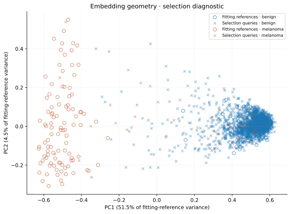
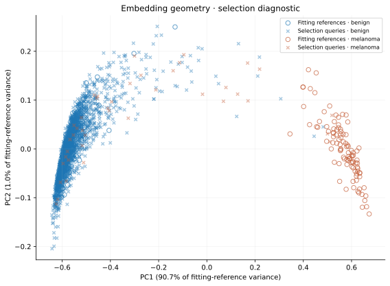

# Melanoma Classification with Siamese Learning

## Executive Summary

This project compares two models for classifying ISIC 2020 skin-lesion images as benign or melanoma. Both use ResNet-18. The baseline learns image labels, while the Siamese model also learns to place images of the same class close together in a feature space. The study asks whether this extra learning, together with labelled reference images, improves decisions about which cases need human review.

The final comparison covers 4,728 images from 288 patients, including 74 melanomas. Both review rules send 71 of the 74 melanomas for review. The baseline reviews 48.03% of images, compared with 50.17% for Siamese. The measured differences do not establish a clear model advantage, and reference disagreement adds no benefit over confidence alone.

The recommendation is to retain the simpler baseline for further research. Neither system is ready to clear images automatically as benign: both leave three melanomas outside the review queue. The models run locally on Apple MPS, with each 30-epoch training run taking about 2.6 hours.

## Feasibility Review

### Research Question

Does Siamese learning improve melanoma classification and help identify cases needing human review, compared with the same CNN trained only to classify images? The practical question is whether comparison with labelled training references reduces review workload while retaining high melanoma recall.

### User and Scope

The intended user is a reviewer assessing dermoscopic images. The prototype classifies images and prioritises uncertain cases. The study uses existing labelled images; it does not measure human diagnostic accuracy or clinical effectiveness.

### Acceptance Criteria

| Criterion | Target | Outcome |
| :--- | :--- | :--- |
| Patient separation | No patient overlap between training, selection, calibration and final groups | Met for the current models; earlier use of final patients is disclosed below. |
| Classification | Assess approximately 80% test accuracy, both classes' metrics, macro-F1, AUROC and precision-recall curves | Reported. High accuracy at threshold 0.5 conceals poor melanoma recall. |
| Review rules | Reach 90% binary recall and at least 95% review capture on calibration patients | Met on calibration. Final results and their uncertainty are reported separately. |
| Added value | Compare confidence and reference review rules; inspect three to five failures | Completed. No added reference benefit was found. |
| Local resources | Pilot below two hours and 24 GiB process memory; measure full-run cost | Pilot budget met. Runtime and memory are reported; exact peak MPS memory is unavailable. |

### Model Choice and Budget

The selected Hard task uses ISIC 2020 and PyTorch. ResNet-18 provides convolutional features; shared weights, classification loss, contrastive loss and augmentation apply course concepts. The main experiment compares two matched 30-epoch runs. Five-epoch pilots took about 28 minutes and 1.2 GiB process memory. About six hours were budgeted for the full pair; baseline and Siamese runs took 2.68 and 2.57 hours. The two-hour limit applied to the pilot.

### Risks and Fallback

Only 337 training images are melanomas. Repeated sampling can overfit those cases, and incorrect predictions may still appear confident. Patient separation, a separate calibration group and fixed final rules limit optimistic evaluation. The classification-only baseline is the fallback if Siamese learning or reference comparison offers no useful improvement.

## Methodology

### Dataset and Patient Groups

The [SIIM-ISIC 2020 dataset](https://doi.org/10.34970/2020-ds01) contains 33,126 images from 2,056 patients, including 584 melanomas. [Rotemberg et al.](https://doi.org/10.1038/s41597-021-00815-z) describe the dataset. The metadata audit found that all 425 published duplicate pairs share patient identity and label, so patient grouping keeps them together.

| Group | Patients | Images | Melanomas | Purpose |
| --- | ---: | ---: | ---: | --- |
| Training (fit) | 1,152 | 18,120 | 337 | Learn weights and build the reference gallery |
| Validation (selection) | 154 | 2,438 | 41 | Choose checkpoints and training settings |
| Calibration | 154 | 2,376 | 50 | Set decision and review thresholds |
| Final test | 288 | 4,728 | 74 | Compare the fixed models and rules |
| Excluded development | 308 | 5,464 | 82 | Previously examined patients |

A fixed manifest assigns whole patients to these groups, stratifying by whether a patient has melanoma. The split uses seeds 42, 20261007 and 20261008. Different lesion counts per patient explain why image and patient proportions differ.

Development patients were excluded after earlier analysis. Final patients were used in a superseded experiment. The current models started from ImageNet weights and trained only on the current training patients. This is an internal retrospective comparison, without an independent external cohort.

### Image Preparation

Images are orientation-corrected, converted to RGB, resized bilinearly to a 256-pixel shorter side, and centre-cropped to 224 × 224. Pixel values are scaled to [0, 1] and normalised using RGB means (0.485, 0.456, 0.406) and standard deviations (0.229, 0.224, 0.225).

Training adds horizontal and vertical flips, rotation within ±45 degrees, translation up to 5%, scale factors [0.9, 1.1], and brightness/contrast factors [0.9, 1.1]. Affine transforms use bilinear interpolation and RGB-mean fill. Both classes receive the same policy; evaluation is deterministic. [Perez et al.](https://arxiv.org/abs/1809.01442) motivate augmentation, but these settings have not been shown to be optimal. Cropping can remove lesion edges.

### Model and Loss

ResNet-18 converts each image into 512 features. A linear layer produces class scores. A copy scaled to unit length is the **embedding**, used to compare images. Pair members share weights. Prediction restores the trained encoder and classifier; the melanoma softmax score gives the image decision. Reference retrieval is a separate diagnostic.


Both models fine-tune ImageNet V1 ResNet-18 with a new binary head, using [He et al.](https://arxiv.org/abs/1512.03385) and [Torchvision](https://docs.pytorch.org/vision/0.28/models/generated/torchvision.models.resnet18.html). Shared pair learning follows [Koch et al.](https://www.cs.toronto.edu/~rsalakhu/papers/oneshot1.pdf); the contrastive objective follows [Hadsell et al.](https://doi.org/10.1109/CVPR.2006.100).

Cross-entropy teaches image labels. Contrastive loss pulls same-class embeddings together and separates different-class embeddings. Let $d$ be Euclidean distance, $s=1$ for matching labels, and margin $m=1$. The baseline uses $\lambda=0$ and Siamese uses $\lambda=0.1$:

$$
L = L_{\mathrm{CE}} + \lambda L_{\mathrm{contrastive}}, \qquad
L_{\mathrm{contrastive}} = \operatorname{mean}[s d^2 + (1-s)\max(0,m-d)^2].
$$

### Training and Checkpoint Selection

Each epoch samples 4,096 pairs from different patients: half same-class and half different-class. Sampling chooses the first class uniformly, then a patient and an image. Both objectives use the same pair identities and shuffle seed. Training exposure is roughly balanced; evaluation keeps the natural class imbalance. Cross-entropy uses no extra class weights.

Training uses [AdamW](https://arxiv.org/abs/1711.05101), seed 42, 30 epochs, 16 pairs per batch, weight decay 0.0001, and initial encoder/head learning rates of 0.0001. Cosine decay lowers rates towards 0.000001. The budget is 245,760 image presentations and 7,680 updates. An epoch is a sampling budget, not a full dataset pass.

The checkpoint with the highest selection melanoma average precision (AP) is retained. Repeated sampling presents each melanoma image about 365 times on average. Actual coverage averages 335 melanoma images and 3,256 benign images per epoch; augmentation adds views, not new patients.

### Decision and Review Rules

Calibration patients set a binary threshold targeting 90% melanoma recall: `1.4540694e-6` for the baseline and `2.0640130e-6` for Siamese. Both rules capture 45 of 50 calibration melanomas. Threshold 0.5 is also evaluated. These softmax scores have not been shown to represent reliable clinical probabilities, following the distinction in [Guo et al.](https://proceedings.mlr.press/v70/guo17a.html).

The shared gallery contains 100 benign and 100 melanoma training images, with one image per patient per class. Each query retrieves five neighbours by embedding distance. Reference disagreement is the fraction opposing the binary prediction. Confidence uncertainty is $-|p-t|$, where $p$ is the melanoma score and $t$ the binary threshold.

Both review rules include every image classified as melanoma. Additional images labelled benign are ranked by confidence, or by reference disagreement with confidence breaking ties. Calibration sets cutoffs targeting at least 95% melanoma capture, including cutoff ties. Both rules capture 48/50 calibration melanomas. **Capture means reaching review**, not a correct human diagnosis. The checkpoint's separate three-way prediction band is used in examples, not in this review comparison.

### Evaluation and Uncertainty

Checkpoints, preprocessing, gallery and thresholds were recorded before final scoring. No model or rule was changed afterwards. Separate prediction runs reproduced the diagnostic scores and decisions.

Intervals use 2,000 paired patient-cluster bootstrap draws with seed 42, stratified by whether patients have melanoma. Each draw retains all lesions from each sampled patient and compares both models on the same draw, following [Field and Welsh](https://doi.org/10.1111/j.1467-9868.2007.00593.x). The 95% percentile intervals describe this trained pair with fixed calibration rules. They exclude variation from training seeds and threshold fitting, and do not correct selection optimism.

## Results

### Development Experiments

The following matched experiments use the current 512-feature ImageNet architecture. Each cell gives selection AP/AUROC.

| Training approach | Baseline | Siamese |
| --- | ---: | ---: |
| Full fine-tuning, basic augmentation | 0.2840 / 0.8629 | 0.2666 / 0.8444 |
| Three-epoch head warmup, lower encoder rate | 0.2233 / 0.8367 | 0.2321 / 0.8454 |
| Full fine-tuning, broader augmentation | 0.3164 / 0.8961 | 0.2587 / 0.8443 |

Warmup and encoder rate changed together, so their effects cannot be separated. Broader augmentation improved baseline AP but slightly reduced Siamese AP. These are single-seed observations.

The final recipe selects baseline epoch 21 and Siamese epoch 30. At the Siamese checkpoint, benign selection loss is 0.0114 and melanoma loss is 7.0710. Falling overall loss therefore hides poor melanoma confidence because benign images dominate validation. The baseline was retained before final scoring: its selection review rule captured 40/41 melanomas, compared with 37/41 for Siamese, at about 50% workload.


### Embeddings and Reference Retrieval

These PCA maps use the same 200 training references and 2,438 selection queries. PCA is fitted only on references, then applied to queries. The two axes retain 55.99% of reference variance for the baseline and 91.75% for Siamese. Each model has different axes, so coordinates cannot be compared directly.





Many melanoma queries fall in the dense benign-query region, while most melanoma training references lie elsewhere. The table measures retrieval in the original 512-feature space. Matching-neighbour fraction is the average proportion of five neighbours with the query's true class. The melanoma fraction is also assessed as a ranking score.

| Selection retrieval measure | Baseline | Siamese |
| --- | ---: | ---: |
| Benign-query matching neighbours | 99.18% | 99.64% |
| Melanoma-query matching neighbours | 30.24% | 20.98% |
| Neighbour melanoma-fraction AUROC | 0.6537 | 0.6197 |
| Neighbour melanoma-fraction AP | 0.1719 | 0.1366 |

Despite a balanced gallery, fewer than one-third of melanoma queries' neighbours have the correct class. This helps explain the weak reference result. These selection measurements do not establish a population difference, and a 2D map cannot prove separation in the full feature space.

### Final Classification Performance

The final set contains 4,728 images from 288 patients, including 74 melanomas from 60 patients. Recall measures how many melanomas are found; precision measures how many melanoma flags are correct. Macro-F1 weights both classes equally. AP is the PR-AUC measure used here; AUROC summarises ranking across thresholds.

| Ranking measure [95% patient interval] | Baseline | Siamese |
| --- | ---: | ---: |
| Melanoma AP | 0.1381 [0.0863, 0.2261] | 0.1211 [0.0816, 0.1950] |
| AUROC | 0.8639 [0.8218, 0.9030] | 0.8784 [0.8460, 0.9083] |

Baseline AP falls from 0.3164 on selection to 0.1381 on final patients; Siamese AP falls from 0.2587 to 0.1211. Small melanoma groups, selection optimism and cohort differences may contribute, but their effects were not measured. The paired intervals below do not establish an AP or AUROC advantage.


The precision-recall reference line is melanoma prevalence, 1.565%. This view makes the false-positive burden visible in an imbalanced dataset, as discussed by [Saito and Rehmsmeier](https://doi.org/10.1371/journal.pone.0118432). Markers use the saved binary thresholds.

### Effect of the Decision Threshold

The calibrated columns use thresholds chosen on calibration patients, without changing them for the final set.

| Final measure | Baseline: 0.5 | Siamese: 0.5 | Baseline: calibrated | Siamese: calibrated |
| --- | ---: | ---: | ---: | ---: |
| Accuracy | 97.95% | 97.99% | 66.52% | 62.14% |
| Macro-F1 | 0.5803 | 0.5425 | 0.4352 | 0.4169 |
| Benign precision | 98.63% | 98.53% | 99.68% | 99.83% |
| Benign recall | 99.29% | 99.44% | 66.20% | 61.65% |
| Benign F1 | 0.9896 | 0.9898 | 0.7956 | 0.7622 |
| Melanoma precision | 23.26% | 16.13% | 3.91% | 3.72% |
| Melanoma recall | 13.51% | 6.76% | 86.49% | 93.24% |
| Melanoma F1 | 0.1709 | 0.0952 | 0.0748 | 0.0716 |
| Benign images flagged (FP) | 33 | 26 | 1573 | 1785 |
| Missed melanomas (FN) | 64 | 69 | 10 | 5 |
| Detected melanomas (TP) | 10 | 5 | 64 | 69 |

At 0.5, accuracy exceeds the approximate 80% target, but the baseline detects only 10 of 74 melanomas and Siamese detects five. Always predicting benign gives 98.43% accuracy and zero melanoma recall. Lowering the threshold raises recall but reduces precision to about 4%. The baseline's 86.49% final recall falls below its 90% calibration target; Siamese reaches 93.24%.

### Review Capture and Workload

The table shows the extended review rule. Confidence and reference rules produce identical decisions within each model.

| Model | Images reviewed | Melanomas reaching review | Benign images reviewed | Melanomas not reviewed |
| --- | ---: | ---: | ---: | ---: |
| Baseline | 48.03% (2271) | 71/74 | 2200 | 3 |
| Siamese | 50.17% (2372) | 71/74 | 2301 | 3 |

| Extended review measure [95% patient interval] | Baseline | Siamese |
| --- | ---: | ---: |
| Melanoma capture, % | 95.95 [91.25, 100.00] | 95.95 [91.25, 100.00] |
| Image review workload, % | 48.03 [44.42, 51.73] | 50.17 [47.13, 53.31] |

The baseline reviews 101 fewer benign images at the same observed capture. Capture of 71/74 gives 95.95%, with interval [91.25%, 100.00%]; it does not establish a 95% population sensitivity floor. Both rules leave the same three melanomas unreviewed: `ISIC_3909039`, `ISIC_6982386` and `ISIC_7346228`.


### Does Uncertainty Identify Errors?

Here an error means a wrong binary image label. Higher uncertainty should rank errors above correct predictions. This error-detection AUROC differs from melanoma AUROC and does not measure probability calibration.

| Model and evaluated group | Errors / images | Confidence error AUROC | Reference error AUROC |
| --- | ---: | ---: | ---: |
| Baseline: All final images | 1583/4728 | 0.1369 | 0.9786 |
| Baseline: Predicted benign | 10/3091 | 0.8073 | 0.5000 |
| Siamese: All final images | 1790/4728 | 0.1751 | 0.9824 |
| Siamese: Predicted benign | 5/2874 | 0.8213 | 0.5000 |

Overall reference AUROC is high because it identifies many false positives already routed for review. Overall confidence ranking is poor because many false positives have high, confident melanoma scores.

Among images labelled benign, all five neighbours are benign for every query. Disagreement is therefore constant and its AUROC is 0.5. Confidence provides some error ranking, but only ten baseline and five Siamese misses support those estimates; no error-AUROC interval is reported. Reference routing falls back to confidence and adds no rescue benefit. These analyses were descriptive checks after final scoring, without changing the rules.

### Paired Model Differences

Differences are Siamese minus baseline. Percentage-point units are labelled.

| Final difference | Estimate [95% patient interval] |
| --- | ---: |
| Melanoma AP | -0.0170 [-0.0575, 0.0145] |
| AUROC | 0.0146 [-0.0128, 0.0410] |
| Binary melanoma recall, percentage points | 6.76 [-1.39, 15.39] |
| Referral workload, percentage points | 2.14 [-0.39, 4.66] |
| Referral capture, percentage points | 0.00 [0.00, 0.00] |

The AP, AUROC and workload intervals include zero. The zero-width capture difference follows identical melanoma capture decisions; absolute capture remains uncertain, as shown above.

## Five Failure Cases

These selection cases show two false negatives and three false positives. The report revision added the rescued melanoma after final scoring, without changing the model or rules. Each figure shows the nearest training reference; fractions use all five neighbours. The figure's `decision` is the separate three-way example output. Review descriptions use the evaluated review rule. Visible features suggest possible failure causes, but no image intervention tested those causes.

**1. Missed melanoma: `ISIC_5137933`, score 5.086e-09.** A pale pink/yellow field has subtle boundaries, fine red structures and a dark frame. All five neighbours are benign. Neither review rule rescues it. Low contrast and framing may contribute; reference agreement repeats the incorrect benign decision.

**2. Melanoma rescued by review: `ISIC_1440985`, score 1.672e-06.** Scattered brown patches lie on a pale yellow field. The nearest benign reference has a compact dark centre on pink skin. Although all neighbours are benign, the score is close enough to the binary threshold for confidence routing to send it for review. Reference disagreement contributes nothing to this rescue.


**3. Benign image flagged: `ISIC_7486266`, score 0.9993.** A pink lesion with ruler marks and hair retrieves five melanoma references. The nearest reference also has a pink centre. Colour or imaging artifacts may contribute. The high score shows an overconfident false positive, which enters review automatically.

**4. Benign image flagged: `ISIC_2222264`, score 0.997.** Diffuse brown pigmentation on a pale background retrieves five melanoma references with varied appearances. The error illustrates visual class overlap. Embedding proximity gives examples of similarity, but does not establish why the prediction was wrong. Both rules review it.


**5. Benign image flagged: `ISIC_4903186`, score 0.9168.** A strongly pigmented brown lesion fills much of the frame. All neighbours are melanoma images, including similarly pigmented examples. Pigment and scale may contribute to confusion. Unanimous reference labels reinforce an incorrect class assignment.


## Local Resource Use

Both models contain 11,177,538 parameters and run on Apple MPS. They have the same forward computation; contrastive learning changes training rather than parameter count.

| Measurement | Baseline | Siamese |
| --- | ---: | ---: |
| Training command, hours | 2.68 | 2.57 |
| Training peak process RSS, GiB | 1.285 | 1.355 |
| Warm forward, 16-image batch, ms | 9.823 | 9.809 |
| Final diagnostic elapsed, s | 226.81 | 229.23 |
| Final query pipeline, images/s | 31.90 | 31.34 |
| Final diagnostic peak process RSS, GiB | 1.028 | 1.062 |
| Fitting-reference encoding, s | 5.22 | 4.97 |
| CPU reference query search, s | 0.00233 | 0.00210 |

Warm forward latency measures a loaded 16-image batch, after three warmups over ten timed batches, with device synchronisation. It excludes image loading, transfers and review analysis. Final throughput includes loading, preprocessing, transfers, encoding and neighbour search; gallery encoding and calibration are separate setup costs. Search timings apply to only 200 references.

Process RSS is the operating system's peak process memory. Exact peak MPS memory is unavailable. The 42.68 MiB current-allocation snapshot is not a peak and excludes caches and driver memory. It is not added to RSS on unified memory. All measured process peaks meet the 24 GiB budget.

## Recommendation and Limitations

Retain the classification-only baseline for further research. It achieves the same observed review capture with 101 fewer benign reviews, although the workload interval includes zero. Neither Siamese learning nor reference disagreement has shown a clear operational benefit in this study.

Automatic benign clearance is not supported: approximately half the images require review and three melanomas remain outside the queue. Review capture does not establish human diagnostic accuracy. One trained seed pair, small melanoma groups, the AP decline and earlier use of final patients limit the conclusions.

Further work could assess lesion-preserving augmentation, loss design, more independent melanoma cases and repeated training seeds. These are proposals, without measured gains. The final set has been evaluated; further model or policy development needs a new evaluation plan.

## Reproducing the Study

### Environment and Data

Run commands from `PatternAnalysis-2026`. Dependencies are PyTorch 2.13.0, Torchvision 0.28.0, NumPy 2.5.1, Pillow 12.3.0, scikit-learn 1.9.0, PyYAML 6.0.3 and Matplotlib 3.11.1. Seeds support repeatability, but do not guarantee identical results across devices.

```bash
python3 -m venv .venv
source .venv/bin/activate
python -m pip install -r recognition/Siamese_ISIC2020_Melanoma_47472442/requirements.txt
```

Download and extract the labelled JPEGs and `ISIC_2020_Training_GroundTruth_v2.csv` from the linked dataset into repository `data/`. The loader searches subdirectories. Create the fixed patient manifest once:

```bash
python -m recognition.Siamese_ISIC2020_Melanoma_47472442.protocol
```

`modules.py` defines the model, `dataset.py` loads images, `train.py` fits and saves it, and `predict.py` demonstrates inference. YAML holds model/training settings; CLI options supply paths, run names and evaluation choices. Device `auto` chooses CUDA, then MPS, then CPU. Data, weights and run outputs remain in ignored `data/`.

### Training

These commands reproduce the reported recipe. Use fresh run names when outputs already exist.

```bash
python -m recognition.Siamese_ISIC2020_Melanoma_47472442.train \
  --config recognition/Siamese_ISIC2020_Melanoma_47472442/configs/baseline.yaml \
  --epochs 30 --seed 42 --run-name resnet18_baseline_imagenet_aug_30ep_seed42

python -m recognition.Siamese_ISIC2020_Melanoma_47472442.train \
  --config recognition/Siamese_ISIC2020_Melanoma_47472442/configs/siamese.yaml \
  --epochs 30 --seed 42 --run-name resnet18_siamese_imagenet_aug_30ep_seed42
```

Each run saves its configuration, checkpoint, metrics, selection/calibration predictions and `training.svg`. The checkpoint includes learned weights, preprocessing, patient roles and the calibrated decision rule. Training never evaluates final patients.

### Prediction and Final Evaluation

Prediction restores the complete checkpoint and prints image/patient IDs, true labels, scores and decisions. It also saves evaluation and example figures. Final evaluation requires explicit opt-in. The baseline's calibrated final confusion counts are TN=3,081, FP=1,573, FN=10 and TP=64.

```bash
python -m recognition.Siamese_ISIC2020_Melanoma_47472442.predict \
  --checkpoint data/runs/resnet18_baseline_imagenet_aug_30ep_seed42/checkpoint.pt \
  --partition final --evaluate-final \
  --evaluation-note "Reproduce the fixed final comparison." \
  --output-dir data/reproductions/baseline_prediction
```

Run diagnostics for each model. The standard output directory must not already exist; use `--output-dir` for a separate reproduction of completed diagnostics.

```bash
for model in baseline siamese; do
  python -m recognition.Siamese_ISIC2020_Melanoma_47472442.diagnostics \
    --checkpoint "data/runs/resnet18_${model}_imagenet_aug_30ep_seed42/checkpoint.pt" \
    --partition final --evaluate-final \
    --evaluation-note "Reproduce the fixed final comparison."
done
```

Diagnostics save score, gallery and neighbour CSVs, embeddings, review curves and an evaluation report. Compare the standard saved diagnostics without inference:

```bash
python -m recognition.Siamese_ISIC2020_Melanoma_47472442.compare \
  --baseline-runs data/runs/resnet18_baseline_imagenet_aug_30ep_seed42 \
  --siamese-runs data/runs/resnet18_siamese_imagenet_aug_30ep_seed42 \
  --partition final --output-dir data/comparisons/reproduced_final_seed42
```

Comparison saves summary CSVs, input hashes and `comparison.svg`. Repeating fixed inference checks reproduction; it does not justify tuning final thresholds.

### Figures from Saved Results

All figure functions are in `visualisation.py`. For example, regenerate ROC and precision-recall curves without loading a model:

```bash
python -m recognition.Siamese_ISIC2020_Melanoma_47472442.visualisation \
  --run-dir data/runs/resnet18_baseline_imagenet_aug_30ep_seed42 \
  --predictions data/runs/resnet18_baseline_imagenet_aug_30ep_seed42/diagnostics/final/query_diagnostics.csv \
  --output recognition/Siamese_ISIC2020_Melanoma_47472442/figures/aug_baseline_final_roc_pr.svg
```

`plot_embedding_map` reads arrays from `embeddings.npz`; `plot_saved_reference_cases` uses saved diagnostic CSVs and original JPEGs. Other functions generate architecture, training, review and comparison figures. For conditional error AUROC, retain rows with `predicted == 0` and compare `actual != predicted` against the saved uncertainty scores. Retrieval measures use true labels and `neighbor_melanoma_fraction`.

## Artificial Intelligence Usage Disclosure

OpenAI Codex assisted with data loading, code structure, model/training scaffolding, plotting, reference analysis, resource measurement, statistics, literature review and report writing. The author ran the training experiments and authorised Codex to run final inference and saved-result analysis. Codex later revised the report and added descriptive analyses without changing models, galleries or rules.

Verification checked patient/image identities, labels, hashes, saved decisions and independently recomputed metrics. Separate predictions matched diagnostic outputs. Source checks used Ruff, Pyright and compilation; no unit-test suite was added. Figures and the PDF were visually inspected. Previous public submissions informed a review of common mistakes; no student implementation was copied. The author is responsible for understanding and checking the code and claims. Clinical effectiveness and external generalisation remain unvalidated.

## References and Image Attribution

ISIC 2020 images are used under CC BY-NC 4.0. Contributing institutions include Hospital Clínic de Barcelona, Medical University of Vienna, Memorial Sloan Kettering Cancer Center, Melanoma Institute Australia, The University of Queensland and University of Athens Medical School. Figures use this project's saved results; reference images come only from training patients.

1. ISIC. [SIIM-ISIC 2020 Challenge Dataset](https://doi.org/10.34970/2020-ds01), 2020.
2. Rotemberg et al. [A patient-centric dataset of images and metadata for identifying melanomas using clinical context](https://doi.org/10.1038/s41597-021-00815-z). *Scientific Data*, 2021.
3. Hadsell, Chopra and LeCun. [Dimensionality Reduction by Learning an Invariant Mapping](https://doi.org/10.1109/CVPR.2006.100). *CVPR*, 2006.
4. He et al. [Deep Residual Learning for Image Recognition](https://arxiv.org/abs/1512.03385). *CVPR*, 2016.
5. Guo et al. [On Calibration of Modern Neural Networks](https://proceedings.mlr.press/v70/guo17a.html). *ICML*, 2017.
6. Torchvision. [ResNet-18 API](https://docs.pytorch.org/vision/0.28/models/generated/torchvision.models.resnet18.html).
7. Field and Welsh. [Bootstrapping clustered data](https://doi.org/10.1111/j.1467-9868.2007.00593.x). *JRSS B*, 2007.
8. Saito and Rehmsmeier. [The Precision-Recall Plot Is More Informative than the ROC Plot When Evaluating Binary Classifiers on Imbalanced Datasets](https://doi.org/10.1371/journal.pone.0118432). *PLOS ONE*, 2015.
9. Perez et al. [Data Augmentation for Skin Lesion Analysis](https://arxiv.org/abs/1809.01442). *ISIC Workshop*, 2018.
10. Loshchilov and Hutter. [Decoupled Weight Decay Regularization](https://arxiv.org/abs/1711.05101). *ICLR*, 2019.
11. Koch, Zemel and Salakhutdinov. [Siamese Neural Networks for One-shot Image Recognition](https://www.cs.toronto.edu/~rsalakhu/papers/oneshot1.pdf). *ICML Deep Learning Workshop*, 2015.
