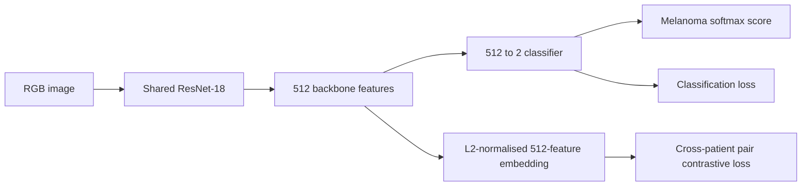
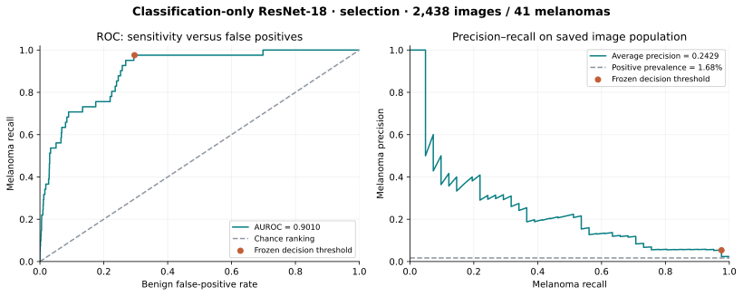
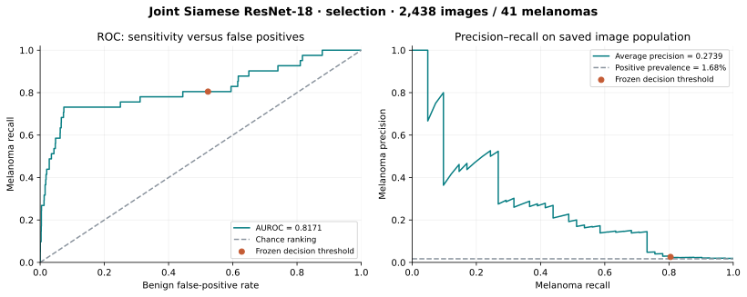
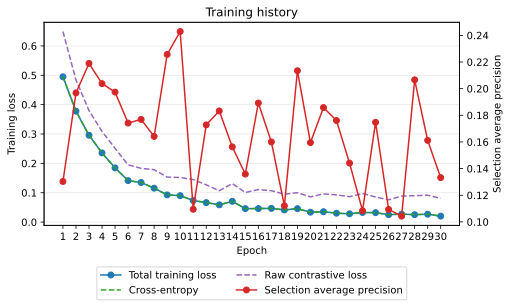
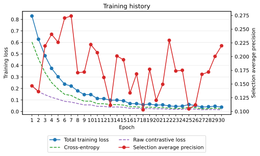
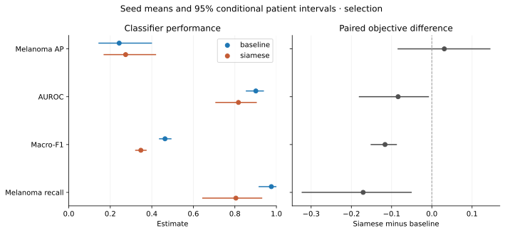
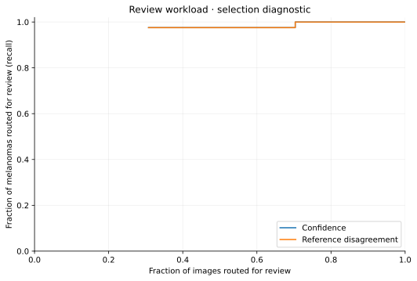
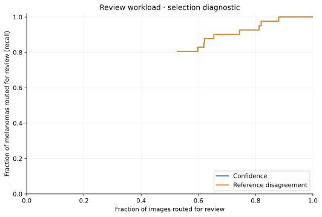
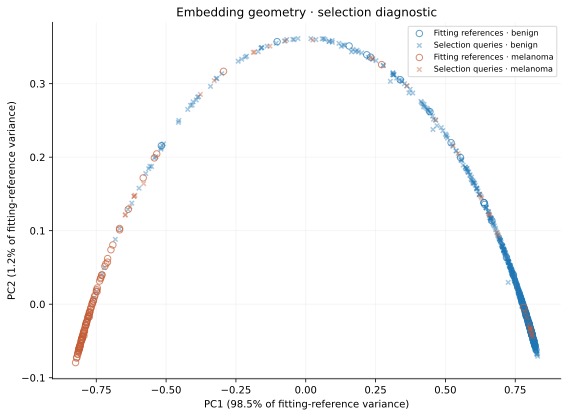

# ISIC 2020 Melanoma Triage with Siamese Metric Learning

## Introduction

This project investigates whether Siamese metric learning improves melanoma triage from dermoscopic images compared with a classification-only convolutional neural network (CNN). The intended user reviews suspicious lesions and uncertain predictions. The engineering question is whether an embedding-based comparison with labelled fitting references identifies errors and reduces review workload at comparable melanoma sensitivity and acceptable local computational cost.

The teaching team has clarified that ImageNet initialisation is permitted. The implementation uses Torchvision's ResNet-18 directly, initialises its encoder with the fixed `IMAGENET1K_V1` weights, and classifies raw 512-dimensional features. Completed ImageNet runs improved selection average precision over random initialisation, while leaving useful melanoma detection unresolved. A three-epoch classifier warmup followed by conservative encoder fine-tuning reduced AP relative to the preceding full fine-tuning recipe. The next matched experiment evaluates broader fitting augmentation with the earlier full fine-tuning settings. Its detection benefit remains unmeasured.

The dataset contains fewer than 2% melanoma images, so raw accuracy can conceal poor detection. The report therefore considers per-class precision and recall, macro-F1, AUROC, melanoma precision–recall performance, actual review workload and computational cost. All reported results describe selection or calibration patients. Final evaluation remains pending. The prototype is an image-only research system without clinical validation or measured human diagnostic performance.

## Methodology

### Dataset, Preprocessing and Patient Separation

The study uses the labelled training images from the [SIIM-ISIC 2020 Challenge dataset](https://github.com/ImageMarkup/isic-challenge-2020/blob/master/index.md), described by [Rotemberg et al.](https://doi.org/10.1038/s41597-021-00815-z). The metadata audit identified 33,126 images from 2,056 patients, including 584 melanoma images (1.76%). All 425 published duplicate pairs share a patient identifier and label.

Images are loaded lazily, corrected for EXIF orientation and converted to RGB. Explicit transforms apply bilinear resize of the shorter side to 256 pixels, centre crop to 224 × 224, scaling to [0, 1], and channel normalisation with mean (0.485, 0.456, 0.406) and standard deviation (0.229, 0.224, 0.225). These fixed preprocessing constants match the earlier pipeline; they do not load learned model parameters or fetch weights. The candidate fitting policy applies independent horizontal and vertical flips with probability 0.5, followed by one bilinear affine transform: rotation within ±45 degrees, horizontal/vertical translation up to 5% of image dimensions and scale factors within [0.9, 1.1]. Brightness and contrast factors remain within [0.9, 1.1]. Augmentation operates after resize and before centre crop; exposed pixels use the normalisation RGB mean. All magnitudes are configurable in YAML and the same policy applies to both classes. [Perez et al.](https://arxiv.org/abs/1809.01442) motivate investigating augmentation for skin-lesion classification, but do not establish these magnitudes as optimal here. Affine transforms and centre cropping can truncate peripheral lesions; the candidate views require visual review before adopting the recipe. Selection, calibration and inference retain deterministic preprocessing independent of the true image label. Lazy loading avoids retaining the image archive in memory.

The patient assignments are frozen in `data/splits/isic_protocol.json`. A deterministic recipe separates a 70% fitting pool, 15% tuning pool and 15% development population using seed 42. It reserves 20% of the fitting pool for final evaluation using seed 20261007 and divides the tuning patients equally between selection and calibration using seed 20261008. Each division stratifies patients by whether any of their images contains melanoma. Every image from a patient remains in the same role; image fractions differ from patient fractions because patients contribute different numbers of lesions.

| Role | Purpose | Patients | Images | Melanomas |
| --- | --- | ---: | ---: | ---: |
| Fitting | Optimisation, pairs and reference gallery | 1,152 | 18,120 | 337 |
| Selection | Checkpoint and model selection | 154 | 2,438 | 41 |
| Calibration | Decision threshold and referral cutoffs | 154 | 2,376 | 50 |
| Final | Evaluation after choices are frozen | 288 | 4,728 | 74 |
| Development | Previously examined patients, outside this comparison | 308 | 5,464 | 82 |

The development population corresponds to previously examined test patients and is excluded from the current comparison. The final population was previously part of a historical model's fitting data; the current comparison therefore uses newly trained models fitted only on the current fitting patients. The known duplicates stay together through whole-patient assignment. Saved configuration, protocol and checkpoint hashes identify the artifacts used by each evaluation.

### Shared ResNet-18 and Siamese Objective

Both models use the same `MelanomaModel`. ResNet-18 produces 512 features, and a linear classifier maps those raw features to benign and melanoma logits. An L2-normalised copy of the same features provides the embedding for contrastive learning and reference comparison. An embedding is a learned feature vector whose distances describe similarity under the training objective. The current recipe trains all parameters from epoch one. Classification updates the backbone in both models; the Siamese objective additionally supervises distances between its normalised features. There is no separate learned projection layer.



Both members of a pair pass through shared weights. Cross-entropy supervises both image labels. Following the contrastive-learning principle of [Hadsell et al.](https://doi.org/10.1109/CVPR.2006.100), the metric term pulls same-class embeddings together and penalises different-class embeddings whose Euclidean distance is below margin $m$:

$$
L = L_{\mathrm{CE}} + \lambda L_{\mathrm{contrastive}}, \qquad
L_{\mathrm{contrastive}} = \operatorname{mean}\left[s d^2 + (1-s)\max(0,m-d)^2\right],
$$

where $s=1$ for matching labels and $d$ is the distance between normalised embeddings. The current classification-only baseline uses $\lambda=0$; the new joint Siamese recipe uses $\lambda=0.1$ and $m=1$. The historical main Siamese experiment used $\lambda=1$. Both objectives record the unweighted contrastive loss as a diagnostic. Total training losses differ by definition and are not a common performance scale.

Each epoch draws 4,096 pairs, alternating same-class and different-class examples and always choosing different patients within a pair. First-image labels are sampled uniformly, with patients sampled within each label. Fitting image classes are therefore approximately balanced, and ordinary cross-entropy is used without additional inverse-frequency weights. Evaluation retains natural prevalence. Dedicated generators give both objectives the same sampling and shuffle streams for a fixed seed.

The current configurations use seed 42, AdamW with decoupled weight decay 0.0001, batch size 16 pairs, and initial classifier and encoder learning rates of 0.0001. [Loshchilov and Hutter](https://arxiv.org/abs/1711.05101) motivate the optimiser's decoupled regularisation. Both parameter groups update from epoch one, with cosine decay towards 0.000001 over 30 epochs. Optional classifier warmup remains configurable; it freezes encoder parameters and BatchNorm statistics and delays cosine decay until the encoder updates. The completed staged experiment used three warmup epochs and encoder learning rate 0.00001, motivated by [Kumar et al.](https://arxiv.org/abs/2202.10054). Its negative result is reported below.

Each full training forward contains 32 images. Each epoch supplies 8,192 image presentations and 256 optimiser steps; this is a sampling budget, not a complete pass through the 18,120 fitting images. A 30-epoch run totals 245,760 presentations and 7,680 classifier and encoder updates under zero warmup. The paired objectives retain the same image and update budgets. Scoring uses batches of 16 individual images. The checkpoint with highest selection average precision is retained, without early stopping. Changing the total or warmup budget changes the schedule, so a shorter run is not an exact prefix of a longer run.

The fitting data contain 337 melanoma images from 240 patients, compared with 17,783 benign images. At approximately balanced sampling, the 30-epoch budget averages about 365 presentations per melanoma image and 6.9 per benign image. Patient-balanced sampling makes individual exposures unequal. Augmentation supplies varied views of these existing cases; it does not create independent patients. The next experiment changes the fitting augmentation policy while restoring the previous full fine-tuning settings. It should be assessed against the completed unstaged ImageNet pair, since comparison against the staged pair would also change warmup and encoder learning rate.

Pair indices are selected once per epoch using the existing per-index RNG seed, then consumed by the loader in its seeded shuffled order. Histories record unique sampled benign images, melanoma images and melanoma patients from that complete pair stream. Counts reset every epoch and do not imply cumulative diversity. Pair selection now precedes the timed fitting forward/backward phase; its overhead remains included in total command runtime. The history also records overall, benign-only and melanoma-only selection log loss, AUROC, pair distances and the active-negative fraction. Per-class losses reuse the existing selection scores without additional inference. Training loss concerns balanced augmented presentations, while selection losses concern deterministic images at natural prevalence. Their absolute levels do not give a directly comparable train/validation loss gap.

The encoder is created with Torchvision's `resnet18`, as documented in the [official API](https://docs.pytorch.org/vision/0.28/models/generated/torchvision.models.resnet18.html). Training explicitly supplies `ResNet18_Weights.IMAGENET1K_V1`. Its original 1,000-class layer is replaced by an identity operation; a separate randomly initialised `Linear(512, 2)` head supplies melanoma classification. All encoder and head parameters are fine-tuned in the current recipe. The architecture and ImageNet initialisation are credited to their published/library sources; the project investigates the paired objective and referral behaviour. Prediction constructs `MelanomaModel()` without external weights and restores the complete saved state, so checkpoint scoring requires no ImageNet download.

### Checkpoint Selection, Calibration and Referral

Selection average precision chooses the checkpoint. Separate calibration patients choose a binary score threshold that retains at least 90% melanoma recall there. The checkpoint also records a three-way score-distance band for benign, ambiguous and melanoma decisions, using the 10th percentile of calibration distance from the threshold. That heuristic is distinct from the two additional diagnostic referral policies assessed below. Softmax scores are ranking measures; balanced fitting does not establish probability calibration at natural prevalence, as distinguished in [Guo et al.](https://proceedings.mlr.press/v70/guo17a.html).

New reports additionally save conventional classification metrics at a fixed score threshold of 0.5. Accuracy, per-class precision/recall and macro-F1 are reported at each operating point with its threshold; ranking AP and AUROC use the same scores. This permits assessment of the accuracy target alongside melanoma detection without combining accuracy from one threshold with recall from another. These additional summaries reuse already computed scores and do not alter the calibration-derived predictions or referral rules.

Reference diagnostics use 100 benign and 100 melanoma fitting images, with one image per patient per class. Both models use the same gallery identities. Each query retrieves its five nearest references by Euclidean embedding distance. Neighbour disagreement is the fraction of reference labels opposing the binary classifier prediction. Confidence uncertainty is negative absolute score distance from the classifier threshold. A balanced gallery's melanoma fraction is an agreement statistic, not a probability at natural prevalence.

Both diagnostic policies always route classifier-positive images for review. Additional negatives are ranked by confidence proximity alone, or by neighbour disagreement with confidence breaking ties. Cutoffs are fitted on calibration patients to capture at least 95% of melanoma images, including all boundary ties, and saved before selection scoring. Capture means a melanoma image reaches review; human diagnostic accuracy is not measured. Selection workload curves describe performance across queues and are not used to retune those frozen cutoffs.

### Statistical Comparison

The completed comparisons use 2,000 paired patient-cluster bootstrap draws, stratified by whether a patient has any melanoma, with bootstrap seed 42. Each draw retains all images from sampled patients, including repeated draws, and evaluates both models on the same patient sample. The approach follows the cluster-resampling principle discussed by [Field and Welsh](https://doi.org/10.1111/j.1467-9868.2007.00593.x).

The resulting 95% percentile intervals condition on one trained seed pair, its selected checkpoints, calibration rules and observed patient-stratum counts. They exclude training and calibration uncertainty and do not correct optimism from checkpoint or model selection. Differences are computed within each draw. Other metrics supplement the primary selection-AP comparison; no multi-seed conclusion is available.

## Feasibility Review

The feasibility check-off is complete. The prototype's acceptance criteria cover patient separation, image-level classification, calibration-based triage, three to five failure autopsies and local resource use. The task brief suggests test accuracy around 0.80 and also requires per-class metrics, PR curves, a baseline and uncertainty analysis. The conventional accuracy result and the higher-recall policy are therefore reported separately.

The initial local budget was a two-hour MPS pilot at 224 × 224 resolution with process memory below 24 GiB. Historical ImageNet-initialised five-epoch pilots completed in 28.12 minutes for the baseline and 28.19 minutes for the Siamese model, with process peaks of 1.225 and 1.194 GiB. Their subsequent 30-epoch experiments took approximately 154 minutes each. The completed random-initialisation 512-feature runs took approximately 2.60 and 2.55 hours with process peaks of 1.218 and 1.179 GiB. The subsequent ImageNet-initialised 512-feature runs took 2.67 and 2.60 hours with peaks of 1.108 and 1.244 GiB. The staged baseline and Siamese runs took 2.57 and 2.61 hours with peaks of 1.235 and 1.155 GiB. Exact MPS peak accelerator allocation is unavailable and is not inferred from a current-allocation snapshot.

The principal remaining risks are the small number of melanomas, selection optimism, overconfident incorrect predictions and an ineffective referral policy. Reference comparison has not improved capture over confidence in the completed 128-feature random-initialisation runs; the completed 512-feature models have not yet generated reference diagnostics. The next experiment compares the broader augmentation policy under matched classification-only and Siamese objectives. A pair of full runs is budgeted at approximately six hours using earlier measurements; its actual time and memory remain unmeasured. The classification-only model is the operational fallback if metric learning does not justify its complexity. The patient protocol remains frozen, with final patients reserved until all choices are fixed.

The following criteria make the prototype's acceptance evidence explicit. They are research-prototype criteria, not clinical certification.

| Criterion | Required evidence | Current status |
| --- | --- | --- |
| Patient separation | Zero patient overlap between fitting, selection, calibration and final roles | Frozen metadata audit passes; retain the same assignments |
| Image classification | Final accuracy around 0.80, accompanied by both classes' metrics and PR curves | Selection accuracy exceeds 0.80 at 0.5; final performance remains unmeasured |
| Triage rule | At least 90% calibration melanoma recall, with achieved held-out capture and workload reported separately | Completed rules attain 45/50 calibration recall; held-out transfer varies |
| Error investigation | 3–5 actual false-positive/false-negative autopsies and a confidence/reference comparison | Five historical cases reported; selected-model evidence remains pending |
| Local feasibility | Pilot within two hours and process peak below 24 GiB; full-run cost measured | Historical pilots pass; full runs take about 2.6 hours each; MPS peak allocation unavailable |

### Completion of the Investigation

The completed feasibility check-off is an ungraded hurdle. The final report must also connect the chosen model's quantitative results, confidence analysis, failure cases and resource measurements. Historical diagnostics below establish the analysis method but do not substitute for that selected-model evaluation.

| Stage | Evidence or remaining action |
| --- | --- |
| Implemented | Shared models, patient-separated data, training/prediction, reference diagnostics, saved-score comparison and SVG generation |
| Completed experiments | Random/ImageNet comparisons, feature change and staged fine-tuning; results remain selection evidence |
| Next author-run experiment | Matched broader-augmentation baseline and Siamese pair, followed by a recipe decision |
| Selected-model analysis | Run selection diagnostics, assess confidence/reference referral, refresh 3–5 autopsies and the resource table |
| Final evaluation | Freeze model, preprocessing, gallery and policies, then evaluate the matched pair on final patients |
| Submission | Finish the README and inspected PDF export, submit to Turnitin and open the PR against `topic-recognition` |
| Review response | Address the teaching team's later code review within its response window |

## Completed ImageNet 512-Feature Results

The runs `resnet18_baseline_imagenet_features512_30ep_seed42` and `resnet18_siamese_imagenet_features512_30ep_seed42` used the current architecture with ImageNet V1 initialisation, learning rate 0.0001 for all parameters, and no classifier warmup. Both completed 30 epochs on MPS. Their saved selection CSVs cover the same 2,438 images and 41 melanomas; recomputed metrics agree with `metrics.json` and labels/patient identities agree with the frozen protocol.

| Selection metric | Classification-only | Siamese, λ = 0.1 |
| --- | ---: | ---: |
| Selected epoch | 9 | 18 |
| Melanoma average precision | 0.2840 | 0.2666 |
| AUROC | 0.8629 | 0.8444 |
| Accuracy at fixed threshold 0.5 | 97.91% | 98.40% |
| Melanomas detected at 0.5 | 10/41 (24.39%) | 8/41 (19.51%) |
| Macro-F1 at 0.5 | 0.6355 | 0.6414 |
| Melanomas detected at the calibration-derived threshold | 39/41 (95.12%) | 39/41 (95.12%) |
| False positives at that threshold | 1,456 | 1,238 |
| Images classified positive at that threshold | 61.32% | 52.38% |

The fine-tuning recipe improved AP over the preceding random-initialisation runs, although initialisation and learning rate changed together. The current Siamese model has lower selection AP and AUROC than its matched baseline. At the calibrated thresholds it captures the same 39 melanomas with 218 fewer false positives. The conventional accuracy remains close to the 98.32% all-benign reference and accompanies poor melanoma recall. Neither operating point establishes an adequate screening policy.

Training classification loss falls to 0.0024 for the baseline and 0.0014 for the Siamese model by epoch 30, while selection log loss rises from its epoch-9 minimum to approximately 0.138 and 0.142. These histories motivated the subsequent staged experiment, rather than extending the budget. They do not establish pretrained-feature distortion as the cause. The earlier `resnet18_siamese_cw010_30ep_seed42` experiment retains the highest observed selection AP, 0.3119, under its different architecture and training recipe. These single-seed results do not isolate architecture effects or establish a reliable Siamese advantage. Reference diagnostics and paired intervals for the new 512-feature runs remain pending; final evaluation has not occurred.

## Completed Staged Fine-Tuning Ablation

The runs `resnet18_baseline_imagenet_staged_30ep_seed42` and `resnet18_siamese_imagenet_staged_30ep_seed42` completed 30 epochs with three classifier-only epochs and encoder learning rate 0.00001 during fine-tuning. Their saved configuration hashes, patient roles, labels and prediction metrics were checked offline. Recorded learning rates follow the intended three-plus-27 schedule. This is saved-artifact evidence, not an independent inspection of the frozen encoder tensors.

| Selection measurement | Staged baseline | Staged Siamese |
| --- | ---: | ---: |
| Selected epoch | 19 | 14 |
| Melanoma average precision | 0.2233 | 0.2321 |
| AUROC | 0.8367 | 0.8454 |
| Accuracy at 0.5 | 97.54% | 97.05% |
| Melanomas detected at 0.5 | 12/41 (29.27%) | 13/41 (31.71%) |
| Macro-F1 at 0.5 | 0.6366 | 0.6251 |
| Melanomas detected at the calibration-derived threshold | 37/41 (90.24%) | 36/41 (87.80%) |
| False positives at that threshold | 1,264 | 1,041 |
| Melanoma precision at that threshold | 2.84% | 3.34% |
| Images classified positive at that threshold | 53.36% | 44.18% |

Relative to full fine-tuning, AP fell from 0.2840 to 0.2233 for the baseline and from 0.2666 to 0.2321 for the Siamese model. At its separately calibrated threshold, the staged Siamese flags 197 fewer benign images but detects 36 rather than 39 melanomas. This is a change in sensitivity as well as workload. Both staged models achieve 45/50 recall on calibration; the Siamese model's lower selection recall illustrates imperfect transfer of that rule. Neither staging nor the small staged Siamese AP advantage is established as a general result from one training seed and 41 selection melanomas.

Training classification loss ends near 0.033 for both models while their epoch-30 AP falls to approximately 0.194 and 0.195. Their AUROC peaks at epoch four. These histories support retaining the selected checkpoints and investigating generalisation rather than extending this training budget. Warmup and encoder learning rate changed together, so their separate effects are not identified. The broader-augmentation experiment therefore returns to the earlier full fine-tuning settings. Its stronger candidate views, sampling-coverage counts and class-specific losses have not yet been evaluated in training.

| Current 512-feature resource measurement | Full baseline | Full Siamese | Staged baseline | Staged Siamese |
| --- | ---: | ---: | ---: | ---: |
| Total training-command time, hours | 2.67 | 2.60 | 2.57 | 2.61 |
| Process peak RSS, GiB | 1.108 | 1.244 | 1.235 | 1.155 |
| Warm forward, batch of 16 images, ms | 9.915 | 10.152 | 10.193 | 9.797 |

All four use MPS and have 11,177,538 parameters. Forward latency excludes loading, preprocessing and transfers. Process RSS is not peak accelerator memory; exact MPS peak allocation is unavailable. These runs have no completed selection reference diagnostics or final evaluation, so this table cannot establish their end-to-end reference-policy cost.

## Historical Random-Initialisation Results

The runs `resnet18_baseline_scratch_recipe_30ep_seed42` and `resnet18_siamese_scratch_recipe_30ep_seed42` used random initialisation, a learned 512-to-128 projection and classification on the normalised 128-dimensional embedding. Their saved selection diagnostics and `data/comparisons/resnet18_scratch_recipe_30ep_selection_seed42/summary.csv` describe the same 2,438 images, including 41 melanomas. These results concern that earlier architecture.

| Selection metric | Classification-only | Siamese, λ = 0.1 |
| --- | ---: | ---: |
| Melanoma average precision | 0.0976 | 0.1036 |
| AUROC | 0.8577 | 0.8484 |
| Melanoma recall at the calibration-derived classifier threshold | 36/41 (87.80%) | 36/41 (87.80%) |
| Confidence referral workload | 45.61% | 57.92% |
| Confidence referral melanoma capture | 38/41 | 39/41 |
| Reference referral workload | 50.90% | 57.92% |
| Reference referral melanoma capture | 38/41 | 39/41 |

The Siamese-minus-baseline AP difference was 0.0060, with a conditional 95% paired patient interval of [−0.0458, 0.0540]. This single-seed result does not establish an AP improvement. Reference referral added workload without extra melanoma capture for the baseline and produced the same review decisions as confidence for the Siamese model. The reference gallery therefore has not demonstrated added triage value.

The subsequent `resnet18_baseline_scratch_features512_30ep_seed42` and `resnet18_siamese_scratch_features512_30ep_seed42` runs removed the projection and classified raw 512-dimensional features. Both used the same patient roles, AdamW/augmentation recipe, initial learning rate 0.0003 and 30-epoch budget.

| Selection metric | Classification-only | Siamese, λ = 0.1 |
| --- | ---: | ---: |
| Selected epoch | 20 | 4 |
| Melanoma average precision | 0.0988 | 0.0944 |
| AUROC | 0.8336 | 0.8116 |
| Melanoma recall at the calibration-derived threshold | 37/41 (90.24%) | 36/41 (87.80%) |
| False positives at that threshold | 955 | 1,045 |
| Accuracy at fixed threshold 0.5 | 90.94% | 73.91% |
| Melanoma recall at fixed threshold 0.5 | 16/41 (39.02%) | 32/41 (78.05%) |

The 512-feature change did not demonstrate the intended improvement. By epoch 30, Siamese fitting classification loss had fallen to 0.0928 while selection AUROC had declined to 0.7545 from its peak of 0.8543 at epoch 8. Its final AP was 0.0738, below the retained epoch-4 checkpoint's 0.0944. These histories motivate investigating generalisation; they do not establish a specific cause or a benefit from extending the epoch budget. The natural-prevalence selection population is 98.32% non-melanoma, illustrating why accuracy must be interpreted alongside detection metrics.

The current 512-feature tensor layout can restore either random- or ImageNet-initialised trained states. Earlier 128-feature checkpoints have incompatible projection keys and classifier shapes and remain unsupported by the current definition. Their saved CSVs, JSON reports and embedding arrays remain available for offline analysis.

## Historical ImageNet Results and Discussion

All ResNet tables and figures in this section describe the earlier ImageNet-initialised experiments with the 128-dimensional projection. Following the teaching team's clarification, ImageNet initialisation is permitted; these remain evidence of their original configurations rather than measurements of the new 512-feature recipe. The random-initialisation comparisons are summarised separately above.

### Completed Evidence and Historical Context

The historical ResNet results use `resnet18_baseline_30ep_seed42` and `resnet18_siamese_30ep_seed42`, their `diagnostics/selection/` outputs and `data/comparisons/resnet18_30ep_selection_seed42/`. Saved prediction identities, patient IDs and labels agree with the frozen protocol and ground truth. Classification metrics were recomputed from saved CSVs, diagnostic predictions agree with training artifacts, and the statistical comparison's input hashes match the current files. Neither historical ResNet run has evaluated final patients.

Earlier five-epoch compact models remain historical development evidence. Their selection AP was 0.0628 for the CNN and 0.0555 for the Siamese model, with AUROC 0.7457 and 0.7964. The compact CNN used weighted cross-entropy; the compact Siamese model classified using distances to fitting references. They differed in architecture and image budget, so they do not isolate the effect of the loss. The current implementation supports ResNet-18 only; the historical scores and figures remain available, but their checkpoints are not supported by the current model definitions.

### Selection Classification Performance

The following binary metrics apply each model's calibration-derived threshold to the same 2,438 selection images, including 41 melanomas. AP and AUROC describe the complete score ranking.

| Metric | Classification-only ResNet-18 | Joint Siamese ResNet-18 |
| --- | ---: | ---: |
| Selected epoch | 10 | 7 |
| Melanoma PR-AUC (average precision estimator) | 0.2429 | **0.2739** |
| AUROC | **0.9010** | 0.8171 |
| Accuracy | 70.84% | 48.28% |
| Macro-F1 | 0.4635 | 0.3472 |
| Melanoma precision | 5.33% | 2.57% |
| Melanoma recall | 97.56% | 80.49% |
| Melanoma F1 | 0.1011 | 0.0497 |
| Benign precision | 99.94% | 99.31% |
| Benign recall (specificity) | 70.38% | 47.73% |
| Benign F1 | 0.8259 | 0.6447 |

| Model | True benign | False positives | False negatives | True melanoma |
| --- | ---: | ---: | ---: | ---: |
| Classification only | 1,687 | 710 | 1 | 40 |
| Joint Siamese | 1,144 | 1,253 | 8 | 33 |

The Siamese model's higher AP has not translated into a better calibrated operating point: the baseline detects seven more melanomas with 543 fewer false positives. The AP advantage may reflect stronger ranking near the top of the list while AUROC and the high-recall operating region favour the baseline. Selection prevalence is 1.68%, shown as the PR reference line. Precision–recall analysis matters here because it exposes the false-positive burden, following [Saito and Rehmsmeier](https://journals.plos.org/plosone/article?id=10.1371/journal.pone.0118432).



*Figure 1. Historical ImageNet experiment. Baseline selection curves. The marked operating point uses the calibration-derived threshold.*



*Figure 2. Historical ImageNet experiment. Siamese selection curves for the same images and prevalence, using the classifier's softmax score.*

### Conventional Accuracy and the Calibrated Operating Point

A predefined 0.5 threshold gives a useful comparison with conventional classification reporting. It does not replace the saved calibration-derived policy or provide a final test estimate.

| Model and threshold | Selection accuracy | Melanomas detected | False positives |
| --- | ---: | ---: | ---: |
| Classification only, 0.5 | 97.62% | 13/41 (31.71%) | 30 |
| Joint Siamese, 0.5 | 97.05% | 17/41 (41.46%) | 48 |
| Classification only, calibration-derived | 70.84% | 40/41 (97.56%) | 710 |
| Joint Siamese, calibration-derived | 48.28% | 33/41 (80.49%) | 1,253 |
| Always benign | 98.32% | 0/41 (0%) | 0 |

Both trained models exceed 80% selection accuracy at 0.5 while missing most melanomas. This demonstrates why changing a threshold to raise accuracy is insufficient evidence of improved detection. The calibration-derived thresholds pursue a different sensitivity–workload trade-off.

| Calibration measurement | Classification only | Joint Siamese |
| --- | ---: | ---: |
| Binary threshold | 0.0239183 | 0.0618354 |
| Saved three-way referral margin | 0.0005364 | 0.0003271 |
| Average precision | 0.1522 | 0.2178 |
| AUROC | 0.8642 | 0.8251 |
| Melanoma recall | 45/50 (90%) | 45/50 (90%) |
| Melanoma precision | 6.07% | 3.53% |
| False positives | 696 | 1,229 |

Calibration performance describes the data used to choose the rule. Its 90% recall target does not guarantee 90% recall on selection or final patients. The Siamese model's drop to 80.49% on selection is a limitation of the current operating policy.

### Learning Behaviour

The five-epoch ResNet pilots selected epochs 3 and 4, with AP 0.2189 and 0.2406. Extending the budget to 30 epochs improved the best AP to 0.2429 and 0.2739, but the retained checkpoints still occurred early, at epochs 10 and 7.



*Figure 3. Historical ImageNet experiment. Baseline history over 30 epochs; the retained checkpoint has the highest selection AP at epoch 10.*



*Figure 4. Historical ImageNet experiment. Siamese history over 30 epochs; the retained checkpoint occurs at epoch 7.*

Baseline training cross-entropy fell from 0.4948 to 0.0204, while AP at epoch 30 was only 0.1332. Siamese total loss fell from 0.8295 to 0.0378, while epoch-30 AP was 0.2197. These histories are consistent with overfitting or unstable generalisation after early improvement. They do not isolate the objective, sampling, preprocessing or lack of regularisation as the cause. Additional epochs alone are not supported by the current evidence.

### Conditional Patient Intervals

The paired comparison includes 154 selection patients, 32 with melanoma. Differences below are Siamese minus baseline; percentage-point units apply to recall and workload.

| Metric | Observed difference | Conditional 95% patient interval |
| --- | ---: | ---: |
| Melanoma AP | +0.0310 | [-0.0852, +0.1456] |
| AUROC | -0.0838 | [-0.1814, -0.0072] |
| Binary melanoma recall | -17.07 percentage points | [-32.35, -5.00] |
| Reference-policy review workload | +13.78 percentage points | [+5.87, +21.64] |

The AP interval spans zero, so this comparison does not establish a reliable Siamese AP advantage. The other displayed intervals favour the baseline for these fixed trained runs and policies. They do not establish a general result across training seeds. The two referral policies have zero paired workload and capture differences within each model, including zero-width patient intervals, because their decisions are identical for every saved query.



*Figure 5. Historical ImageNet experiment. Saved seed-42 comparison with conditional patient percentile intervals. Binary metrics use the calibration-derived thresholds.*

### Referral Behaviour and Review Workload

Both diagnostic policies captured 48 of 50 calibration melanomas (96%) against the shared 95% target. On selection patients they produced the following results. The confidence and reference policies are combined in the table because their decisions are identical.

| Model and policy | Images reviewed | Workload | Melanomas captured | Melanomas left unreviewed |
| --- | ---: | ---: | ---: | ---: |
| Classification only, classifier flags | 750 | 30.76% | 40/41 (97.56%) | 1 |
| Classification only, either referral policy | 1,165 | 47.79% | 40/41 (97.56%) | 1 |
| Joint Siamese, classifier flags | 1,286 | 52.75% | 33/41 (80.49%) | 8 |
| Joint Siamese, either referral policy | 1,501 | 61.57% | 34/41 (82.93%) | 7 |

Referrals add 415 benign reviews without rescuing another melanoma for the baseline. They add 215 reviews for the Siamese model, capturing one additional melanoma and 214 additional benign images. The models do not achieve matched selection capture, so a workload difference alone is not an equivalent-sensitivity comparison.





*Figure 6. Historical ImageNet experiment. Descriptive selection workload curves. The confidence and reference curves overlap within each model; their frozen operating results are given in the table.*

Reference disagreement has an apparently strong overall error-detection AUROC of 0.9858 for the baseline and 0.9870 for the Siamese model. These are not melanoma-classification AUROCs. Every classifier-negative selection image has five benign nearest neighbours, making its disagreement statistic zero. Within this negative group, reference error-detection AUROC is therefore 0.5 for both models. The high aggregate error score largely identifies false-positive flags that already enter review; it provides no ranking signal to rescue additional false negatives. The entire confidence and reference workload curves are identical, not just their chosen operating points.

### Failure Autopsy and Embedding Geometry

The saved Siamese montage contains five actual binary errors, including a false negative and four false positives. Its scores are compared with threshold 0.0618354; the neighbours are fitting-only references from different patients.

| Image | Actual label | Siamese score | Melanoma neighbours | Observation and interpretation |
| --- | --- | ---: | ---: | --- |
| `ISIC_2268341` | Melanoma | 0.059825 | 0/5 | A pale, pink query with visible hair and ruler markings is cleared; all neighbours reinforce the benign decision. This is a false negative that disagreement fails to identify. |
| `ISIC_3455136` | Benign | 0.936264 | 5/5 | A dark, irregularly pigmented query is placed beside melanoma references. Both the classifier and retrieval agree on an incorrect label. Colour and morphology are hypotheses for further investigation, not established causes. |
| `ISIC_5783764` | Benign | 0.931285 | 5/5 | The query has a diffuse coloured centre and a bright surrounding field. The neighbouring images vary in background, scale and markings; embedding proximity does not provide a straightforward visual explanation. |
| `ISIC_8270405` | Benign | 0.929431 | 5/5 | The lesion occupies much of the query frame, while several references show smaller lesions with more surrounding skin. Scale and cropping warrant inspection, but their causal effect is unmeasured. |
| `ISIC_2918117` | Benign | 0.924586 | 5/5 | The dark, lobed query resembles some melanoma references in broad appearance. The case illustrates benign–melanoma visual overlap and confident error despite complete neighbour agreement. |


*Figure 7. Historical ImageNet experiment. Each query appears beside three of its five nearest fitting references. Labels and neighbour statistics are diagnostic evidence, not independent confirmation of the model's decision.*

All eight Siamese false negatives have five benign neighbours. The confidence and reference policies rescue the same one image and leave seven unreviewed. Retrieved examples therefore explain which fitting cases are nearby, but cannot currently be presented as an independent safeguard against incorrect clearing. Visual inspection alone does not prove that hair, ruler markings, colour or crop caused a prediction.



*Figure 8. Historical ImageNet experiment. PCA fitted on the 200 fitting references and applied to selection embeddings. Query labels affect colouring only.*

The first PCA component explains 98.5% of fitting-reference variation for the Siamese model, versus 93.6% for the baseline. Most variation is concentrated along one discrimination direction. This is not proof of defective embeddings in a binary task, and two-dimensional geometry can hide other structure. However, the clear fitting-reference endpoints coexist with selection melanomas among benign embeddings. Tight fitting clusters have not supplied a useful disagreement-based referral signal on these unseen patients.

### Computational Cost

| Measurement | Classification only | Joint Siamese |
| --- | ---: | ---: |
| Device | Apple MPS | Apple MPS |
| Parameters | 11,242,434 | 11,242,434 |
| Optimisation time, 30 epochs | 109.40 min | 109.46 min |
| Selection scoring, including checkpoint rescore | 43.23 min | 43.42 min |
| Calibration scoring and rule selection | 1.18 min | 1.18 min |
| Total training-command elapsed time | 153.87 min | 154.12 min |
| Warm forward latency, batch of 16 images | 9.754 ms | 9.794 ms |
| Training-command process peak RSS | 1.200 GiB | 1.163 GiB |
| Current MPS tensor allocation at training report | 269.97 MiB | 269.97 MiB |
| Full selection diagnostic command | 161.70 s | 161.16 s |
| Diagnostic query scoring, including loading and retrieval | 83.46 s | 83.54 s |
| Diagnostic query throughput | 29.21 images/s | 29.18 images/s |
| CPU five-neighbour query search after encoding | 0.00080 s | 0.00081 s |
| Exact peak MPS allocation | Unavailable | Unavailable |

The matched architecture and image budget make this a controlled objective comparison. The measured latency is a warm, preloaded batch forward through both heads, averaged over ten batches after three warmups; it excludes decoding, transfers and softmax. Full diagnostic query throughput includes loading, preprocessing, transfers, inference, softmax, CPU embedding collection and neighbour search. Reference encoding and calibration are additional phases contributing to total diagnostic time. The tiny measured neighbour-search time concerns only 200 references and is not a general scaling claim.

Process RSS is the operating system's process-lifetime high-water mark. The MPS number is a current tensor-allocation snapshot, excluding allocator caches and total Metal-driver allocation. It is not a peak, and it must not be added to RSS on Apple's unified memory. Full 30-epoch runs exceed the original two-hour pilot allowance; the five-epoch pilots met it. Both measured process peaks remain well below the 24 GiB criterion.

## Conclusions and Next Comparison

The current evidence establishes local execution and an unresolved metric-learning question. The completed 512-feature ImageNet Siamese model has lower AP than its matched baseline. Staged fine-tuning reduces AP for both objectives, while its lower false-positive count accompanies more missed melanomas. Historical reference diagnostics also fail to establish a useful safeguard against false negatives. A high accuracy at 0.5 therefore does not justify automated benign clearing.

The next bounded experiment evaluates broader fitting augmentation under the earlier full fine-tuning settings: zero classifier warmup and initial encoder/classifier rates of 0.0001. Backbone, losses, patient roles, image budget, seed, colour jitter and evaluation preprocessing remain fixed. The candidate policy adds broader rotation, translation and scale variation. Its effect is assessed as one augmentation-policy change rather than attributing any gain to one transform. Coverage counts describe which existing images and patients are reused; separate benign and melanoma selection losses expose class-specific learning behaviour. [Perez et al.](https://arxiv.org/abs/1809.01442) provide motivation, not an expected improvement or established transform bounds for this split.

After the matched pair completes, select a recipe from its AP and detection/workload evidence. Generate that model pair's confidence/reference diagnostics, conditional patient intervals, actual failure autopsies and resource profile. Repeated training seeds would strengthen robustness evidence, but patient intervals from one fixed seed do not measure training variability. Freeze all model and decision-policy choices before the final comparison. The engineering recommendation should identify which model and review policy, if any, offers a useful advantage; the classification-only model remains the fallback. The prototype currently lacks evidence supporting clinical deployment or unsupervised clearing of lesions.

## Reproducibility and Usage

The implementation is organised into `modules.py` for model definitions, `dataset.py` for image loading, `train.py` for fitting, checkpoint selection and calibration, and `predict.py` for checkpoint-based inference. `protocol.py` creates, loads and summarises patient roles; `provenance.py` provides configuration serialisation and file hashes. `references.py` selects and encodes fitting references, while `diagnostics.py` assembles their evidence and compares calibration-derived referral policies. `compare.py` analyses saved diagnostic predictions across paired seeds. The two YAML configurations define the current ResNet-18 objectives and training settings. The code assumes correctly configured local inputs and uses the fixed RGB preprocessing pipeline. Historical compact scores and figures remain available for comparison, but their checkpoints are no longer supported by the current model definitions.

### Environment

The pinned dependencies reflect the local development environment.

| Dependency | Version |
| --- | --- |
| PyTorch | 2.13.0 |
| Torchvision | 0.28.0 |
| NumPy | 2.5.1 |
| Pillow | 12.3.0 |
| scikit-learn | 1.9.0 |
| PyYAML | 6.0.3 |
| Matplotlib | 3.11.1 |

The environment can be installed from the repository root as follows.

```bash
python3 -m venv .venv
source .venv/bin/activate
python -m pip install --upgrade pip
python -m pip install -r recognition/Siamese_ISIC2020_Melanoma_47472442/requirements.txt
```

The default device setting, `auto`, selects CUDA when available, then Apple MPS, then CPU. Explicit `--device mps` and `--device cpu` overrides are available when a specific execution device is required.

### Dataset Layout

The extracted training JPEGs and `ISIC_2020_Training_GroundTruth_v2.csv` are stored under the repository-local `data/` directory.

```text
data/
├── ISIC_2020_Training_GroundTruth_v2.csv
├── train/
│   └── ISIC_*.jpg
└── splits/
    └── isic_protocol.json
```

On a new checkout, create the patient split once from the labelled CSV. In this workspace it already exists and is reused by training and prediction. The creation command does not overwrite existing files.

```bash
python -m recognition.Siamese_ISIC2020_Melanoma_47472442.protocol
```

Training loads the saved patient split. Datasets, manifests, checkpoints and generated run outputs remain outside the submitted source; selected report figures are retained under `figures/`.

### Training and Saved Artifacts

The completed runs `data/runs/resnet18_baseline_30ep_seed42/` and `data/runs/resnet18_siamese_30ep_seed42/` used ImageNet initialisation with the earlier 128-feature architecture. The `scratch_recipe` and `scratch_features512` runs used random initialisation; the completed `imagenet_features512` pair used full ImageNet fine-tuning from epoch one. The completed `imagenet_staged` pair used three warmup epochs and a lower encoder rate. The next experiments use distinct names containing `imagenet_aug`; their results are pending.

The current `baseline.yaml` and `siamese.yaml` contain only model and training hyperparameters. Defaults are 30 epochs, zero `head_warmup_epochs`, classifier and encoder learning rates of 0.0001, shared `min_learning_rate: 0.000001`, and `weight_decay: 0.0001`. The cosine schedule covers all 30 epochs. Fitting augmentation uses `rotation_degrees: 45.0`, `translation_fraction: 0.05`, `scale_jitter: 0.1` and `color_jitter: 0.1`. Translation is the maximum fractional shift per axis; scale factors range from `1 - scale_jitter` to `1 + scale_jitter`. Setting an individual magnitude to zero removes that variation. Explicit CLI options override YAML, including `--rotation-degrees`, `--translation-fraction`, `--scale-jitter` and `--color-jitter`. Run names, paths, device and calibration targets remain outside YAML. ImageNet V1 initialisation is fixed by training. The baseline uses contrastive weight zero and the Siamese configuration uses 0.1.

Train the matched broader-augmentation models with the same 30-epoch budget:

```bash
python -m recognition.Siamese_ISIC2020_Melanoma_47472442.train \
  --config recognition/Siamese_ISIC2020_Melanoma_47472442/configs/baseline.yaml \
  --epochs 30 --seed 42 --run-name resnet18_baseline_imagenet_aug_30ep_seed42
```

```bash
python -m recognition.Siamese_ISIC2020_Melanoma_47472442.train \
  --config recognition/Siamese_ISIC2020_Melanoma_47472442/configs/siamese.yaml \
  --epochs 30 --seed 42 --run-name resnet18_siamese_imagenet_aug_30ep_seed42
```

Each command starts a fresh run from the same official ImageNet encoder weights and a new binary head. Torchvision downloads the weights on first use if they are absent from its local cache. All parameters and BatchNorm statistics update from epoch one under the default zero-warmup recipe. Existing run directories are refused; use a new name for each subsequent budget or seed. Training does not resume an earlier melanoma checkpoint.

Each run saves `effective_config.json`, `checkpoint.pt`, `metrics.json`, `selection_predictions.csv`, `calibration_predictions.csv` and `training.svg` under `data/runs/<run-name>/`. The effective configuration records the fixed `initial_weights` identity as `ResNet18_Weights.IMAGENET1K_V1`, learning rates and augmentation magnitudes; its file hash links the checkpoint and metrics to those settings. The checkpoint also records the objective label and loss settings, learned encoder and classifier tensors, preprocessing, patient protocol, fitting patients, score meaning, selected epoch and calibration-derived decision rule. Metrics record the seed, resolved device, losses, both learning rates, image/optimiser budgets, phase timings and selection/calibration results. Histories add `selection_benign_loss`, `selection_melanoma_loss`, `sampled_benign_images`, `sampled_melanoma_images` and `sampled_melanoma_patients`. The coverage fields are per-epoch unique counts, not independent new cases. `encoder_optimizer_steps` distinguishes encoder updates from total optimiser/classifier steps. The `selection` and `calibration` summaries use the saved calibrated threshold, while `selection_at_0_5` and `calibration_at_0_5` use the conventional threshold. Prediction CSV decisions retain the calibrated rule. Training does not create a final prediction loader or save final scores.

### Checkpoint Prediction

Once a 512-feature run is complete, its checkpoint defaults to calibration prediction. Prediction constructs the architecture without requesting ImageNet weights, restores that run's trained tensors and applies the fixed preprocessing. Its saved protocol, fitting patients, configuration and decision rule are checked before scoring. Prediction saves the CSV, score-distribution and failure-case SVGs, and an `evaluation.json` record identifying the checkpoint hash, role, runtime settings and resulting metrics. The `metrics` summary uses the saved calibrated threshold; `metrics_at_0_5` assesses the same scores at 0.5. New prediction directories are refused if they already exist.

```bash
python -m recognition.Siamese_ISIC2020_Melanoma_47472442.predict \
  --checkpoint data/runs/resnet18_baseline_imagenet_aug_30ep_seed42/checkpoint.pt \
  --partition calibration
```

```bash
python -m recognition.Siamese_ISIC2020_Melanoma_47472442.predict \
  --checkpoint data/runs/resnet18_siamese_imagenet_aug_30ep_seed42/checkpoint.pt \
  --partition calibration
```

Final evaluation requires a checkpoint trained under the new protocol and all three flags below. It saves results separately under `predictions/final/`, with the evaluation note and checkpoint identity recorded before scoring. This command is reserved for the final frozen comparison.

```bash
python -m recognition.Siamese_ISIC2020_Melanoma_47472442.predict \
  --checkpoint data/runs/resnet18_baseline_imagenet_aug_30ep_seed42/checkpoint.pt \
  --partition final --evaluate-final \
  --evaluation-note "Model, preprocessing and decision policy frozen for final comparison."
```

The prediction examples apply after the broader-augmentation runs complete. Completed random- and ImageNet-initialised 512-feature checkpoints use the same tensor layout and can also be restored by supplying their paths. The earlier 128-dimensional checkpoints cannot be loaded by the current architecture; their saved-score evidence remains available.

Prediction prints and saves image identifiers, ground-truth labels, scores, binary predictions and triage decisions. Both objectives use the softmax melanoma score from the saved classifier on the raw 512-dimensional backbone features. Pair labels, neighbour voting and gallery scores do not enter this image-level inference path. The score remains a ranking measure; class-balanced training does not establish probability calibration at natural melanoma prevalence.

### Reference and Referral Diagnostics

After both broader-augmentation runs complete, generate their selection diagnostics with the following commands. They execute checkpoint inference and are not launched automatically. These commands also accept the completed unstaged 512-feature checkpoint paths. The completed 128-dimensional diagnostics describe the earlier architecture only.

```bash
python -m recognition.Siamese_ISIC2020_Melanoma_47472442.diagnostics \
  --checkpoint data/runs/resnet18_baseline_imagenet_aug_30ep_seed42/checkpoint.pt \
  --partition selection
```

```bash
python -m recognition.Siamese_ISIC2020_Melanoma_47472442.diagnostics \
  --checkpoint data/runs/resnet18_siamese_imagenet_aug_30ep_seed42/checkpoint.pt \
  --partition selection
```

Outputs are stored under `data/runs/<run-name>/diagnostics/<partition>/`; existing directories are refused. Diagnostic settings use CLI options: `--references-per-class 100`, `--neighbors 5`, `--target-recall 0.95`, `--max-cases 5`, `--batch-size 16` and `--device auto`. These evaluation choices remain outside the training YAML files. Gallery encoding, calibration analysis, query encoding, CPU neighbour search and total elapsed time are recorded separately. Calibration encodings are reused when `--partition calibration` is selected.

| Artifact | Purpose |
| --- | --- |
| `evaluation.json` | Checkpoint/configuration/protocol identity, diagnostic settings, frozen calibration cutoffs, achieved review metrics, calibrated `classifier` and conventional `classifier_at_0_5` summaries, error-detection metrics and timings |
| `gallery.csv` | Actual fitting-reference image IDs, patients and labels |
| `neighbors.csv` | Each query's ordered reference IDs, patients, labels and distances |
| `query_diagnostics.csv` | Classifier score, original triage decision, uncertainty statistics and both additional review decisions |
| `referral_curves.csv` | Descriptive review-fraction and melanoma-capture coordinates for each queue |
| `embeddings.npz` | Reference/query embeddings, labels and image IDs for offline plotting |
| `failure_references.svg` | Up to five actual binary errors with their nearest fitting references; omitted if there are no errors |
| `referral_workload.svg`, `embeddings.svg` | Workload/capture curves and the fitting-reference PCA projection |

`query_diagnostics.csv` keeps the checkpoint's original three-way `decision` alongside the separate binary `confidence_review` and `reference_review` indicators. The new comparison does not overwrite the checkpoint policy. Calibration results describe policy-fitting data; selection results remain model-development evidence. Final diagnostics require `--partition final --evaluate-final --evaluation-note "..."` after all model, gallery and referral settings are frozen. The authorisation and calibration-derived cutoffs are recorded before final scoring. Final curves describe the frozen experiment and must not be used to retune its operating point.

Plot generation lives in `visualisation.py`. For example, a saved embedding map can be regenerated without loading a checkpoint or decoding images:

```python
from pathlib import Path
import numpy as np
from recognition.Siamese_ISIC2020_Melanoma_47472442.visualisation import plot_embedding_map

folder = Path("data/runs/resnet18_siamese_imagenet_aug_30ep_seed42/diagnostics/selection")
with np.load(folder / "embeddings.npz") as evidence:
    plot_embedding_map(
        evidence["reference_embeddings"], evidence["reference_labels"],
        evidence["query_embeddings"], evidence["query_labels"],
        folder / "embeddings.svg", "selection",
    )
```

### Statistical Comparison

After both broader-augmentation selection diagnostics complete, generate their paired comparison with:

```bash
python -m recognition.Siamese_ISIC2020_Melanoma_47472442.compare \
  --baseline-runs data/runs/resnet18_baseline_imagenet_aug_30ep_seed42 \
  --siamese-runs data/runs/resnet18_siamese_imagenet_aug_30ep_seed42 \
  --partition selection \
  --output-dir data/comparisons/resnet18_imagenet_aug_30ep_selection_seed42
```

This command reads `effective_config.json` and each run's `diagnostics/<partition>/evaluation.json` and `query_diagnostics.csv`. It opens no checkpoint or image. It requires matching completed roles, patient protocols, diagnostic settings, initial weight identity and training hyperparameters, including warmup length, encoder learning rate, translation fraction and scale jitter. Predictions are aligned by unique image IDs, with patient IDs and labels checked. Matching seed pairs must use the same fitting-gallery identities; the baseline's actual contrastive weight must be zero and the Siamese weight positive. Two completed runs without staged settings can still be compared with each other; they cannot be mixed with staged runs as a controlled objective comparison. Previously generated comparison outputs retain their original evidence.

To summarise repeated training seeds, provide multiple directories after each of `--baseline-runs` and `--siamese-runs`. Each objective must contain one run for the same set of seeds; input ordering does not matter. Use training's existing `--seed` and `--run-name` options to create those runs with otherwise identical settings, then generate their diagnostics. The comparison's `--seed` controls only its resampling RNG (default 42); `--resamples` defaults to 2,000. Analysis settings remain outside the YAML files. The script launches no training or inference.

The patient is the resampling unit, following the cluster-bootstrap principle discussed by [Field and Welsh](https://doi.org/10.1111/j.1467-9868.2007.00593.x). This project's stratified design preserves the numbers of patients with and without any melanoma. Each draw samples patients with replacement within those strata and retains every image of every sampled patient, including repeated patients. The same draw evaluates every model and seed. Metrics remain image-level and each draw uses its actual image count; predictions from different training seeds are never pooled as independent observations.

The outputs cover accuracy, macro-F1, AUROC, melanoma average precision, both classes' precision/recall, and each frozen referral policy's review fraction and melanoma capture recall. Binary classifier metrics use the saved calibrated predictions; the separate threshold-0.5 summaries are not inputs to this paired comparison. The outputs also include reference-minus-confidence workload and capture differences within each run. `siamese_minus_baseline` reports the paired objective difference for each metric. Differences are computed within each draw before taking percentile bounds. A negative workload difference indicates fewer reviewed images; its achieved capture difference must be considered alongside it. Average precision remains the primary model-selection metric; other intervals are descriptive.

| Artifact | Contents |
| --- | --- |
| `per_seed.csv` | Estimates and approximate 95% patient percentile intervals for each seed and paired objective difference |
| `summary.csv` | Means across seeds, sample seed SD and conditional patient intervals, including paired objective differences |
| `comparison.json` | Role, training/bootstrap seeds, resampling settings, population counts and input-file identities |
| `comparison.svg` | Classifier seed means and patient intervals, with paired Siamese-minus-baseline differences |

Seed SD uses the original cohort's estimates and is left blank for one seed. Patient intervals average metrics across the supplied trained runs without resampling training seeds. They condition on those models, their frozen calibration rules and observed patient-stratum counts; they exclude model-training and calibration uncertainty. They also do not correct optimism from selection-based checkpoint choice. Calibration comparisons describe policy-fitting patients. Final comparisons read only previously generated, explicitly authorised final diagnostic artifacts, after all model and policy choices are frozen. No cutoff is fitted or changed by this script.

Existing output directories are refused. The SVG helper `plot_statistical_comparison(summary, output_path, partition)` lives in `visualisation.py` and accepts the rows of `summary.csv`, allowing regeneration from saved results. The completed ImageNet and 128-dimensional random-initialisation comparisons supply the intervals reported in their respective sections above. Intervals for the 512-feature architecture and multi-seed conclusions remain pending. Both objectives in each new matched comparison start from the same ImageNet encoder weights and head-initialisation seed.

### Resource Measurements

Training saves parameter count and a warm model-forward benchmark in `metrics.json` under `profile`. Three unmeasured warmup batches precede ten measured forwards of the same preloaded selection batch. `inference_latency_ms` is the mean **batch** latency; `latency_batch_images` records its actual size. Dividing these values gives amortised time per image, rather than the latency of a separately submitted single image. The current forward includes backbone encoding, classification and embedding normalisation, with gradients disabled, and excludes JPEG decoding, preprocessing, transfers, softmax and reference search. Accelerator work is synchronized at timing boundaries.

The prediction command records `scoring_seconds` and `scoring_images_per_second` in its `evaluation.json`. This interval includes image loading, preprocessing, transfers, model inference, softmax and CPU score collection. Checkpoint loading, CSV/SVG generation and metric calculation are outside this interval and contribute to the elapsed entry-point time. Checkpoint tensors are loaded on CPU before the model is moved to the selected device, avoiding a second checkpoint copy on the accelerator.

Diagnostic `evaluation.json` separates reference encoding, calibration encoding and CPU neighbour search. `calibration_seconds` also includes fitting and assessing the review cutoffs. Query encoding and neighbour search are recorded separately and summed as `query_seconds`; `query_images_per_second` uses that complete scoring interval. Gallery construction/encoding, calibration, policy assessment, CSV/NPZ exports and plotting contribute to total elapsed time. When queries reuse calibration results, `query_images_encoded` is zero and query throughput is `null`.

All three commands save `process_peak_rss_bytes`, the operating system's process-lifetime high-water mark, near their final report write after artifact generation. Use a fresh Python process for each command. This RSS measurement assesses the 24 GiB process-memory criterion. Each report's `total_seconds` includes setup and artifact generation, ending immediately before the final JSON write. It excludes Python startup/imports.

`accelerator_peak_allocated_bytes` reports the CUDA tensor-allocation peak since the command's reset. Training includes model, optimiser and saved-best-state allocations. `accelerator_current_allocated_bytes` records current CUDA or MPS tensor allocation at reporting. MPS and CPU have no reported accelerator peak (`null`); the MPS snapshot excludes allocator caches and is not a peak or total Metal-driver allocation. RSS and accelerator allocation must not be added together, particularly with Apple unified memory. The resource table in the historical ImageNet section describes those earlier 128-feature training and diagnostic commands. The feasibility section separately reports completed random-initialisation runtimes. Compact reports retain their original measurements.

### Saved-Score Visualisation

The historical ImageNet ROC and precision–recall figures can be regenerated independently from their saved prediction CSVs and `metrics.json`. The examples below reproduce the earlier 128-feature results. `visualisation.py` defaults to `calibration_predictions.csv`; `--predictions` selects any other saved CSV. It reads image labels and scores, calculates the curves and marks the frozen threshold stored in the metrics file. This offline command does not load a checkpoint or execute training or inference.

```bash
python -m recognition.Siamese_ISIC2020_Melanoma_47472442.visualisation \
  --run-dir data/runs/resnet18_baseline_30ep_seed42 \
  --predictions data/runs/resnet18_baseline_30ep_seed42/selection_predictions.csv \
  --output recognition/Siamese_ISIC2020_Melanoma_47472442/figures/resnet18_baseline_roc_pr.svg \
  --title "Classification-only ResNet-18 · selection"
```

```bash
python -m recognition.Siamese_ISIC2020_Melanoma_47472442.visualisation \
  --run-dir data/runs/resnet18_siamese_30ep_seed42 \
  --predictions data/runs/resnet18_siamese_30ep_seed42/selection_predictions.csv \
  --output recognition/Siamese_ISIC2020_Melanoma_47472442/figures/resnet18_siamese_roc_pr.svg \
  --title "Joint Siamese ResNet-18 · selection"
```

Omitting `--output` saves `roc_pr.svg` in the selected run directory. `--predictions <path>` selects another saved CSV, such as final predictions produced by the explicit evaluation command; it does not score any images. The same command accepts a completed Siamese run because the curve calculations require ranking scores rather than calibrated probabilities. Both classes must be present in the prediction file. The plotted PR summary is average precision, and the horizontal reference line represents the plotted melanoma prevalence.

The training-history figures use the same `plot_training_history` helper called by `train.py`. New histories show seven panels: training losses, selection AP/AUROC, overall and per-class selection log loss, classifier/encoder learning rates, pair distances, active-negative fraction, and unique fitting coverage. Coverage uses a logarithmic count axis and distinguishes images from patients. The learning-rate axis uses a logarithmic scale, so frozen encoder zeros are omitted; the classifier trace remains visible during warmup. Saved histories plot the measurements they contain; the historical figures below do not acquire new measurements. Figures can be regenerated without rerunning a model:

```python
import json
from pathlib import Path
from recognition.Siamese_ISIC2020_Melanoma_47472442.visualisation import plot_training_history

figures = Path("recognition/Siamese_ISIC2020_Melanoma_47472442/figures")
for run, prefix in (
    ("resnet18_baseline_30ep_seed42", "resnet18_baseline"),
    ("resnet18_siamese_30ep_seed42", "resnet18_siamese"),
):
    report = json.loads((Path("data/runs") / run / "metrics.json").read_text())
    plot_training_history(report["history"], figures / f"{prefix}_training.svg")
```

### Experiment Sequence

Run the two broader-augmentation commands above. Both use ImageNet V1 initialisation, zero warmup, 30 epochs and initial encoder/classifier rates of 0.0001. The paired objectives share seed, patient roles, augmentation and training budget; the contrastive multiplier changes from zero to 0.1. Assess the augmentation policy against the completed full fine-tuning ImageNet pair. A direct comparison with the staged recipe also changes warmup and encoder rate and cannot isolate augmentation.

Inspect class-specific selection losses and unique sampled counts alongside AP, AUROC and the actual calibrated detection/workload results. Then generate selection diagnostics and their saved-score comparison using the commands above. Retain a recipe only after considering its measured trade-offs. The learned pair-comparison head and focal loss remain separate possible interventions; neither is part of this batch. Keep final evaluation reserved until all model and policy choices are frozen.

## Artificial Intelligence Usage Disclosure

OpenAI Codex assisted with code organisation, the shared ResNet model, joint-loss training and prediction, reference/referral diagnostics, resource instrumentation, statistical comparison code, documentation, literature and public prior-year review, experiment planning and saved-artifact analysis. The author performed the compact and ResNet training runs, including the completed random- and ImageNet-initialised 512-feature experiments and staged runs. Codex checked saved identities and metrics, inspected diagnostic figures, and assembled report/SVG evidence from saved outputs. With the author's explicit authorisation, Codex also ran the earlier 128-dimensional from-scratch selection diagnostics and paired bootstrap comparison. The augmentation/coverage batch receives static verification only; Codex has not run its training, augmentation previews, checkpoint inference or bootstrap resampling. Its performance and visual suitability remain unverified. Earlier results retain their original configurations. Prior-year source was reviewed outside the submission repository; no student implementation was transplanted into this model. The author remains responsible for reviewing the generated material and defending the architecture, experimental procedure, failure interpretation and conclusions.

## References and Image Attribution

Dermoscopic images used by the project come from the SIIM-ISIC 2020 dataset under its CC BY-NC 4.0 licence. Dataset sources include Hospital Clínic de Barcelona, Medical University of Vienna, Memorial Sloan Kettering Cancer Center, Melanoma Institute Australia, The University of Queensland and University of Athens Medical School. The quantitative plots in this comparison were generated from this project's saved outputs.

1. International Skin Imaging Collaboration. [SIIM-ISIC 2020 Challenge Dataset](https://doi.org/10.34970/2020-ds01), 2020.
2. Rotemberg et al. [A patient-centric dataset of images and metadata for identifying melanomas using clinical context](https://doi.org/10.1038/s41597-021-00815-z). *Scientific Data*, 2021.
3. Hadsell, Chopra and LeCun. [Dimensionality Reduction by Learning an Invariant Mapping](https://doi.org/10.1109/CVPR.2006.100). *CVPR*, 2006.
4. He et al. [Deep Residual Learning for Image Recognition](https://arxiv.org/abs/1512.03385). *CVPR*, 2016.
5. Guo et al. [On Calibration of Modern Neural Networks](https://proceedings.mlr.press/v70/guo17a.html). *ICML*, 2017.
6. Torchvision. [ResNet-18 architecture and initialisation API](https://docs.pytorch.org/vision/0.28/models/generated/torchvision.models.resnet18.html).
7. Field and Welsh. [Bootstrapping clustered data](https://doi.org/10.1111/j.1467-9868.2007.00593.x). *Journal of the Royal Statistical Society: Series B*, 2007.
8. Saito and Rehmsmeier. [The Precision-Recall Plot Is More Informative than the ROC Plot When Evaluating Binary Classifiers on Imbalanced Datasets](https://journals.plos.org/plosone/article?id=10.1371/journal.pone.0118432). *PLOS ONE*, 2015.
9. Ha, Liu and Liu. [Identifying Melanoma Images using EfficientNet Ensemble: Winning Solution to the SIIM-ISIC Melanoma Classification Challenge](https://arxiv.org/abs/2010.05351), 2020.
10. Khosla et al. [Supervised Contrastive Learning](https://arxiv.org/abs/2004.11362). *NeurIPS*, 2020.
11. Loshchilov and Hutter. [Decoupled Weight Decay Regularization](https://arxiv.org/abs/1711.05101). *ICLR*, 2019.
12. Perez et al. [Data Augmentation for Skin Lesion Analysis](https://arxiv.org/abs/1809.01442). *ISIC Workshop at MICCAI*, 2018.
13. Kumar et al. [Fine-Tuning can Distort Pretrained Features and Underperform Out-of-Distribution](https://arxiv.org/abs/2202.10054). *ICLR*, 2022.
