# Melanoma Classification with Siamese Learning

## Executive Summary

This project uses ISIC 2020 to investigate whether Siamese metric learning improves melanoma classification and helps identify cases needing specialist review. A shared ResNet-18 produces a class probability and an embedding for comparison with labelled training images. The baseline uses the same architecture and training recipe, with the contrastive loss weight set to zero.

Five training seeds were evaluated for each model on 4,728 images from 288 patients, including 74 melanomas. Mean accuracy was 0.824 for the baseline and 0.830 for Siamese. Melanoma average precision was 0.195 and 0.176, respectively. The reference-based review policy sent about 32% of images to a specialist and captured 88.9% of melanomas with the baseline and 90.5% with Siamese. Neither met the 95% capture target on final patients.

The recommendation is to retain the baseline as the classification benchmark and study reference-assisted review in both models. Contrastive training showed no consistent classification advantage, although Siamese rescued some baseline misses through review. Reference comparison helped rank missed melanomas, but the remaining misses prevent automatic benign clearance. These are internal benchmark results requiring independent confirmation.

## Feasibility Review

### Research Question and Scope

Does Siamese learning, combined with labelled training references, identify unreliable predictions and reduce specialist workload at high melanoma recall, compared with the same CNN trained only to classify images?

The intended user is a specialist reviewing dermoscopic images. The prototype classifies lesions and prioritises cases for review. It uses existing labelled images and does not measure human diagnostic accuracy or clinical effectiveness. This feasibility review defines the scope, acceptance criteria, resource budget and fallback.

### Acceptance Criteria

| Criterion          | Target                                                                      | Outcome                                                                                                       |
| :----------------- | :-------------------------------------------------------------------------- | :------------------------------------------------------------------------------------------------------------ |
| Patient separation | No overlap between training, selection, calibration and final patients      | Met: the patient groups are disjoint.                                                                         |
| Classification     | Approximately 0.8 accuracy; report both classes, macro-F1, AUROC and PR-AUC | Met at the selected operating point. Melanoma precision remains low.                                          |
| Review policy      | At least 95% melanoma capture on calibration patients                       | Met on calibration; final mean capture was 88.9–90.5%.                                                       |
| Added value        | Compare confidence and reference review; inspect three to five failures     | Completed. Reference ranking improved, while a consistent contrastive benefit was not established.            |
| Local resources    | Runs below two hours and 24 GiB memory; report computational cost           | Runtime met at about 17 minutes. Sampled allocation was below budget; exact peak GPU memory was not measured. |

### Model Choice, Evidence and Budget

The Hard-difficulty Siamese task uses ISIC 2020 and PyTorch. ResNet-18 supports convolutional feature extraction, shared-weight comparison, transfer learning, contrastive loss and class rebalancing. The training partition contains 23,584 images, including 419 melanomas. A six GPU-hour budget was allocated; each seed-42 eight-epoch run took about 17 minutes on Apple MPS.

### Risks and Fallback

The main risks are memorisation of the small melanoma class, overconfident errors and uncertain thresholds fitted on only 50 calibration melanomas. Patient grouping, separate model selection and calibration, repeated training seeds and fixed evaluation rules address these risks. The classification-only baseline is the fallback if metric learning offers no useful improvement. The next experiment should assess the fixed baseline and review rule on independent patients under a new evaluation plan.

## Methodology

### Dataset and Patient Groups

The SIIM-ISIC 2020 dataset [1, 2] contains 33,126 JPEG images from 2,056 patients, including 584 melanomas. Whole patients are assigned to groups, stratified by whether they have melanoma. The metadata audit found that all 425 published duplicate pairs share patient identity, so patient grouping keeps them together.

| Group       | Patients | Images | Melanomas | Purpose                                         |
| ----------- | -------: | -----: | --------: | ----------------------------------------------- |
| Training    |    1,460 | 23,584 |       419 | Learn weights and build the reference gallery   |
| Selection   |      154 |  2,438 |        41 | Choose the checkpoint                           |
| Calibration |      154 |  2,376 |        50 | Fit probability scaling and decision thresholds |
| Final       |      288 |  4,728 |        74 | Evaluate the fixed current models and rules     |

The manifest uses seeds 42, 20261007 and 20261008. All patient groups are disjoint. Evaluation retains the natural melanoma prevalence of approximately 1.6–2.1%.

The final cohort informed model development, so it provides an internal benchmark rather than independent validation. Its patients are separate from training patients, but development-related optimism has not been quantified.

### Image Preparation

Images use JPEG draft decoding, EXIF orientation correction and RGB conversion. Evaluation resizes the shorter side to 384 pixels and takes a 384 × 384 centre crop. ImageNet normalisation uses means (0.485, 0.456, 0.406) and standard deviations (0.229, 0.224, 0.225).

Training uses random resized crops covering 35–100% of the image, horizontal and vertical flips, rotations within ±45°, and colour jitter of 0.2 for brightness, contrast and saturation and 0.02 for hue. These transformations vary orientation, scale and colour [9]. They can also remove lesion edges or alter useful detail.

### Model Architecture

ResNet-18 [4, 6] maps each image to 512 features. A linear head produces benign and melanoma logits. The same features, scaled to unit length, form the embedding used for distance comparisons. Pair members share all encoder weights, following the Siamese principle [11]. Prediction restores the encoder and classifier learned during training.

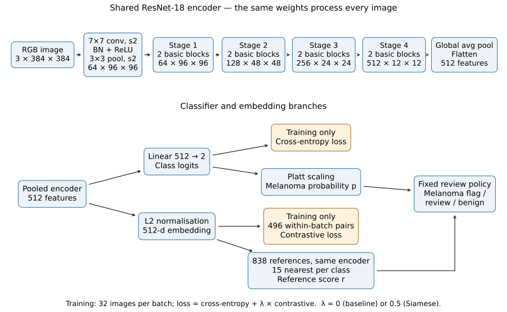

The encoder stages show channel and spatial dimensions per image. Both models use the same architecture. The training losses update the shared encoder; prediction combines classifier probability with reference similarity through the fixed review policy.

### Training Objective

Each batch contains 32 sampled images and forms all 496 unordered pairs. Sampling targets 15% melanoma images, or 4.8 per batch on average; a melanoma is not guaranteed in every batch. Expected pair counts are approximately 11 melanoma–melanoma, 126 mixed-class and 358 benign–benign pairs. All pairs reuse the same image embeddings.

Cross-entropy learns image labels, while the contrastive loss [3] pulls same-class embeddings together and separates different-class embeddings. For distance $d_{ij}$, matching pairs $P$, different-class pairs $N$ and margin $m=1$:

$$
L = L_{\mathrm{CE}}^{\text{smooth}=0.1} + \lambda\left[\frac{1}{|P|}\sum_{(i,j)\in P}d_{ij}^{2} + \frac{1}{|N|}\sum_{(i,j)\in N}\max(0,m-d_{ij})^{2}\right].
$$

The baseline uses $\lambda=0$ and Siamese uses $\lambda=0.5$. Matching and different-class pair terms are averaged separately. Within the matching term, benign pairs still dominate; melanoma–melanoma pairs account for about 3% under the sampling distribution.

| Training setting       | Value                                                    |
| ---------------------- | -------------------------------------------------------- |
| Initialisation         | ImageNet V1 ResNet-18 with a new binary head             |
| Image size and batch   | 384 × 384; 32 images                                    |
| Sampling budget        | 23,584 draws per epoch; 15% melanoma target              |
| Epochs                 | 8                                                        |
| Optimiser              | AdamW [10], peak learning rate 0.0002, weight decay 0.05 |
| Regularisation         | Label smoothing 0.1 and image augmentation               |
| Schedule and precision | One-cycle schedule with 10% warmup; bfloat16 autocast    |
| Checkpoint selection   | Highest selection AUROC                                  |
| Training seeds         | 42, 43, 44, 67 and 69, matched across objectives         |

### Reference Score and Review Policy

The gallery contains all 419 training melanomas and 419 sampled benign training images. For each query, the model measures mean distance to the 15 nearest references in each class. If these means are $\bar d_b$ for benign and $\bar d_m$ for melanoma, the reference score is

$$
r = \frac{\bar d_b}{\bar d_b + \bar d_m}.
$$

Higher values indicate greater relative similarity to melanoma references. A score of 0.5 means equal mean distances; the review cutoff is fitted separately and can be below 0.5. The score is a similarity measure, not a calibrated melanoma probability.

Platt scaling [5] fits a logistic transformation of classifier logit margins on calibration patients. The binary threshold $t$ is the 80th percentile of benign calibration probabilities, targeting 80% specificity. Because benign images dominate the dataset, overall accuracy is also near 80%, but that value is not guaranteed on new patients. A reference cutoff $u$ targets at least 95% calibration melanoma capture. All values are stored in the checkpoint.

The decision tree applies these checks to each image in order. Here, $p$ is the calibrated melanoma probability and $r$ is the reference score; $t$ and $u$ are their stored thresholds. A classifier-positive image is referred immediately. Only classifier-negative images need the reference check to determine their output.

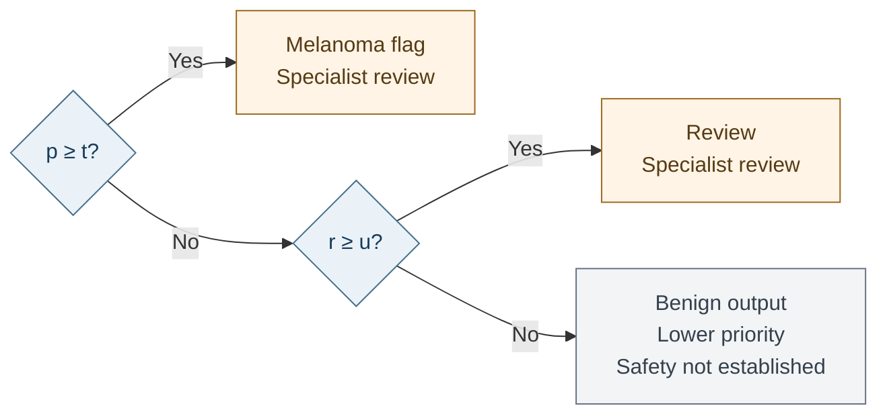

Workload counts both melanoma flags and review outputs. Capture is the proportion of true melanomas reaching either category; it does not measure correct human diagnosis. A probability-only review cutoff is retained as a comparator. Neither model nor policy was changed after the current final scoring.

## Experimental Results

### Learning Curves

For seed 42, selection AUROC peaks at epoch 5 for the baseline and epoch 3 for Siamese. Falling training loss does not ensure better selection performance. The baseline also computes contrastive loss as a diagnostic, with zero weight; its decline shows that classification alone changes embedding structure.

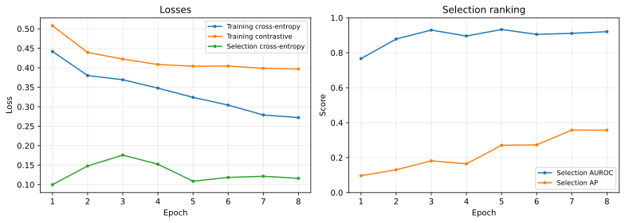

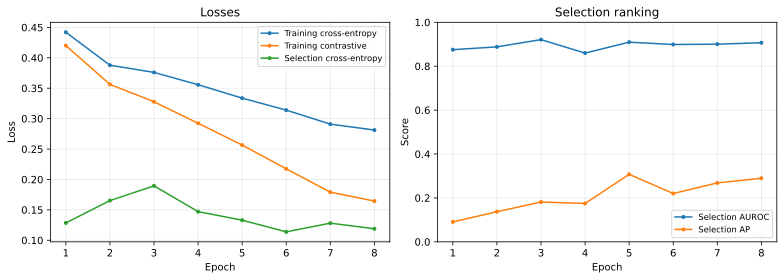

### Five-Seed Final Comparison

Each cell is the mean ± sample standard deviation across five trained seeds on the same final patients. Melanoma is the positive class. AP is the PR-AUC measure used here; AUROC measures ranking across thresholds. Precision–recall analysis is particularly useful when positive cases are rare [8]. Recall is the fraction of melanomas found, and precision is the fraction of melanoma flags that are correct.

| Final measure                |         Baseline |          Siamese |
| ---------------------------- | ---------------: | ---------------: |
| AUROC                        |   0.871 ± 0.033 |   0.865 ± 0.025 |
| Melanoma AP (PR-AUC)         |   0.195 ± 0.010 |   0.176 ± 0.027 |
| Decision accuracy            |   0.824 ± 0.011 |   0.830 ± 0.008 |
| Macro-F1                     |   0.511 ± 0.007 |   0.514 ± 0.007 |
| Benign precision             |   0.995 ± 0.001 |   0.995 ± 0.001 |
| Benign recall                |   0.825 ± 0.011 |   0.831 ± 0.008 |
| Benign F1                    |   0.902 ± 0.006 |   0.906 ± 0.005 |
| Melanoma precision           |   0.065 ± 0.006 |   0.066 ± 0.005 |
| Melanoma recall              |   0.765 ± 0.064 |   0.749 ± 0.051 |
| Melanoma F1                  |   0.120 ± 0.010 |   0.121 ± 0.010 |
| Reference-score AUROC        |   0.892 ± 0.011 |   0.889 ± 0.016 |
| Brier score                  | 0.0141 ± 0.0002 | 0.0143 ± 0.0004 |
| Images sent to review, %     |      31.6 ± 4.7 |      31.8 ± 2.8 |
| Melanomas reaching review, % |      88.9 ± 6.0 |      90.5 ± 4.6 |

Across the five baseline runs and five Siamese runs, classification accuracy ranges from approximately 81% to 84%, with about three-quarters of melanomas correctly flagged. Precision remains near 6.5%, reflecting the large benign false-positive burden. An always-benign classifier would achieve 98.4% accuracy and zero melanoma recall. The task's accuracy target therefore provides limited evidence of practical screening quality.

Baseline AP is higher on average, while the remaining measures show mixed differences. The seed standard deviations describe variation between retrained models; they are not confidence intervals or proof that the models are equivalent.

### Patient Uncertainty and Seed-42 Examples

The following intervals use 2,000 paired patient-cluster bootstrap draws [7], stratified by whether patients have melanoma. Each draw retains all images from each sampled patient. They apply to the seed-42 checkpoints and fixed rules, without incorporating uncertainty from retraining or calibration.

| Measure            |                Baseline |                 Siamese |        Siamese - baseline |
| ------------------ | ----------------------: | ----------------------: | ------------------------: |
| AUROC              | 0.8584 [0.8068, 0.9018] | 0.8243 [0.7663, 0.8763] | -0.0342 [-0.0836, 0.0133] |
| Melanoma AP        | 0.1891 [0.1107, 0.3096] | 0.1415 [0.0821, 0.2417] | -0.0475 [-0.1202, 0.0244] |
| Decision recall    | 0.6892 [0.5733, 0.7973] | 0.6622 [0.5507, 0.7662] | -0.0270 [-0.1286, 0.0800] |
| Decision precision | 0.0607 [0.0477, 0.0753] | 0.0584 [0.0462, 0.0730] | -0.0023 [-0.0116, 0.0073] |
| Decision accuracy  | 0.8283 [0.8021, 0.8515] | 0.8276 [0.7976, 0.8540] | -0.0006 [-0.0170, 0.0134] |
| Review workload    | 0.2673 [0.2325, 0.3067] | 0.2936 [0.2552, 0.3365] |  +0.0262 [0.0124, 0.0407] |
| Review capture     | 0.7973 [0.6944, 0.8904] | 0.8378 [0.7432, 0.9211] | +0.0405 [-0.0548, 0.1370] |

For this seed pair, Siamese workload is about 2.6 percentage points higher. Other difference intervals include zero, meaning that the Siamese model is not statistically better or worse than the baseline on these final patients.

| Seed-42 final confusion counts | True benign (TN) | Benign flagged (FP) | Missed melanoma (FN) | Found melanoma (TP) |
| ------------------------------ | ---------------: | ------------------: | -------------------: | ------------------: |
| Baseline                       |             3865 |                 789 |                   23 |                  51 |
| Siamese                        |             3864 |                 790 |                   25 |                  49 |

The ROC and PR panels compare classifier probability with reference score. Reliability uses eight quantile bins; the adjacent table lists each bin's mean probability and melanoma/image counts. The horizontal log scale separates low predicted probabilities. Curves use rounded CSV scores and are approximate; the main metric table uses full-precision summaries. The Brier score is only modestly lower than the 0.0154 from predicting the final prevalence for every image. These results do not establish reliable patient-level risk estimates.

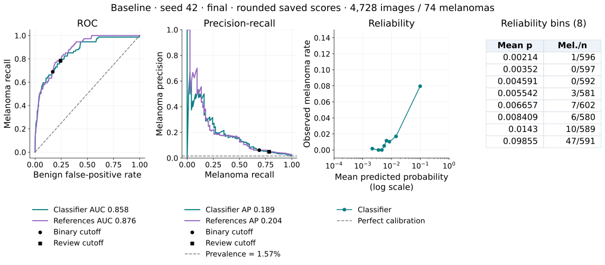

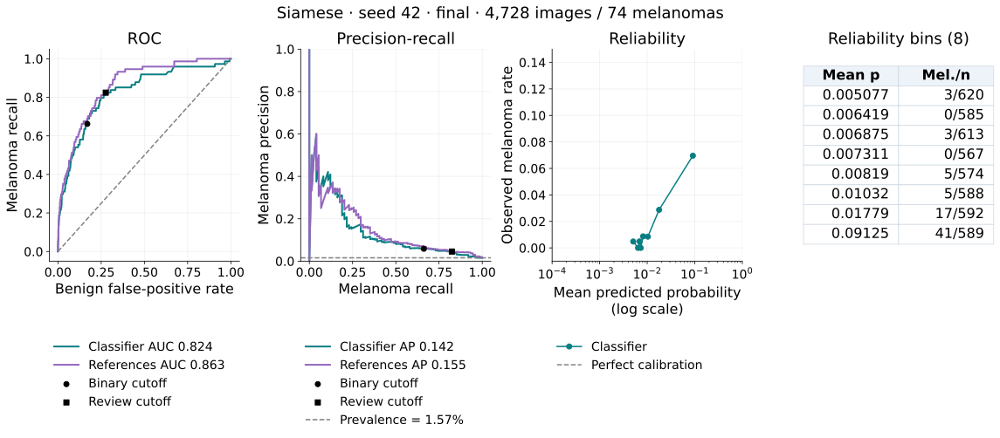

### Embedding Structure

PCA is fitted only on the 838 training references, then applied to final queries. Many final melanoma images overlap the dense benign-query region in these projections. The two axes retain only about 61–67% of reference variance, so the plots do not establish separation or failure causes in the full 512-feature space. Original-space reference AUROC is reported above.

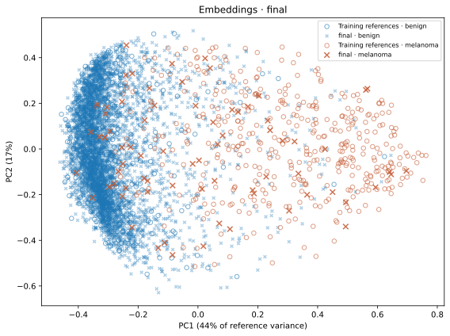

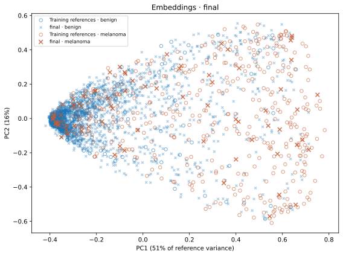

## Confidence and Referral Analysis

An error is an incorrect binary image label. Classifier uncertainty is the negative distance from the decision threshold in calibrated log-odds; reference disagreement is $|r-\hat y|$, where $\hat y$ is the binary prediction. Higher uncertainty should rank errors above correct decisions. Error-detection AUROC has an error as its positive outcome, unlike melanoma-classification AUROC.

| Error-ranking AUROC, mean ± SD across five seeds        |       Baseline |        Siamese |
| -------------------------------------------------------- | -------------: | -------------: |
| All binary errors: classifier uncertainty                | 0.565 ± 0.040 | 0.566 ± 0.065 |
| All binary errors: reference disagreement                | 0.971 ± 0.014 | 0.962 ± 0.034 |
| Missed melanomas among binary negatives: reference score | 0.814 ± 0.022 | 0.842 ± 0.028 |
| Missed melanomas among binary negatives: probability     | 0.724 ± 0.141 | 0.734 ± 0.091 |

Classifier uncertainty is only slightly better than chance for identifying all binary errors. Reference disagreement looks strong overall, but many of those errors are false positives already entering specialist review. Its added value is better assessed among images not flagged by the classifier, where reference score has higher observed missed-melanoma ranking than probability.

The subgroup figures use stored decisions to define the binary-negative group. They are approximate because exported reference scores have only three decimal places. This avoids redefining groups from rounded probabilities, but score ties still limit precision. These descriptive findings support further study of reference-assisted review; they do not establish a significant contrastive advantage or reliable 95% capture on new patients.

The calibration comparison below thresholds each score alone to capture 48 of 50 melanomas. These are single-score review rules; the deployed triage also includes classifier-positive flags. The in-sample results show lower observed workload variation for references, without establishing future workload.

| Calibration workload, mean ± SD (%) | Probability-only review | Reference-only review |
| ------------------------------------ | ----------------------: | --------------------: |
| Baseline                             |            51.0 ± 23.6 |           33.5 ± 6.1 |
| Siamese                              |             38.9 ± 8.9 |           36.5 ± 3.6 |

### Final Referral Trade-off

The following comparison uses the same final patients and the existing calibration cutoffs for every rule. Values are mean ± sample standard deviation across five seeds. Probability-only review already includes classifier flags because its cutoff is lower than the binary decision threshold in all ten runs. Reference-only review is also shown separately from the combined policy.

| Model    | Fixed final policy                  | Workload (%) | Melanoma capture (%) |
| -------- | ----------------------------------- | -----------: | -------------------: |
| Baseline | Classifier flags only               |  18.4 ± 1.1 |          76.5 ± 6.4 |
| Baseline | Probability-only review             | 47.2 ± 26.2 |          92.2 ± 6.7 |
| Baseline | Reference-only review               |  29.8 ± 5.5 |          88.1 ± 6.9 |
| Baseline | Classifier flags + reference review |  31.6 ± 4.7 |          88.9 ± 6.0 |
| Siamese  | Classifier flags only               |  17.8 ± 0.8 |          74.9 ± 5.1 |
| Siamese  | Probability-only review             |  33.6 ± 8.7 |          88.1 ± 6.9 |
| Siamese  | Reference-only review               |  31.6 ± 3.0 |          90.3 ± 5.1 |
| Siamese  | Classifier flags + reference review |  31.8 ± 2.8 |          90.5 ± 4.6 |

For the baseline, combined reference review reduces mean workload from 47.2% to 31.6%, alongside a capture decrease from 92.2% to 88.9%. For Siamese, it reduces mean workload from 33.6% to 31.8% while observed capture rises from 88.1% to 90.5%. Probability-only workload varies substantially between seeds, especially for the baseline. These are different achieved operating points, not a comparison at identical capture. The findings describe fixed-rule trade-offs; they do not establish a statistically reliable winner or justify choosing new thresholds from final labels.

## Failure Case Analysis

These five cases are the two lowest-probability melanomas and three highest-probability benign images from the seed-42 baseline. Both models are compared on those same images. Each figure shows the original and the actual evaluation crop received by both models, with their saved probabilities, reference scores and outputs. Visible features suggest possible failure triggers; no controlled intervention established their causes.

**1. Melanoma reviewed by both: `ISIC_0946787`.** A compact dark oval remains visible in the evaluation crop. Both classifiers miss it: baseline p≈0.0007 and Siamese p≈0.0101 are below their binary thresholds. Reference scores of 0.410 and 0.479 exceed their respective review cutoffs, rescuing the case in both models. A higher Siamese probability alone does not change the binary result.

**2. Melanoma rescued only by Siamese: `ISIC_7748311`.** The crop retains a low-contrast brown lesion, hair and ruler markings. The baseline outputs benign (p≈0.00516, r=0.384); Siamese routes it for review (p≈0.01117, r=0.443). Both probabilities are below their binary cutoffs, so the difference comes from the reference rule. This illustrates a useful Siamese result for one seed pair, without proving that contrastive training or any particular artifact caused it.

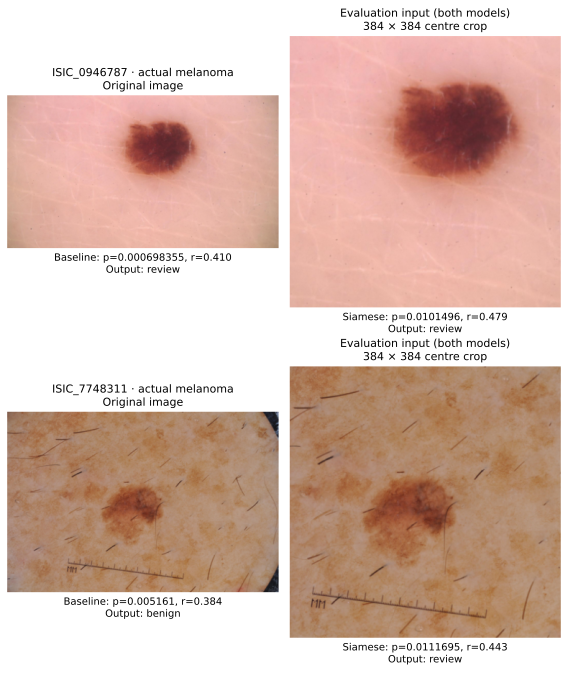

**3. Benign image flagged by both: `ISIC_7194471`.** Dense hair and irregular pigmentation remain visible after cropping. Probability decreases from about 0.857 for baseline to 0.278 for Siamese, but both still exceed their binary thresholds. The lower Siamese score therefore remains a false positive. The image suggests visual ambiguity; it does not establish hair as the cause.

**4. Benign image flagged by both: `ISIC_9743014`.** A dark centre and red surrounding area dominate the crop. Siamese probability is lower (about 0.098 versus 0.779), yet the decision remains a melanoma flag. Pigmentation and redness are plausible sources of confusion, but their individual effects were not isolated.

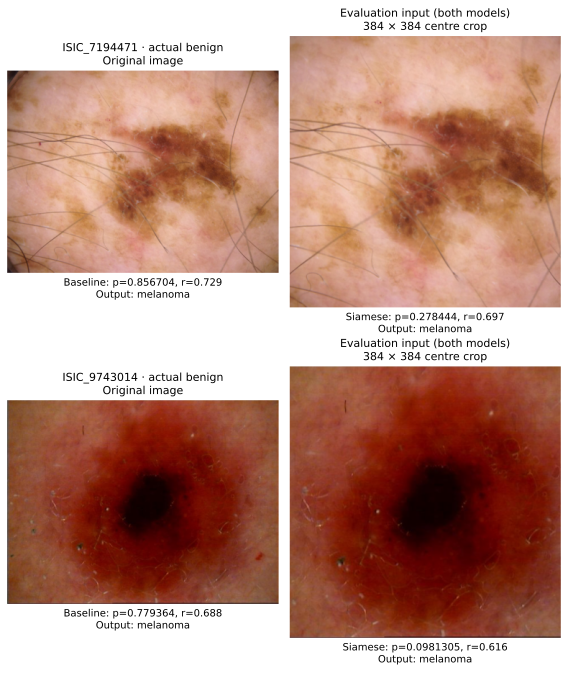

**5. Benign image flagged by both: `ISIC_5485142`.** A pink lesion sits among brown marks. The evaluation crop removes much of the outer framing, so the full image's dark corners cannot by themselves explain the prediction. Baseline p≈0.745 and Siamese p≈0.376 both produce melanoma flags. This persistent error warrants further investigation of lesion appearance and background rather than a claimed causal explanation.

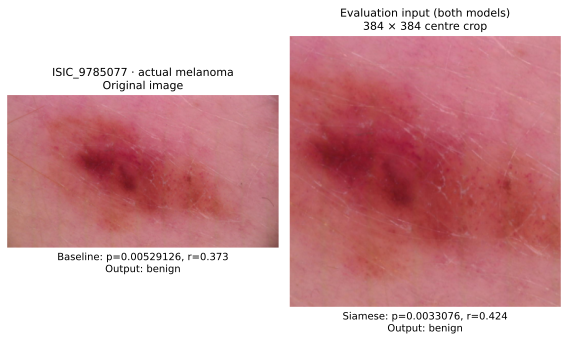

## Computational Feasibility

Measurements use the author's Apple M5 Pro with 48 GB unified memory and the PyTorch MPS backend. Values below describe seed 42. Both objectives have the same parameter count and forward architecture.

| Measurement                                           |   Baseline |    Siamese |
| ----------------------------------------------------- | ---------: | ---------: |
| Parameters                                            | 11,177,538 | 11,177,538 |
| Training, minutes                                     |       16.9 |       16.9 |
| Maximum sampled MPS driver allocation, training (GiB) |       4.39 |       4.39 |
| MPS driver allocation after inference benchmark (GiB) |       2.08 |       2.08 |
| Peak main-process RSS during training (GiB)           |       0.77 |       0.79 |
| Forward latency, 32-image batch (ms)                  |       43.9 |       43.8 |
| Image-scoring throughput (images/s)                   |       56.0 |       55.6 |

Latency covers ten preloaded 32-image batches after three warmups, with device synchronisation. Image-scoring throughput includes loader startup, JPEG decoding, preprocessing and encoder execution; it excludes reference search and plotting. Both runs compute contrastive loss for monitoring, so their similar training times do not isolate the cost of that term.

MPS values are driver-allocation samples, not measured peaks. Main-process RSS excludes loader workers. The available measurements support local feasibility, but do not establish total peak memory against the 24 GiB criterion. The 838 reference embeddings occupy about 1.7 MB.

## Recommendation and Limitations

Retain the baseline as the classification research benchmark because it has higher mean AP and a simpler objective. Siamese remains a useful comparison for referral research: its combined policy has slightly higher observed mean capture at similar workload, and it rescues one of the illustrated baseline misses. The mixed five-seed results do not establish a consistent overall advantage for either objective. Further model and policy selection requires independent patients.

At the current policy, about 32% of images reach a specialist and mean melanoma capture is 89–91%. The remaining cases should not be treated as safely benign. Capture is below the calibration target and does not measure human diagnostic accuracy. The result is a workload–capture trade-off that still requires human oversight.

The main limits are small melanoma groups, evaluation data informing development, one source dataset and incomplete peak-memory measurement. Further work should use independent patients, stronger calibration evidence and controlled investigation of image artifacts.

## Reproducibility and Usage

### Environment and Data

Run commands from `PatternAnalysis-2026`. The recorded environment uses Python 3.14.6, PyTorch 2.13.0, Torchvision 0.28.0, NumPy 2.5.1, Pillow 12.3.0, scikit-learn 1.9.0, PyYAML 6.0.3 and Matplotlib 3.11.1. Device selection prefers CUDA, then MPS, then CPU.

```bash
python3 -m venv .venv
source .venv/bin/activate
pip install -r recognition/Siamese_ISIC2020_Melanoma_47472442/requirements.txt
```

Download the ISIC 2020 training JPEGs and `ISIC_2020_Training_GroundTruth_v2.csv` [1] into repository `data/`; subdirectories are supported. Create the fixed patient manifest once:

```bash
python -m recognition.Siamese_ISIC2020_Melanoma_47472442.dataset
```

The package separates model components (`modules.py`), data handling (`dataset.py`), training (`train.py`), prediction (`predict.py`), comparison (`compare.py`) and SVG generation (`visualisation.py`). YAML files hold model and training settings. Seeds control sampling and initialisation, but results may vary across hardware.

### Training and Prediction

These commands reproduce the main pair. Existing run directories are refused; choose a new `--run-name` when repeating a run.

```bash
python -m recognition.Siamese_ISIC2020_Melanoma_47472442.train \
  recognition/Siamese_ISIC2020_Melanoma_47472442/configs/baseline.yaml
python -m recognition.Siamese_ISIC2020_Melanoma_47472442.train \
  recognition/Siamese_ISIC2020_Melanoma_47472442/configs/siamese.yaml
```

The remaining main runs use the following exact names. For either model, pass its YAML, `--seed` and `--run-name`; for example, append `--seed 43 --run-name baseline_seed43` to the baseline command.

| Seed | Baseline run        | Siamese run        |
| ---: | ------------------- | ------------------ |
|   42 | `baseline`        | `siamese`        |
|   43 | `baseline_seed43` | `siamese_seed43` |
|   44 | `baseline_seed44` | `siamese_seed44` |
|   67 | `baseline_seed67` | `siamese_seed67` |
|   69 | `baseline_seed69` | `siamese_seed69` |

Training saves weights, configuration, calibration rules and reference embeddings in `checkpoint.pt`, plus `metrics.json` and `training.svg`. Final patients are not loaded by training.

Score each of the ten checkpoints on calibration and final patients using the command below with the appropriate checkpoint path and `--partition`. These outputs supply the report's summary tables.

```bash
python -m recognition.Siamese_ISIC2020_Melanoma_47472442.predict \
  data/runs/baseline/checkpoint.pt --partition final
```

Prediction prints image/patient IDs, true labels, probabilities, reference scores and decisions. It saves `predictions.csv`, metrics and figures under `<run>/<partition>/`. These baseline examples show all three outputs:

```text
image_name,patient_id,actual,probability,reference_score,decision
ISIC_0286360,IP_7729044,1,0.127255,0.531,melanoma
ISIC_0327406,IP_7069391,1,0.0103555,0.427,review
ISIC_0082348,IP_7684360,0,0.00584584,0.306,benign
```

### Comparison and Figures

The offline summary reproduces the classification, referral, uncertainty and resource tables from saved run files. Adding `--figures` also regenerates the seed-42 ROC/PR/reliability plots and the matched failure crops using the 384-pixel evaluation configuration. It does not load model weights, perform inference or modify run outputs.

```bash
python -m recognition.Siamese_ISIC2020_Melanoma_47472442.summarise \
  --figures recognition/Siamese_ISIC2020_Melanoma_47472442/figures \
  > data/report_summary.md
```

The paired patient comparison reads saved seed-42 predictions without inference:

```bash
python -m recognition.Siamese_ISIC2020_Melanoma_47472442.compare \
  data/runs/baseline/final/predictions.csv \
  data/runs/siamese/final/predictions.csv
```

`visualisation.py` contains the plotting functions, including `plot_case_comparison` for matched original images, model inputs and outputs. Rounded CSV scores limit the exactness of replotting and subgroup rankings; the summary uses saved decision labels for subgroup membership and full-precision metric JSON for aggregate results. The review-policy diagram uses Mermaid, with a rendered SVG for the PDF export. Repeated fixed inference checks reproduction; final labels must not be used to choose new thresholds or models.

## Artificial Intelligence Usage Disclosure

OpenAI Codex assisted with data loading, training and plotting code, literature review, typing fixes, offline summaries, report writing and the Quarto PDF export. Anthropic Claude assisted with in-batch contrastive loss, reference scoring, throughput optimisation and multi-seed analysis.

Verification includes source checks, comparison of reported values with saved metrics and predictions, confirmation of patient separation and matching image identities, the paired patient bootstrap, and inspection of figures and the exported PDF. The author remains responsible for the code, references and every claim. No previous student's implementation was copied.

## References

ISIC 2020 images are used under CC BY-NC 4.0. Figures show this project's own results; reference images come only from training patients.

1. International Skin Imaging Collaboration. [SIIM-ISIC 2020 Challenge Dataset](https://doi.org/10.34970/2020-ds01), 2020.
2. Rotemberg et al. [A patient-centric dataset of images and metadata for identifying melanomas using clinical context](https://doi.org/10.1038/s41597-021-00815-z). *Scientific Data*, 2021.
3. Hadsell, Chopra and LeCun. [Dimensionality Reduction by Learning an Invariant Mapping](https://doi.org/10.1109/CVPR.2006.100). *CVPR*, 2006.
4. He et al. [Deep Residual Learning for Image Recognition](https://arxiv.org/abs/1512.03385). *CVPR*, 2016.
5. Platt. Probabilistic Outputs for Support Vector Machines and Comparisons to Regularized Likelihood Methods. *Advances in Large Margin Classifiers*, 1999; see also Guo et al., [On Calibration of Modern Neural Networks](https://proceedings.mlr.press/v70/guo17a.html), *ICML*, 2017.
6. Torchvision. [ResNet-18 API](https://docs.pytorch.org/vision/0.28/models/generated/torchvision.models.resnet18.html).
7. Field and Welsh. [Bootstrapping clustered data](https://doi.org/10.1111/j.1467-9868.2007.00593.x). *JRSS B*, 2007.
8. Saito and Rehmsmeier. [The Precision-Recall Plot Is More Informative than the ROC Plot When Evaluating Binary Classifiers on Imbalanced Datasets](https://doi.org/10.1371/journal.pone.0118432). *PLOS ONE*, 2015.
9. Perez et al. [Data Augmentation for Skin Lesion Analysis](https://arxiv.org/abs/1809.01442). *ISIC Workshop*, 2018.
10. Loshchilov and Hutter. [Decoupled Weight Decay Regularization](https://arxiv.org/abs/1711.05101). *ICLR*, 2019.
11. Koch, Zemel and Salakhutdinov. [Siamese Neural Networks for One-shot Image Recognition](https://www.cs.toronto.edu/~rsalakhu/papers/oneshot1.pdf). *ICML Deep Learning Workshop*, 2015.
