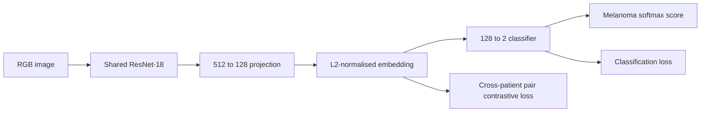
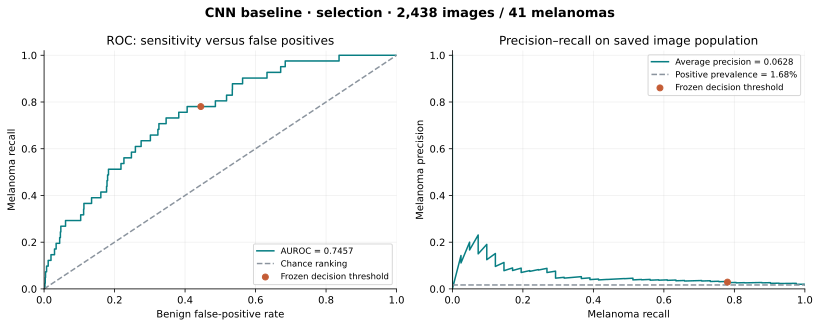
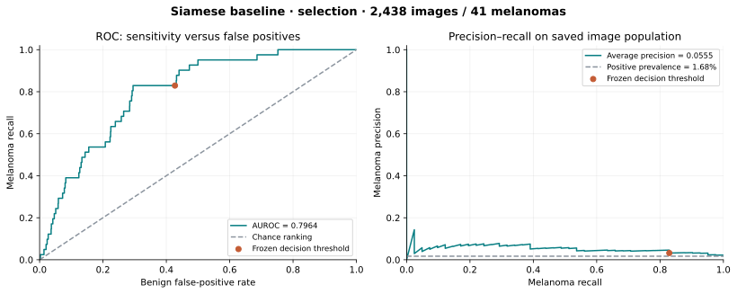
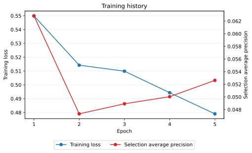
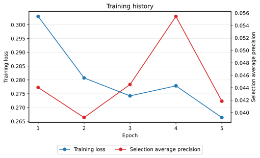

# ISIC 2020 Melanoma Triage with Siamese Metric Learning

## Introduction

This project investigates whether Siamese metric learning can improve melanoma triage from dermoscopic images compared with a direct convolutional neural network (CNN). The intended user is a reviewer who must identify suspicious lesions and assess uncertain predictions. The engineering question is whether an embedding-based comparison with labelled reference images provides useful evidence of uncertainty while reducing review workload at a comparable melanoma sensitivity and acceptable local computational cost.

The ISIC 2020 dataset contains fewer than 2% melanoma images, making aggregate accuracy an incomplete measure of detection performance. This investigation therefore considers per-class precision and recall, macro-F1, AUROC, melanoma precision–recall performance, referral behaviour and computational cost. Both compact models have completed five-epoch runs on Apple MPS using the same patient protocol. The CNN achieved higher selection average precision, while the Siamese model achieved higher selection AUROC. Final evaluation remains pending. The prototype is an image-only research system; its scope does not include clinical validation or autonomous diagnosis.

## Methodology

### Dataset and Preprocessing

The study uses the labelled training images from the [SIIM-ISIC 2020 Challenge dataset](https://github.com/ImageMarkup/isic-challenge-2020/blob/master/index.md), described by [Rotemberg et al.](https://doi.org/10.1038/s41597-021-00815-z). The metadata audit identified 33,126 images from 2,056 patients, including 584 melanoma images (1.76%). All 425 published duplicate pairs share a patient identifier and label.

Images are loaded lazily and converted to RGB. The completed compact models use a square resize to 224 × 224 pixels and floating-point tensors with values in the range [0, 1]. The ResNet-18 configurations instead use the [official ImageNet preprocessing preset](https://docs.pytorch.org/vision/0.28/models/generated/torchvision.models.resnet18.html): bilinear resize of the shorter side to 256 pixels, centre crop to 224 × 224, scaling to [0, 1], and channel normalisation with mean (0.485, 0.456, 0.406) and standard deviation (0.229, 0.224, 0.225). These settings also apply to a ResNet initialised without pretrained weights.

The current loader uses only the ResNet-18 pipeline. Horizontal and vertical flips are applied before preprocessing during fitting only. Selection, calibration and prediction views use the same deterministic preset. The checkpoint records its description. Lazy loading avoids retaining the full image archive in memory.

The completed comparison uses the standalone patient protocol in `data/splits/isic_protocol.json`. A deterministic recipe separates a 70% fitting pool, 15% tuning pool and 15% development population using seed 42. It reserves 20% of the fitting pool for final evaluation using seed 20261007, and divides the tuning patients equally between checkpoint selection and decision calibration using seed 20261008. Every division stratifies patients by whether any of their images contains melanoma, and every image from a patient remains in the same role. Image fractions differ from patient fractions because patients contribute different numbers of lesions. The development population corresponds to previously examined test patients and is excluded from the current comparison.

| Role | Purpose | Patients | Images | Melanomas |
| --- | --- | ---: | ---: | ---: |
| Fitting | Optimisation, training pairs and reference gallery | 1,152 | 18,120 | 337 |
| Selection | Checkpoint and model selection | 154 | 2,438 | 41 |
| Calibration | Decision threshold and referral band | 154 | 2,376 | 50 |
| Final | Evaluation after experimental choices are frozen | 288 | 4,728 | 74 |
| Development | Previously examined patients, outside the new comparison | 308 | 5,464 | 82 |

The protocol stores patient identifiers for each role; image identifiers and labels come from the dataset metadata. The split assigns whole patients to roles, keeping their images and the known duplicates together. Loading maps these saved patient assignments to image indices and assumes valid ISIC metadata and protocol files. Creation uses the labelled CSV without opening images. The final population was previously part of the historical baseline's training set, so every model in the new comparison must be retrained using fitting patients only.

### Historical Compact CNN Baseline

The completed compact baseline accepted an RGB image and produced two logits corresponding to benign (`0`) and melanoma (`1`). Its feature extractor contained three convolutional blocks with 32, 64 and 128 channels, ReLU activations and max pooling. Adaptive pooling produced a 4 × 4 feature map, followed by a 256-unit fully connected layer and the two-class output. Weighted cross-entropy increases the contribution of the rare melanoma class during optimisation.

The softmax melanoma output is used as a ranking score. Although it lies between zero and one, class-weighted training does not establish that it is calibrated to the dataset's natural prevalence. The distinction between a ranking score and a reliable probability is relevant when interpreting confidence and referral decisions.

### Siamese Metric Learning

The Siamese model passes two RGB images through the same encoder weights and produces a normalised, 128-dimensional embedding for each image. An embedding is a learned feature vector whose distances represent similarity under the training objective. Contrastive learning, following the principle described by [Hadsell et al.](https://doi.org/10.1109/CVPR.2006.100), reduces distances between same-class pairs and penalises different-class pairs whose distance remains below the margin.

Training pairs are balanced between same-class and different-class examples and are drawn from different training patients. In the completed compact experiment, the encoder used the same convolutional channel widths as the baseline but pooled to a single spatial feature vector before projection. Those historical models therefore differed in pooling and output heads. Future runs use the common ResNet-18 encoder described below.

In the completed compact Siamese run, individual-image classification compared a query embedding with a fixed, labelled fitting gallery. For each class, the model averaged distances to the five nearest references among 100 images per class. Its melanoma score was the mean benign-reference distance minus the mean melanoma-reference distance; a larger score indicated relatively closer melanoma references. The checkpoint recorded the gallery identifiers, and this gallery score was not assumed to be a calibrated probability. These historical results remain reported below.

The current ResNet implementation instead trains a binary classifier directly on the metric-trained embedding. This makes the same learned representation responsible for both pair similarity and the image-level melanoma decision. Fitting-reference diagnostics and neighbour disagreement will be investigated separately after the controlled classifier comparison.

### Current ResNet-18 Architecture

Both current configurations use the same `MelanomaModel`: ResNet-18 produces 512 features, a linear projection produces a normalised 128-dimensional embedding, and a linear classifier maps that embedding to benign and melanoma logits. All parameters are trainable. The classifier consumes the same embedding supervised by the contrastive objective, so inference uses the metric-trained representation directly.



The two members of every pair are concatenated into one image batch and pass through the shared network once. Cross-entropy supervises both image labels. The pair loss pulls same-class embeddings together and penalises different-class embeddings whose Euclidean distance is below margin $m$:

$$
L = L_{\mathrm{CE}} + \lambda L_{\mathrm{contrastive}}, \qquad
L_{\mathrm{contrastive}} = \operatorname{mean}\left[s d^2 + (1-s)\max(0,m-d)^2\right],
$$

where $s=1$ for matching image labels and $d$ is the distance between the two normalised embeddings. The classification-only baseline uses $\lambda=0$; the joint Siamese configuration uses $\lambda=1$ and $m=1$. These are initial pilot settings, not empirically selected optima. Both configurations still record the raw contrastive loss as an embedding diagnostic. Total training losses differ by definition and should not be used to rank the two experiments.

Both configurations sample 4,096 pairs per epoch, alternating matching and different labels and always choosing different patients within a pair. First-image labels are sampled uniformly, and patients are sampled within each label, making image classes approximately balanced during training. Ordinary cross-entropy is therefore used without additional inverse-frequency class weights. Selection and calibration retain their natural prevalence. A dedicated shuffle generator and deterministic pair streams give the same sampled inputs for the same seed in both configurations.

With five epochs and batch size 16 **pairs**, each model receives 8,192 image presentations and 256 optimiser updates per epoch: 40,960 image presentations and 1,280 updates in total. A full training forward contains 32 images; scoring and latency profiling use batches of 16 individual images. The architecture, initialisation, augmentation, sampler, learning rate and optimiser budget are matched, isolating the added contrastive term within this experiment. Neither current configuration has been run, so the quantitative results below remain those of the compact models.

ImageNet initialisation uses Torchvision's `ResNet18_Weights.IMAGENET1K_V1`; the original ImageNet classifier is replaced by this project's projection and binary head. The provided draft brief's Siamese entry does not require training from scratch or prohibit ImageNet initialisation, but it does not explicitly confirm permission for this task. The implementation proceeds on the interpretation that generic pretrained initialisation is compatible with the required Siamese learning; this is not a recorded teaching-team approval. The weight source is attributed in the references, and `--no-pretrained` supports the same architecture from random initialisation.

### Model Selection and Decision Rule

Both historical compact models were trained for five epochs with batch size 16, Adam learning rate 0.001 and seed 42. Selection average precision chose the checkpoint: epoch 1 for the CNN and epoch 4 for the Siamese model. Each checkpoint's binary threshold was then chosen on separate calibration patients to retain at least 90% melanoma recall there.

The three-way decision rule adds a referral band around this threshold. Scores at or below the lower boundary are cleared as benign, scores at or above the upper boundary are flagged as melanoma, and scores within the band are referred as ambiguous. The band width uses the 10th percentile of calibration-score distance from the threshold. This is a score-based heuristic whose ability to identify errors requires empirical assessment.

The completed compact models shared preprocessing, seed, patient roles and reporting, but their architectures and optimisation budgets differed. The CNN processes all 18,120 fitting images per epoch; the Siamese model samples 4,096 pairs per epoch. Training saves selection and calibration evidence only. Selection results have been used to choose checkpoints, while calibration results describe the patients used to choose the decision rule. Both are development evidence. Final evaluation is a separate prediction operation after experimental choices are frozen.

## Feasibility Review

The feasibility check-off is complete. The following written review records the prototype's feasibility, acceptance criteria and proposed next experiment. Completion of the review does not establish that the proposed model extensions have been implemented or evaluated.

### User Need, Scope and Acceptance Criteria

The intended user is a reviewer assessing suspicious or ambiguous dermoscopic images. The prototype predicts melanoma versus benign and investigates whether metric learning improves confidence assessment and review workload over a direct CNN. Its scope is a local, image-only comparison.

Leakage control requires zero overlapping patients across fitting, selection, calibration and final evaluation, with published duplicates kept together and pairs and reference galleries restricted to fitting patients. Classification requires one melanoma score and image label, with both models evaluated on identical patients using accuracy, per-class precision and recall, macro-F1, AUROC and melanoma PR-AUC. The task brief suggests an accuracy target of approximately 0.80.

Triage thresholds will be frozen using calibration patients, targeting at least 90% melanoma recall there. Evaluation will report melanoma sensitivity, benign false-positive rate, ambiguous referrals and total review workload, with referral rules compared at matched recall. Qualitative evidence will include three to five actual failures with images, scores and training references, alongside an assessment of whether confidence or neighbour disagreement identifies errors.

The local resource constraint is a two-hour Apple MPS pilot at batch size 16 and 224 × 224 resolution, with observed process memory capped at 24 GiB. Parameter count, timing scope and accelerator allocation will be recorded, with unavailable exact peak-memory measurements identified. Together, these establish five acceptance criteria covering leakage, classification, triage, failure evidence and local resources.

### Model Choice and Course Concepts

The selected Hard option is a Siamese network on ISIC 2020. The completed compact model learned normalised embeddings with contrastive loss and used a fitting-gallery score. The current implementation adds a binary head on the shared ResNet-18 embedding and jointly optimises classification and contrastive learning. An otherwise identical configuration with zero metric-loss weight supplies the controlled classification-only baseline.

The design connects CNNs, shared weights, embedding geometry, class imbalance, generalisation and selective prediction. Its literature basis includes [Hadsell et al.](https://doi.org/10.1109/CVPR.2006.100) for contrastive learning, [He et al.](https://arxiv.org/abs/1512.03385) for residual networks and [Guo et al.](https://proceedings.mlr.press/v70/guo17a.html) for calibration. The shared pretrained encoder and joint objective are implemented but unevaluated.

### Local Execution Evidence

Both five-epoch runs completed on MPS. Recorded elapsed time before artifact saving was 55.16 minutes for the CNN and 24.50 minutes for the Siamese model. The saved CSV populations and labels match the patient protocol and ground truth, and their recomputed classification and ranking metrics match the JSON reports. These results establish local training and scoring feasibility for both compact models.

The runs remain preliminary evidence of detection quality. Selection average precision was 0.0628 for the CNN and 0.0555 for the Siamese model; their calibration precision at 90% binary melanoma recall was 3.67% and 3.85%, respectively. Current MPS allocation was recorded, while peak accelerator allocation and peak process memory were not measured.

### Risks, Budget and Fallback

The principal risks are limited positive examples, misleading accuracy, overconfident scores and reference-gallery cost. The patient protocol is frozen and both compact models have been trained using fitting patients only. The next study would compare a stronger direct classifier and joint Siamese training within the two-hour MPS pilot budget, using selection average precision for model selection. The small numbers of melanoma images in selection, calibration and final evaluation limit the precision of the resulting estimates.

If resource use exceeds the budget, additional encoder layers can remain frozen or batch size can be reduced. If similarity produces no reliable triage advantage, the recommendation will favour the simpler classifier with an empirically assessed decision rule and human review.

## Results and Discussion

### Completed Runs and Evidence

The comparison uses the saved `baseline_seed42` and `siamese_seed42` runs. Both used the same fitting, selection and calibration patients, with the same protocol hash recorded in their reports. All saved prediction identifiers, patients and labels match the protocol and ground truth. Accuracy, macro-F1, AUROC, average precision, confusion matrices and triage decisions were independently recomputed from the saved CSVs and agree with the reported values.

The selection population contains 2,438 images and 41 melanomas; calibration contains 2,376 images and 50 melanomas. Neither run has evaluated the reserved final population. The following results describe model development and threshold calibration, rather than final test performance.

### Selection Performance

Binary metrics below apply each model's calibration-derived threshold to its selection scores. Average precision and AUROC use the complete ranking of those scores.

| Metric | CNN baseline | Siamese baseline |
| --- | ---: | ---: |
| Selected epoch | 1 | 4 |
| Melanoma PR-AUC (average precision estimator) | **0.0628** | 0.0555 |
| AUROC | 0.7457 | **0.7964** |
| Accuracy | 55.91% | 57.71% |
| Macro-F1 | 0.3843 | 0.3945 |
| Melanoma precision | 2.91% | 3.21% |
| Melanoma recall | 78.05% | 82.93% |
| Benign precision | 99.33% | 99.49% |
| Benign recall (specificity) | 55.53% | 57.28% |

The CNN leads on average precision, the metric used for checkpoint selection. The Siamese model leads on AUROC and several metrics at the frozen operating point. These results do not identify a consistent overall winner: a higher AUROC has not translated into higher average precision for the Siamese model. Melanoma prevalence in the selection population is 1.68%, providing the reference line in the precision–recall plots.



*Figure 1. CNN selection curves from saved scores. The marked operating point uses the threshold chosen on calibration patients.*



*Figure 2. Siamese selection curves on the same image population. The signed gallery score is used directly as a ranking score.*

### Learning Behaviour



*Figure 3. Five-epoch CNN history, with the highest selection average precision at epoch 1.*



*Figure 4. Five-epoch Siamese history, with the highest selection average precision at epoch 4.*

CNN training loss decreased from 0.5499 to 0.4790, while selection average precision fell from its epoch-1 maximum of 0.0628 to 0.0526 at epoch 5. Siamese loss decreased overall from 0.3030 to 0.2664; average precision fluctuated, peaked at 0.0555 in epoch 4 and finished at 0.0418. Neither history shows a sustained improvement in selection average precision across the five epochs. These short histories do not isolate representation quality, optimisation or overfitting as the cause. Cross-entropy and contrastive loss values are different objectives and cannot be compared directly between the models.

### Calibration and Binary Decisions

Each binary threshold was chosen to retain at least 90% recall on the 50 calibration melanomas. Both detect 45 of those 50 images at their threshold. That recall is a calibration target achieved on the data used to choose the rule; it is not evidence of 90% recall on unseen final patients.

| Metric | CNN baseline | Siamese baseline |
| --- | ---: | ---: |
| Binary threshold | 0.305074 | -0.021096 |
| Referral margin | 0.005146 | 0.005626 |
| Melanoma average precision | 0.0319 | 0.0311 |
| AUROC | 0.6901 | 0.6853 |
| Accuracy | 50.13% | 52.53% |
| Macro-F1 | 0.3649 | 0.3774 |
| Melanoma precision | 3.67% | 3.85% |
| Melanoma recall | 90.00% | 90.00% |
| Benign precision | 99.57% | 99.59% |
| Benign recall (specificity) | 49.27% | 51.72% |

The calibration confusion counts are shown below. A false positive is a benign image predicted as melanoma, and a false negative is a melanoma predicted as benign at the binary threshold.

| Model | True benign | False positives | False negatives | True melanoma |
| --- | ---: | ---: | ---: | ---: |
| CNN | 1,146 | 1,180 | 5 | 45 |
| Siamese | 1,203 | 1,123 | 5 | 45 |

At the matched calibration recall, the Siamese model produces 57 fewer false positives. Both still classify approximately half the benign images as melanoma, producing precision below 4%. An always-benign classifier would achieve 97.90% accuracy on calibration with zero melanoma recall. Consequently, aggregate accuracy alone would give a misleading account of detection quality.

### Referral Behaviour and Review Workload

The referral policy routes both melanoma-flagged and ambiguous images for review. Its saved calibration decisions are:

| Decision | CNN benign | CNN melanoma | Siamese benign | Siamese melanoma |
| --- | ---: | ---: | ---: | ---: |
| Clear as benign | 1,044 | 2 | 1,076 | 3 |
| Refer as ambiguous | 232 | 6 | 231 | 7 |
| Flag as melanoma | 1,050 | 42 | 1,019 | 40 |

Both models refer 238 images as ambiguous, or 10.02% of calibration images. Including melanoma flags, the CNN routes 1,330 images for review (55.98%) and captures 48 of 50 melanomas (96.00%). The Siamese model routes 1,297 images (54.59%) and captures 47 of 50 melanomas (94.00%). The CNN leaves two melanomas in the cleared group and the Siamese model leaves three.

The Siamese policy's lower calibration workload therefore accompanies one additional missed melanoma. These three-way policies are not operating at matched routed sensitivity, so this result does not establish a workload advantage at equivalent melanoma detection. Applying the same policies to selection patients routes 50.21% of images with 80.49% melanoma capture for the CNN, and 49.02% with 92.68% capture for the Siamese model. The change between populations reinforces the need to assess generalisation and compare policies at matched recall.

The referral band remains a score-distance heuristic. Its ability to identify errors, and the additional value of reference disagreement, require further investigation.

### Computational Cost

| Measurement | CNN baseline | Siamese baseline |
| --- | ---: | ---: |
| Device | Apple MPS | Apple MPS |
| Image size / batch size | 224 × 224 / 16 images | 224 × 224 / 16 pairs |
| Parameters | 618,306 | 109,760 |
| Fitting examples per epoch | 18,120 images | 4,096 pairs |
| Optimisation time, five epochs | 46.05 min | 15.02 min |
| Selection scoring time, including best-checkpoint rescore | 7.97 min | 8.24 min |
| Calibration scoring and rule selection | 1.10 min | 1.20 min |
| Elapsed time before artifact saving | 55.16 min | 24.50 min |
| Fixed selection-batch forward latency, 16 images | 4.130 ms | 4.187 ms |
| Current MPS allocation at profiling | 30.86 MiB | 11.56 MiB |
| Peak accelerator / process memory | Not measured | Not measured |

The shorter Siamese run is specific to this experiment's smaller model and training budget. Across five epochs, the CNN processes 90,600 image presentations and performs 5,665 optimisation steps. The Siamese model processes 20,480 pairs, or 40,960 image presentations, in 1,280 steps. Its different pooling and projection also give it substantially fewer parameters. These differences prevent attributing the timing or performance differences solely to the learning objective.

Forward latency measures the classifier forward pass for the CNN and the single-image encoder for the Siamese model. It excludes image decoding, transfers, softmax or gallery-distance scoring, and report generation. The selection and calibration scoring phases include their data-loading and scoring work; Siamese scoring also rebuilds the gallery embeddings for each scoring call. Current MPS allocation is not peak accelerator memory or total process memory. Both recorded run durations fall below the two-hour pilot budget, while compliance with the 24 GiB process-memory criterion cannot be assessed from the saved measurements.

### Failure Cases and Remaining Evidence

The calibration outputs identify four distinct melanomas cleared as benign by at least one model. The table compares their saved scores and three-way decisions. Scores have different meanings in the two models and should be interpreted against their respective saved thresholds and referral margins.

| Melanoma image | CNN score / decision | Siamese score / decision |
| --- | --- | --- |
| `ISIC_2776906` | 0.2826 / benign | 0.0137 / melanoma |
| `ISIC_3464344` | 0.2907 / benign | -0.0346 / benign |
| `ISIC_3969411` | 0.3710 / melanoma | -0.0431 / benign |
| `ISIC_4936662` | 0.3000 / refer | -0.0470 / benign |

Both models clear `ISIC_3464344` incorrectly. For `ISIC_2776906` and `ISIC_3969411`, one model flags the melanoma while the other clears it. For `ISIC_4936662`, the CNN's referral band routes an image that the Siamese policy clears. This disagreement provides concrete cases for the next qualitative review. Their visual appearances and nearest references in the fitting gallery have not yet been analysed for these runs, so no visual cause or explanation benefit is claimed here.

Only one seed has been run, and the selection and calibration groups contain 41 and 50 melanoma images. No confidence intervals have been estimated. The current models also differ in architecture and training budget. These limits make the results an initial comparison rather than evidence that one learning approach consistently outperforms the other.

## Conclusions and Future Work

Both compact models train and score locally on MPS. The CNN achieved higher selection average precision (0.0628 versus 0.0555), while the Siamese model achieved higher selection AUROC (0.7964 versus 0.7457). At the calibration threshold targeting 90% melanoma recall, precision remained below 4% for both. Their three-way policies routed approximately 55% of calibration images for review while still clearing melanomas incorrectly. The completed comparison therefore establishes working baselines and an unresolved sensitivity–workload trade-off.

The implementation now supports a controlled ResNet-18 comparison of classification alone and joint classification/contrastive learning, with the same architecture, paired-image inputs and optimiser budget. These configurations remain unrun. The next evidence is the author-run pilot comparison, followed by fitting-reference and neighbour-disagreement diagnostics for referral and failure analysis. Selection average precision will guide model choices, with the final population reserved until those choices and the decision policy are frozen.

The intended contribution is an empirical comparison of referral based on classifier confidence and referral based on disagreement among training references at matched melanoma sensitivity. Case images, fitting references, workload curves, repeated runs and complete resource measurements are needed to establish whether metric learning adds useful triage evidence. If no reliable advantage emerges, the report will favour the simpler classifier with an empirically assessed decision rule and human review.

## Reproducibility and Usage

The implementation is organised into `modules.py` for model definitions, `dataset.py` for image loading, `train.py` for fitting, checkpoint selection and calibration, and `predict.py` for checkpoint-based inference. `protocol.py` creates, loads and summarises patient roles; `provenance.py` provides configuration serialisation and file hashes. The two YAML configurations now define the unrun ResNet-18 experiments. The code assumes correctly configured local inputs and uses the fixed RGB preprocessing pipeline. Historical compact scores and figures remain available for comparison, but their checkpoints are no longer supported by the current model definitions.

### Environment

The pinned dependencies reflect the local development environment.

| Dependency | Version |
| --- | --- |
| PyTorch | 2.13.0 |
| Torchvision | 0.28.0 |
| NumPy | 2.5.1 |
| Pillow | 12.3.0 |
| scikit-learn | 1.9.0 |
| PyYAML | 6.0.3 |
| Matplotlib | 3.11.1 |

The environment can be installed from the repository root as follows.

```bash
python3 -m venv .venv
source .venv/bin/activate
python -m pip install --upgrade pip
python -m pip install -r recognition/Siamese_ISIC2020_Melanoma_47472442/requirements.txt
```

The default device setting, `auto`, selects CUDA when available, then Apple MPS, then CPU. Explicit `--device mps` and `--device cpu` overrides are available when a specific execution device is required.

### Dataset Layout

The extracted training JPEGs and `ISIC_2020_Training_GroundTruth_v2.csv` are stored under the repository-local `data/` directory.

```text
data/
├── ISIC_2020_Training_GroundTruth_v2.csv
├── train/
│   └── ISIC_*.jpg
└── splits/
    └── isic_protocol.json
```

On a new checkout, create the patient split once from the labelled CSV. In this workspace it already exists and is reused by training and prediction. The creation command does not overwrite existing files.

```bash
python -m recognition.Siamese_ISIC2020_Melanoma_47472442.protocol
```

Training loads the saved patient split. Datasets, manifests, checkpoints and generated run outputs remain outside the submitted source; selected report figures are retained under `figures/`.

### Training and Saved Artifacts

The completed compact runs remain under `data/runs/baseline_seed42/` and `data/runs/siamese_seed42/`. The current `baseline.yaml` and `siamese.yaml` files contain only the objective choice, pretrained initialisation and training hyperparameters: epochs, batch size in pairs, learning rate, pairs per epoch, contrastive weight and margin. Run names and input/output paths are supplied separately through CLI arguments or Python defaults. Seed 42, automatic device selection and calibration recall 0.9 remain Python defaults, with CLI overrides available. Explicit CLI arguments take precedence over YAML values. `model: base` fixes the contrastive multiplier to zero; `model: siamese` enables the configured multiplier.

```bash
python -m recognition.Siamese_ISIC2020_Melanoma_47472442.train \
  --config recognition/Siamese_ISIC2020_Melanoma_47472442/configs/baseline.yaml \
  --run-name resnet18_baseline_seed42
```

```bash
python -m recognition.Siamese_ISIC2020_Melanoma_47472442.train \
  --config recognition/Siamese_ISIC2020_Melanoma_47472442/configs/siamese.yaml \
  --run-name resnet18_siamese_seed42
```

The first pretrained training invocation may download the ImageNet weights into Torch's local cache. Subsequent invocations reuse that cache. Setting `pretrained: false` or passing `--no-pretrained` initialises ResNet-18 from scratch while retaining the same preprocessing.

Each run saves `effective_config.json`, `checkpoint.pt`, `metrics.json`, `selection_predictions.csv`, `calibration_predictions.csv` and `training.svg` under `data/runs/<run-name>/`. Existing run directories are refused. The configuration records the settings actually used after defaults and overrides, including pretrained initialisation; its file hash links the checkpoint and metrics to those settings. The checkpoint also records the objective label and loss settings, learned projection and classifier tensors, preprocessing, patient protocol, fitting patients, score meaning, selected epoch and calibration-derived decision rule. Metrics record the initialisation setting, seed, resolved device, loss components, image/optimiser budgets, phase timings and development results. Training does not create a final prediction loader or save final scores.

### Checkpoint Prediction

Once a ResNet run is complete, its checkpoint defaults to calibration prediction. Prediction constructs ResNet-18 without pretrained initialisation, loads its saved tensors and applies the fixed preprocessing; reloading therefore does not download ImageNet weights. Its saved protocol, fitting patients, configuration and decision rule are checked before scoring. Prediction saves the CSV, score-distribution and failure-case SVGs, and an `evaluation.json` record identifying the checkpoint hash, role, runtime settings and resulting metrics. New prediction directories are refused if they already exist.

```bash
python -m recognition.Siamese_ISIC2020_Melanoma_47472442.predict \
  --checkpoint data/runs/resnet18_baseline_seed42/checkpoint.pt \
  --partition calibration
```

```bash
python -m recognition.Siamese_ISIC2020_Melanoma_47472442.predict \
  --checkpoint data/runs/resnet18_siamese_seed42/checkpoint.pt \
  --partition calibration
```

Final evaluation requires a checkpoint trained under the new protocol and all three flags below. It saves results separately under `predictions/final/`, with the evaluation note and checkpoint identity recorded before scoring. This command is reserved for the final frozen comparison.

```bash
python -m recognition.Siamese_ISIC2020_Melanoma_47472442.predict \
  --checkpoint data/runs/resnet18_baseline_seed42/checkpoint.pt \
  --partition final --evaluate-final \
  --evaluation-note "Model, preprocessing and decision policy frozen for final comparison."
```

The reported compact comparison uses its saved CSVs. The prediction commands above apply to future completed ResNet runs; they do not reproduce the historical compact inference.

Prediction prints and saves image identifiers, ground-truth labels, scores, binary predictions and triage decisions. Both objectives use the softmax melanoma score from the saved classifier on the normalised embedding. Pair labels, neighbour voting and gallery scores do not enter this image-level inference path. The score remains a ranking measure; class-balanced training does not establish probability calibration at natural melanoma prevalence.

### Saved-Score Visualisation

The ROC and precision–recall figure can be regenerated independently from saved prediction CSVs and `metrics.json`. `visualisation.py` defaults to `calibration_predictions.csv`; `--predictions` selects any other saved CSV. It reads image labels and scores, calculates the curves and marks the frozen threshold stored in the metrics file. This offline command does not load a checkpoint or execute training or inference.

```bash
python -m recognition.Siamese_ISIC2020_Melanoma_47472442.visualisation \
  --run-dir data/runs/baseline_seed42 \
  --predictions data/runs/baseline_seed42/selection_predictions.csv \
  --output recognition/Siamese_ISIC2020_Melanoma_47472442/figures/cnn_selection_roc_pr.svg \
  --title "CNN baseline · selection"
```

```bash
python -m recognition.Siamese_ISIC2020_Melanoma_47472442.visualisation \
  --run-dir data/runs/siamese_seed42 \
  --predictions data/runs/siamese_seed42/selection_predictions.csv \
  --output recognition/Siamese_ISIC2020_Melanoma_47472442/figures/siamese_selection_roc_pr.svg \
  --title "Siamese baseline · selection"
```

Omitting `--output` saves `roc_pr.svg` in the selected run directory. `--predictions <path>` selects another saved CSV, such as final predictions produced by the explicit evaluation command; it does not score any images. The same command accepts a completed Siamese run because the curve calculations require ranking scores rather than calibrated probabilities. Both classes must be present in the prediction file. The plotted PR summary is average precision, and the horizontal reference line represents the plotted melanoma prevalence.

The training-history figures use the same `plot_training_history` helper called by `train.py`. New histories also plot cross-entropy and raw contrastive loss alongside total loss and selection average precision. Historical compact histories retain their available loss and selection curves. Figures can be regenerated without rerunning a model:

```python
import json
from pathlib import Path
from recognition.Siamese_ISIC2020_Melanoma_47472442.visualisation import plot_training_history

figures = Path("recognition/Siamese_ISIC2020_Melanoma_47472442/figures")
for run, prefix in (("baseline_seed42", "cnn"), ("siamese_seed42", "siamese")):
    report = json.loads((Path("data/runs") / run / "metrics.json").read_text())
    plot_training_history(report["history"], figures / f"{prefix}_training.svg")
```

## Artificial Intelligence Usage Disclosure

OpenAI Codex assisted with code organisation, the shared ResNet implementation, joint-loss training and prediction code, documentation, review of public prior-year feedback, experiment planning and analysis of saved artifacts. For this comparison, metrics and decisions were recomputed from the saved CSV scores, patient and label joins were checked against the protocol and ground truth, and SVG curves were generated using the repository's visualisation code. The author performed the completed compact training runs. The ResNet configurations remain unrun; implementation verification used static checks without model construction, training or inference. The author remains responsible for reviewing the generated material and defending the architectural choices, experimental procedure and interpretation of the results.

## References and Image Attribution

Dermoscopic images used by the project come from the SIIM-ISIC 2020 dataset under its CC BY-NC 4.0 licence. Dataset sources include Hospital Clínic de Barcelona, Medical University of Vienna, Memorial Sloan Kettering Cancer Center, Melanoma Institute Australia, The University of Queensland and University of Athens Medical School. The quantitative plots in this comparison were generated from this project's saved outputs.

1. International Skin Imaging Collaboration. [SIIM-ISIC 2020 Challenge Dataset](https://doi.org/10.34970/2020-ds01), 2020.
2. Rotemberg et al. [A patient-centric dataset of images and metadata for identifying melanomas using clinical context](https://doi.org/10.1038/s41597-021-00815-z). *Scientific Data*, 2021.
3. Hadsell, Chopra and LeCun. [Dimensionality Reduction by Learning an Invariant Mapping](https://doi.org/10.1109/CVPR.2006.100). *CVPR*, 2006.
4. He et al. [Deep Residual Learning for Image Recognition](https://arxiv.org/abs/1512.03385). *CVPR*, 2016.
5. Guo et al. [On Calibration of Modern Neural Networks](https://proceedings.mlr.press/v70/guo17a.html). *ICML*, 2017.
6. Torchvision. [ResNet-18 pretrained weights and preprocessing](https://docs.pytorch.org/vision/0.28/models/generated/torchvision.models.resnet18.html).
