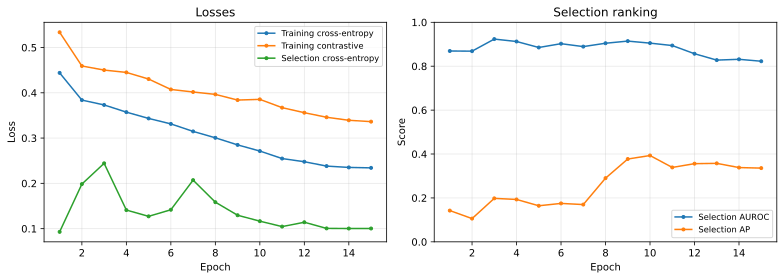
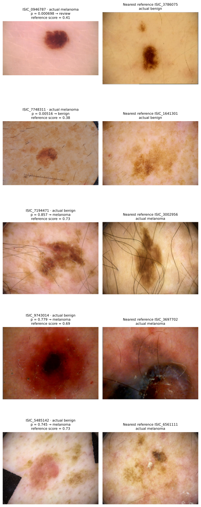

# Siamese Metric Learning for Melanoma Triage (ISIC 2020)

## Summary

Melanoma is rare in screening images: 1.8% of ISIC 2020 images, 1.57% of the final test group. A classifier can therefore reach high accuracy while missing most melanomas and still sounding confident. This project trains a shared ResNet-18 encoder with cross-entropy and, for the Siamese model, a contrastive loss over every image pair in each batch. It then turns the model into a three-way triage:

1. **Melanoma.** The calibrated classifier probability is above a threshold that keeps about 80% accuracy.
2. **Review.** Otherwise, the image is sent for review if it sits closer to labelled training melanomas than to training benign images (the **reference score**).
3. **Benign.** Everything else.

The baseline is the identical network and recipe with the contrastive weight set to 0.

The main results come from **five training seeds per model**, all scored once on 288 held-out patients (4,728 images, 74 melanomas):

| Final test, mean ± sd over 5 seeds | Baseline | Siamese |
| --- | ---: | ---: |
| Accuracy (decision threshold) | 0.824 ± 0.011 | 0.830 ± 0.008 |
| Melanoma recall / precision | 0.765 / 0.065 | 0.749 / 0.066 |
| AUROC | 0.871 ± 0.033 | 0.865 ± 0.025 |
| Melanoma AP (PR-AUC) | 0.195 ± 0.010 | 0.176 ± 0.027 |
| Images sent to a specialist (triage workload) | 31.6% | 31.8% |
| Melanomas reaching a specialist (triage capture) | 88.9% | 90.5% |

**Findings and recommendation**

- **The tasksheet's ~0.8 test accuracy is met** by every one of the 10 checkpoints (0.81–0.84), with about three-quarters of melanomas flagged.
- **Contrastive training gives no measurable benefit** over the identical classification-only baseline.
- **Classifier confidence barely identifies its own errors** (error-detection AUROC 0.57).
- **Comparing each image with labelled training references** (the Siamese comparison) is the most reliable part of the system:
  - it ranks the melanomas the classifier missed better than confidence does (0.81–0.84 against 0.72–0.74);
  - it is far steadier between seeds than the classifier.
- **Recommendation:** keep the simpler baseline encoder and route review through reference comparison. Do not auto-clear images: about 1 in 10 melanomas still falls below the review threshold.

## Contents

- [Problem and Algorithm](#problem-and-algorithm)
- [Feasibility Review](#feasibility-review)
- [Data, Pre-processing and Splits](#data-pre-processing-and-splits)
- [Training and Decision Rules](#training-and-decision-rules)
- [How the Recipe Was Developed](#how-the-recipe-was-developed)
- [Results](#results)
- [Investigating the Confidence Dilemma](#investigating-the-confidence-dilemma)
- [Failure Case Autopsy](#failure-case-autopsy)
- [Resource Profile](#resource-profile)
- [Recommendation and Limitations](#recommendation-and-limitations)
- [Reproducing the Study](#reproducing-the-study)
- [Artificial Intelligence Usage Disclosure](#artificial-intelligence-usage-disclosure)
- [References](#references)

## Problem and Algorithm

**Problem.** Given one dermoscopic lesion image, decide whether it is melanoma, and decide when the model should not be trusted so the image goes to a specialist. Three difficulties dominate:

- **Extreme imbalance:** 584 of 33,126 images are melanoma.
- **Visual mimicry:** atypical benign naevi look like early melanoma.
- **Imaging artifacts:** hair, rulers, dark vignettes and ink marks.

The engineering question set by the tasksheet is whether the model's confidence, or its embedding distance, tracks correctness well enough to automate the confident cases and route the ambiguous ones.

**How it works.** A Siamese network compares inputs with *shared* weights, as in Koch et al. [11]. Here one ResNet-18 [4] encodes every image into 512 features.

- **Two outputs:**
  - a linear layer turns the features into benign/melanoma logits;
  - a unit-length copy of the same features is the **embedding** used to compare images.
- **Training:** each batch of 32 images forms all $\binom{32}{2}=496$ unordered pairs. The contrastive loss of Hadsell et al. [3] pulls same-class pairs together and pushes melanoma–benign pairs at least a margin apart. It is added to cross-entropy.
- **Prediction:** a single forward pass gives:
  - a calibrated melanoma probability, used for the 80%-accuracy decision;
  - an embedding, compared with 838 labelled training references to give a reference score that decides whether a cleared image still needs review.


**Pair generation strategy.**

- **Image sampling:** a class-weighted sampler draws training images so that 15% are melanomas, about 4.8 per batch.
- **Pairs per batch:** about 10 melanoma–melanoma pairs, 150 melanoma–benign pairs and 330 benign–benign pairs. All of them use the same forward pass, so pairs cost no extra encoder evaluations.
- **Balancing:** positive-pair and negative-pair losses are averaged separately and then added, so the many benign–benign pairs cannot swamp the melanoma pairs.
- **Loss:** let $d_{ij}$ be the Euclidean distance between unit embeddings, $P$ and $N$ the same-class and different-class pairs, $m=1$ the margin and $\lambda$ the contrastive weight (0 for the baseline, 0.5 for the Siamese model):

$$
L = L_{\mathrm{CE}}^{\text{smooth}=0.1} + \lambda\left[\frac{1}{|P|}\sum_{(i,j)\in P} d_{ij}^2 + \frac{1}{|N|}\sum_{(i,j)\in N} \max(0,\, m-d_{ij})^2\right]
$$

**Reference score.** Let $\bar d_{\text{benign}}$ and $\bar d_{\text{melanoma}}$ be the mean distances from a query embedding to its 15 nearest benign and 15 nearest melanoma training references. The score is

$$
r = \frac{\bar d_{\text{benign}}}{\bar d_{\text{benign}} + \bar d_{\text{melanoma}}}
$$

so $r=0.5$ means the query is equally close to both classes, and higher means more melanoma-like. The gallery holds all 419 training melanomas and 419 randomly chosen training benign images.

| File | Contents |
| --- | --- |
| `modules.py` | `MelanomaModel` (shared encoder, classifier, embedding), `contrastive_loss`, `nearest_references` (PyTorch only) |
| `dataset.py` | ISIC loading, patient-level split creation, augmentation, class-weighted sampler |
| `train.py` | Training loop, per-epoch selection metrics and loss plots, checkpoint selection, calibration of every decision rule |
| `predict.py` | Loads a checkpoint, triages one patient group, prints every prediction, saves metrics and figures |
| `compare.py` | Paired patient-cluster bootstrap of baseline against Siamese |
| `utils.py` | Device choice, data loaders, scoring, Platt scaling, thresholds, metrics, memory profiling |
| `visualisation.py` | Architecture, training, ROC/PR/reliability, embedding and failure-case figures |
| `configs/*.yaml` | `baseline`, `siamese`, and the ablations `siamese_light` and `scratch` |

## Feasibility Review

This is the one-page review presented at the midpoint check-off. The **Outcome** column records the result at submission.

**User need and scope.** The intended user is a specialist reviewing dermoscopic images. The prototype labels clear melanomas and prioritises uncertain cases for human review. It uses existing labelled images. It does not measure human diagnostic accuracy or clinical effectiveness.

**Research question.** Does Siamese metric learning, together with comparison against labelled training references, identify unreliable predictions and reduce review workload at high melanoma recall, compared with the same CNN trained only to classify?

| Acceptance criterion | Target | Outcome |
| --- | --- | --- |
| Patient separation | No patient in more than one of training, selection, calibration and final groups | **Met.** Whole patients are assigned by a fixed manifest; the 425 published duplicate pairs all share a patient, so they never cross groups. |
| Classification | About 0.8 test accuracy; per-class precision, recall and F1, macro-F1, AUROC and PR curves | **Met.** Final accuracy 0.81–0.84 on all 10 checkpoints; every metric is reported below. |
| Review rule | At least 95% melanoma capture on calibration patients | **Met on calibration (96%). Not met on final** (mean 89–90%; see [Limitations](#recommendation-and-limitations)). |
| Added value | Compare confidence-based and reference-based review; inspect 3–5 failures | **Met.** Reference comparison ranks missed melanomas better and is steadier; five failures are analysed. |
| Local resources | Each run under two hours and 24 GiB memory on a laptop GPU | **Met.** 17 minutes per run, 4.4 GiB peak GPU memory, 0.8 GiB process memory. |

**Model choice and course concepts.**

- **Task and tools:** the Hard-difficulty Siamese task, implemented in PyTorch.
- **Backbone:** ResNet-18 [4] is a small residual CNN that suits 384-pixel images on a laptop GPU.
- **Course concepts:** shared-weight pairs, a contrastive loss, transfer learning, data augmentation, class rebalancing and probability calibration.
- **Weights:** the encoder starts from ImageNet weights. Training from scratch is measured as an ablation to justify this choice.

**Preliminary evidence.**

- Patient-level metadata audit: 2,056 patients, with 2–115 images each.
- Five-epoch pilots: about 28 minutes and 1.2 GiB process memory.
- One-epoch smoke test of the final recipe: calibration AUROC 0.907.

**Risks, budget and fallback.**

- **Risks:**
  - Too few melanomas (419 for training, 41–74 per evaluation group), which makes memorisation and noisy evaluation the main risks.
  - Confidently wrong predictions.
- **Budget:** about 6 GPU-hours.
- **Fallback:** the classification-only baseline, which is also the planned control. If Siamese learning brings no benefit, the recommendation falls back to it.

## Data, Pre-processing and Splits

**Data.** The SIIM-ISIC 2020 training set [1, 2]: 33,126 JPEG images from 2,056 patients, of which 584 are melanoma. Labels come from `ISIC_2020_Training_GroundTruth_v2.csv`.

**Splits.** Whole patients are assigned to one group each, stratified by whether the patient has any melanoma. Seeds 42, 20261007 and 20261008 are fixed in `dataset.py`.

| Group | Patients | Images | Melanomas | Used for |
| --- | ---: | ---: | ---: | --- |
| Training | 1,460 | 23,584 | 419 | Learning weights; reference gallery |
| Selection | 154 | 2,438 | 41 | Choosing the epoch (validation) |
| Calibration | 154 | 2,376 | 50 | Fitting probability scaling and all thresholds |
| Final | 288 | 4,728 | 74 | One-off test of the frozen models and rules |

**Why patient-level splits.** Each patient contributes between 2 and 115 lesion photographs, often taken in the same session. An image-level split would place a patient's other lesions, and the 425 duplicate pairs, in both training and test, which inflates every metric.

**Why four groups.**

- Choosing the epoch, fitting thresholds and testing each need data the earlier step has not seen.
- Thresholds fitted on the test set would make the reported accuracy circular.
- Training includes 308 "development" patients that early experiments had examined. They are never used for evaluation.

**Natural prevalence.** Evaluation groups keep the natural 1.6–2.1% melanoma rate, so precision and workload are realistic.

**Pre-processing.**

- **Every image:**
  - JPEG draft decoding at the target size, which is 4–5× faster on the 6000 × 4000 originals;
  - EXIF orientation correction and RGB conversion;
  - ImageNet mean/std normalisation.
- **Evaluation:** resize the shorter side to 384 pixels, then centre-crop to 384 × 384.
- **Training augmentation:**
  - random resized crops covering 35–100% of the image;
  - horizontal and vertical flips;
  - rotation up to ±45° with mean-colour fill;
  - colour jitter (brightness, contrast, saturation 0.2; hue 0.02).
- **Why these choices:**
  - Lesions have no canonical orientation, so flips and rotations are label-preserving.
  - Crops and colour jitter imitate different dermoscopes and zoom levels, as studied by Perez et al. [9].
  - 384 pixels keeps fine pigment-network detail that a 224-pixel input loses.

## Training and Decision Rules

| Setting | Value | Reason |
| --- | --- | --- |
| Initialisation | ImageNet ResNet-18 [6] | Scratch training reaches less than half the melanoma AP (see [Ablations](#ablations)) |
| Sampler | 15% melanoma per epoch, 23,584 draws | Every batch has melanoma pairs. Each training melanoma is seen about 8 times per epoch, against about 365 times per run under the earlier 50/50 pair sampler. |
| Loss | Cross-entropy with label smoothing 0.1, plus 0.5 × contrastive (Siamese) | Smoothing stops logits saturating on memorised melanomas |
| Optimiser | AdamW [10], peak rate 2e-4, weight decay 0.05, batch 32 | Strong regularisation for 419 positives |
| Schedule | One-cycle: 10% linear warm-up, then cosine decay over 8 epochs | Longer runs overfit (see [How the Recipe Was Developed](#how-the-recipe-was-developed)) |
| Precision | bfloat16 autocast | About 1.5× faster on Apple MPS |
| Checkpoint | Epoch with the best selection AUROC | AUROC uses all 2,438 selection images; AP over 41 melanomas is too noisy to pick epochs |

Every rule is fitted **on calibration patients only** and stored in the checkpoint:

1. **Probability scaling.** Platt scaling [5]: logistic regression on the classifier's logit margin, which turns scores into probabilities near the real melanoma rate.
2. **Decision threshold.** The 80th percentile of calibration benign probabilities. About 80% of benign images are then cleared, and because 98% of images are benign, accuracy lands near 0.8, the tasksheet target.
3. **Review threshold.** The highest reference score that still puts at least 95% of calibration melanomas at or above it.
4. **Triage.** The probability decides **melanoma** at or above threshold 2. Otherwise the reference score decides **review** at or above threshold 3. The rest are **benign**.

## How the Recipe Was Developed

The project went through one invalid design before the current pipeline. That history is kept short here because it shaped every choice above.

**Earlier design (superseded).**

- **Setup:** pairs sampled half same-class and half different-class, 30 epochs at 224 pixels, checkpoint chosen by selection AP, and softmax thresholds tuned for 90% recall. Each run took about 2.6 hours.
- **Why it failed:**
  - With only 337 training melanomas then, each was presented about **365 times**, so the models memorised them.
  - Selection AP of 0.32 fell to 0.14 on the final group.
  - Softmax scores saturated, so the "90% recall" thresholds were about $10^{-6}$.
  - At those thresholds, final accuracy was 62–67%, which fails the ~0.8 target. At 0.5 the accuracy was 98%, but only 7–14% of melanomas were found.
  - 70–79% of each melanoma query's five nearest references were benign, so reference review added nothing.
- **What survives:** these models were scored once on the final group and are **not** reported as results. Their failure motivated the redesign, so the final group is no longer completely untouched (see [Limitations](#recommendation-and-limitations)).

**Current pipeline.** Decided on selection and calibration patients only:

1. **Rebuild against memorisation.**
   - Changes: moderate image oversampling (15%) with all in-batch pairs, label smoothing, stronger augmentation and weight decay, 384-pixel inputs, Platt scaling, an 80%-specificity decision threshold and AUROC-based checkpointing. The 308 development patients were added to training (419 melanomas).
   - Speed-ups (JPEG draft decoding, bfloat16, 12 loader workers) cut training from 2.6 hours to 17 minutes.
2. **Shorten training from 15 to 8 epochs.**
   - In 15-epoch runs, selection AUROC peaked at epochs 3–6, then fell steadily, for example 0.924 down to 0.822 for the baseline (figure below).
   - On calibration, the 8-epoch baseline raised melanoma AP from 0.195 to 0.270 in half the time.
3. **Make the reference score continuous.**
   - The first version was a 15-neighbour vote, which can only take 16 values.
   - Seven of 50 calibration melanomas had no melanoma neighbour, so reaching 95% recall needed a threshold of 0: **every** image went to review.
   - The distance ratio fixed this: 39% workload at 96% recall for the same checkpoint.
4. **Repeat with five seeds** (42, 43, 44, 67, 69) per model, plus two ablations. With 41–74 melanomas per group, one seed cannot separate the two models.
5. **Route review through the reference score** instead of classifier probability. The reason was the classifier's review workload, which swung from 26% to 91% between seeds on calibration. This was decided and committed before final scoring.



## Results

### Training Curves (8-epoch recipe, seed 42)

Training cross-entropy falls steadily. Selection AUROC peaks mid-run (epoch 5 for the baseline, 3 for the Siamese model) while selection AP keeps rising. Selection cross-entropy is noisy because 41 melanomas dominate it.

The "training contrastive" line in the baseline plot is only monitored (weight 0). It falls anyway, because cross-entropy alone already groups the classes. The Siamese model drives it from 0.42 to 0.16.


### Benchmark Across Seeds

Each cell is mean ± sd over 5 training seeds, with rules frozen on calibration. **Calibration** numbers are partly in-sample, because the thresholds were fitted there. **Final** numbers are the held-out test.

| Measure | Baseline: calibration | Siamese: calibration | Baseline: final | Siamese: final |
| --- | ---: | ---: | ---: | ---: |
| AUROC | 0.873 ± 0.046 | 0.897 ± 0.013 | 0.871 ± 0.033 | 0.865 ± 0.025 |
| Melanoma AP | 0.301 ± 0.034 | 0.257 ± 0.050 | 0.195 ± 0.010 | 0.176 ± 0.027 |
| Brier score | 0.017 | 0.018 | 0.014 | 0.014 |
| Accuracy | 0.799 ± 0.002 | 0.800 ± 0.001 | 0.824 ± 0.011 | 0.830 ± 0.008 |
| Macro-F1 | 0.516 | 0.517 | 0.511 ± 0.007 | 0.514 ± 0.007 |
| Melanoma recall | 0.816 ± 0.074 | 0.824 ± 0.036 | 0.765 ± 0.064 | 0.749 ± 0.051 |
| Melanoma precision | 0.080 | 0.081 | 0.065 ± 0.006 | 0.066 ± 0.005 |
| Reference-score AUROC | 0.918 ± 0.005 | 0.911 ± 0.009 | 0.892 ± 0.011 | 0.889 ± 0.016 |
| Triage workload | 35.7% | 36.9% | 31.6% ± 4.7 | 31.8% ± 2.8 |
| Triage melanoma capture | 96.4% | 96.0% | 88.9% ± 6.0 | 90.5% ± 4.6 |

Final results for each checkpoint (74 melanomas). Workload and capture refer to the full triage:

| Seed | Baseline AUROC / AP | Baseline accuracy / recall | Baseline workload / capture | Siamese AUROC / AP | Siamese accuracy / recall | Siamese workload / capture |
| --- | --- | --- | --- | --- | --- | --- |
| 42 | 0.858 / 0.189 | 0.828 / 0.689 | 26.7% / 79.7% | 0.824 / 0.142 | 0.828 / 0.662 | 29.4% / 83.8% |
| 43 | 0.906 / 0.193 | 0.826 / 0.865 | 27.5% / 94.6% | 0.892 / 0.191 | 0.823 / 0.770 | 33.0% / 94.6% |
| 44 | 0.904 / 0.187 | 0.826 / 0.770 | 35.0% / 93.2% | 0.878 / 0.185 | 0.834 / 0.743 | 31.6% / 87.8% |
| 67 | 0.854 / 0.211 | 0.834 / 0.743 | 37.5% / 90.5% | 0.859 / 0.208 | 0.842 / 0.784 | 36.0% / 93.2% |
| 69 | 0.831 / 0.195 | 0.806 / 0.757 | 31.3% / 86.5% | 0.870 / 0.156 | 0.823 / 0.784 | 29.3% / 93.2% |

**What the tables show.**

- **No clear winner.** The two models are tied within one standard deviation on every measure. The baseline is slightly ahead on AP, and the Siamese classifier is slightly steadier on AUROC.
- **Calibration flatters.** AP drops from about 0.28 to about 0.19 on final. Calibration and selection have only 41–50 melanomas each, so whichever epoch or threshold looks best there is partly chosen for noise.
- **The reference score is the steadiest ranking.** Its AUROC varies by 0.005–0.016 between seeds, against 0.013–0.046 for the classifier.

### Paired Comparison, Seed 42 (Final)

The intervals come from 2,000 paired patient-cluster bootstrap draws [7], stratified by whether a patient has melanoma. Both models are scored on the same resampled patients.

| Final measure | Baseline [95% CI] | Siamese [95% CI] | Siamese − baseline [95% CI] |
| --- | ---: | ---: | ---: |
| AUROC | 0.858 [0.807, 0.902] | 0.824 [0.766, 0.876] | −0.034 [−0.084, 0.013] |
| Melanoma AP | 0.189 [0.111, 0.310] | 0.142 [0.082, 0.242] | −0.048 [−0.120, 0.024] |
| Decision recall | 0.689 [0.573, 0.797] | 0.662 [0.551, 0.766] | −0.027 [−0.129, 0.080] |
| Decision precision | 0.061 [0.048, 0.075] | 0.058 [0.046, 0.073] | −0.002 [−0.012, 0.007] |
| Decision accuracy | 0.828 [0.802, 0.852] | 0.828 [0.798, 0.854] | −0.001 [−0.017, 0.013] |
| Triage workload | 0.267 [0.233, 0.307] | 0.294 [0.255, 0.337] | **+0.026 [0.012, 0.041]** |
| Triage capture | 0.797 [0.694, 0.890] | 0.838 [0.743, 0.921] | +0.041 [−0.055, 0.137] |

The only interval that excludes zero is triage workload: the Siamese model sends 2.6 points more images to review. Seed 42 happens to be the lowest-recall seed for both models (table above), which is why reporting a single seed would mislead.

### Per-Class Metrics and Confusion Matrices, Seed 42 (Final)

Melanoma is the positive class. These are the 80%-accuracy decisions before the review stage.

| Seed-42 final, decision threshold | Baseline | Siamese |
| --- | ---: | ---: |
| Benign precision / recall / F1 | 0.994 / 0.830 / 0.905 | 0.994 / 0.830 / 0.905 |
| Melanoma precision / recall / F1 | 0.061 / 0.689 / 0.112 | 0.058 / 0.662 / 0.107 |
| Macro-F1 | 0.508 | 0.506 |
| Accuracy | 0.828 | 0.828 |
| True benign / false melanoma (TN / FP) | 3,865 / 789 | 3,864 / 790 |
| Missed / found melanomas (FN / TP) | 23 / 51 | 25 / 49 |

Melanoma precision is low by design. At 1.57% prevalence, flagging 18% of images to catch most melanomas means about 15 benign images per melanoma flagged. Accuracy alone hides this: predicting "benign" for every image would score 98.4%.

### ROC, Precision-Recall and Reliability (Seed 42, Final)

- **ROC and PR panels:** the classifier (teal) and reference score (purple), with the frozen decision point (circle) and reference review point (square).
- **Reliability panel:** after Platt scaling, binned predicted probabilities follow the observed melanoma rate, so the probabilities are well calibrated *on average*. The Brier score of 0.014 is only modestly better than the 0.0154 of always predicting the prevalence.


### Embeddings (Seed 42, Final)

These are 2D PCA projections fitted only on the 838 training references (circles), then applied to final images (crosses).

- **In both models:**
  - Benign references form a dense cluster on the left, and melanoma references spread to the right.
  - Many final melanomas fall inside the benign cluster. These are the cases that both the classifier and the reference score find hard.
- **Contrastive loss tightens the benign cluster** (PC1 explains 51% of variance against 44%). It does not pull these hard test melanomas out of it, which matches the lack of a classification gain.
- **Caveat:** two components hold only 61–67% of the reference variance, so overlap in the plot does not prove overlap in 512 dimensions. The reference-score AUROC (0.88–0.89) measures separation in the full space.


### Ablations

These were measured on calibration only; they were not scored on the final group.

| Calibration, mean over seeds | Seeds | AUROC | AP | Reference AUROC | Triage workload |
| --- | ---: | ---: | ---: | ---: | ---: |
| Baseline (contrastive weight 0) | 5 | 0.873 | 0.301 | 0.918 | 35.7% |
| Light Siamese (weight 0.25) | 3 | 0.889 | 0.277 | 0.914 | 37.1% |
| Siamese (weight 0.5) | 5 | 0.897 | 0.257 | 0.911 | 36.9% |
| Baseline from scratch (15 epochs, rate 1e-3) | 1 | 0.885 | **0.120** | 0.869 | 46.1% |

- **Contrastive weight:** a lighter weight does not recover the baseline's AP, so the contrastive term is not simply too strong.
- **Training from scratch:**
  - It was still improving at epoch 14, and its selection AUROC peaked at only 0.846.
  - On calibration it finds melanomas less than half as well (AP 0.120 against 0.301) and needs 10 points more review workload.
  - With 419 training melanomas, ImageNet initialisation is a measured necessity rather than a shortcut. The scratch run also had a higher learning rate and more epochs, so it is not a one-variable comparison.

## Investigating the Confidence Dilemma

**Does confidence track correctness?** An error is a wrong decision at the 80%-accuracy threshold.

- **Confidence** is the distance of the log-odds from the threshold.
- **Reference disagreement** is $|r - \hat y|$, where $\hat y$ is 1 if the image is flagged as melanoma and 0 if not.
- **How to read the error-detection AUROCs:** 1.0 means every error is less confident than every correct decision; 0.5 is chance.

| Final, mean ± sd over 5 seeds | Baseline | Siamese |
| --- | ---: | ---: |
| Error detection by classifier confidence | 0.565 ± 0.040 | 0.566 ± 0.065 |
| Error detection by reference disagreement | 0.971 ± 0.014 | 0.962 ± 0.034 |
| Missed-melanoma ranking among cleared images: reference score | **0.814 ± 0.022** | **0.843 ± 0.030** |
| Missed-melanoma ranking among cleared images: classifier probability | 0.724 ± 0.141 | 0.736 ± 0.094 |

**Confidence.** The classifier is overconfident where it matters: its confidence is barely better than chance at finding its own errors. Most errors are confident false alarms on pigmented benign lesions.

**Reference disagreement.** It looks excellent, but this mostly reflects the same false alarms. A benign image flagged as melanoma usually still sits nearer benign references.

**Missed melanomas.** The safety-relevant test is the last two rows: among the images the classifier cleared as benign, which score ranks the missed melanomas higher?

- The reference score wins for 9 of the 10 checkpoints.
- It is also several times steadier between seeds (sd 0.02–0.03 against 0.09–0.14).
- The Siamese embedding is slightly better at this rescue ranking (0.843 against 0.814). This is the only place contrastive training helps, and the gap is about one standard deviation.

**Review rule stability.** On calibration, with both rules targeting 96% recall:

| Calibration, 5 seeds each | Classifier-probability review | Reference-score review |
| --- | ---: | ---: |
| Baseline workload, mean ± sd (range) | 51% ± 24 (36–91%) | 34% ± 6 (28–42%) |
| Siamese workload, mean ± sd (range) | 39% ± 9 (27–48%) | 37% ± 4 (33–42%) |

- **Why the classifier's rule swings:** the 95%-recall cut sits below the 48th of 50 melanomas, so two or three badly scored melanomas can drag it down far enough to flag 91% of images.
- **Why the reference score holds:** it measures similarity to hundreds of references and degrades more gracefully.

## Failure Case Autopsy

These five cases come from the seed-42 baseline on the final group:

- the two lowest-scored melanomas;
- the three highest-scored benign images.

Each is shown beside its nearest training reference. The visual triggers named below are hypotheses from inspection; no controlled intervention tested them.



1. **Melanoma rescued only by references: `ISIC_0946787`, p = 0.0007 → review.**
   - **Image:** a compact, dark, evenly coloured oval on smooth pink skin. This is the textbook appearance of a benign naevus, so the classifier is confidently wrong.
   - **Nearest reference:** a benign pigmented lesion.
   - **Outcome:** the reference score of 0.41 is just above the 0.40 review threshold, so the image reaches a specialist anyway. This is the rescue case the triage is designed for.
   - **Trigger:** mimicry of benign symmetric naevi.
2. **Missed melanoma: `ISIC_7748311`, p = 0.005 → benign.**
   - **Image:** a light-brown, low-contrast lesion with an irregular edge, overlaid by hair and a ruler scale.
   - **Nearest reference:** a benign light-brown reticular lesion.
   - **Outcome:** the reference score of 0.38 also falls below the threshold, so both views agree and both are wrong.
   - **Trigger:** low contrast plus artifacts, with an early melanoma that resembles benign reticular naevi.
3. **False alarm: `ISIC_7194471`, p = 0.86 → melanoma.**
   - **Image:** a large, irregular, multi-toned brown lesion covered by dense hair.
   - **Nearest reference:** a melanoma with the same elongated brown shape under hair (reference score 0.73).
   - **Trigger:** asymmetry and colour variegation, which are real melanoma warning signs. This is a reasonable referral rather than a model fault.
4. **False alarm: `ISIC_9743014`, p = 0.78 → melanoma.**
   - **Image:** a very dark centre with a red, inflamed halo.
   - **Nearest reference:** a dark, ulcerated melanoma.
   - **Trigger:** dark pigment and redness, possibly an irritated or traumatised naevus. The model has learned "very dark plus red" as melanoma.
5. **False alarm: `ISIC_5485142`, p = 0.75 → melanoma.**
   - **Image:** a pink lesion surrounded by scattered brown macules, with black dermoscope vignette corners.
   - **Nearest reference:** a melanoma photographed in a similar multi-spot field.
   - **Trigger:** the frame artifact and the busy background, rather than the lesion itself.

**Patterns.**

- False alarms are driven by dark, irregular or artifact-heavy images, and are *confident* (p ≥ 0.75), so confidence cannot flag them.
- Missed melanomas look like benign naevi. The reference score rescues some of them (case 1), but not those whose nearest references are themselves benign look-alikes (case 2).

## Resource Profile

Measured on an Apple M5 Pro (18-core CPU, integrated GPU, 48 GB unified memory), macOS, PyTorch 2.13 MPS backend.

| Measure | Baseline | Siamese |
| --- | ---: | ---: |
| Parameters | 11,177,538 | 11,177,538 |
| Training time, 8 epochs | 0.28 h (17 min) | 0.28 h (17 min) |
| Peak GPU memory, training (MPS driver allocation) | 4.39 GiB | 4.39 GiB |
| Peak GPU memory, inference | 2.08 GiB | 2.08 GiB |
| Peak process memory (RSS), training | 0.77 GiB | 0.79 GiB |
| Forward latency, preloaded 32-image batch at 384² (bf16) | 43.9 ms (1.4 ms/image) | 43.8 ms (1.4 ms/image) |
| End-to-end throughput, including JPEG decoding | 56 images/s | 56 images/s |
| Reference gallery | 838 embeddings (1.7 MB) | 838 embeddings (1.7 MB) |

**Notes on the measurements.**

- Latency is the mean of 10 timed batches after 3 warm-up batches, with device synchronisation. It excludes image loading.
- End-to-end throughput covers the whole final group, including loader start-up.
- The reference search is one 4,728 × 838 distance matrix; it was not timed separately because its cost is negligible beside the encoder.
- The contrastive loss adds no measurable training time, because it reuses the batch's embeddings, and it changes nothing at inference.

## Recommendation and Limitations

**Recommendation to the project manager**

1. **Use the baseline encoder.**
   - Siamese contrastive training costs nothing extra, but it showed no benefit over 5 seeds.
   - It lowered AP slightly and, for seed 42, needed significantly more review workload.
   - The simpler model is easier to maintain and explain.
2. **Keep the Siamese comparison at inference.**
   - Comparing each image with 838 labelled training references is the most useful uncertainty signal measured here.
   - It costs about one distance matrix, ranks missed melanomas better than the classifier's own confidence, and keeps review workload stable across retrains.
   - It also shows the reviewer the nearest confirmed cases, which gives an explanation the probability does not.
3. **Operating policy.**
   - About 18% of images are flagged as likely melanoma, and a further ~14% are routed to review by reference score.
   - The remaining ~68% are *deprioritised, not discarded*.
4. **Do not auto-clear yet.**
   - On final patients the triage caught 89–90% of melanomas on average, not the 95% it was calibrated for.
   - Across seeds, capture ranged from 80% to 95%: roughly 4–15 of the 74 final melanomas would have been cleared.
   - Safe automation needs a larger calibration set, so the 95% cut is estimated from hundreds of melanomas rather than 50, plus prospective validation.

**Limitations**

- **Small positive counts.**
  - With 41, 50 and 74 melanomas in selection, calibration and final, every recall and capture figure has wide intervals; final capture of 79.7% has a 95% interval of [69%, 89%].
  - Choosing epochs and thresholds on such small groups is optimistic: AP fell from about 0.28 to 0.19 between calibration and final.
- **Final group used twice.**
  - The superseded models were scored on these patients once before.
  - No model, threshold or rule was changed after the current final scoring, and the review rule was fixed before it.
  - However, the redesign was motivated partly by those earlier final results, so a small optimistic bias cannot be excluded.
- **One dataset, no external cohort.** ISIC 2020 comes from a few institutions; the results may not transfer to other dermoscopes or populations.
- **Capture is not diagnosis.** Reaching review does not mean a specialist diagnoses the lesion correctly.
- **Non-determinism.** Seeds fix sampling, initialisation and the gallery. Re-running the seed-42 baseline reproduced its first epochs' selection metrics exactly on this machine, but GPU kernels may differ on other hardware.

**Future work**

- A larger calibration set, possibly pooling calibration and selection with cross-fitting.
- Lesion-preserving crops or hair removal to target the artifact failures.
- A gallery that includes hard benign look-alikes.
- Testing on an external cohort such as ISIC 2019 or HAM10000.

## Reproducing the Study

### Environment

- **Software:**
  - Python 3.14.6
  - torch 2.13.0, torchvision 0.28.0, numpy 2.5.1, pillow 12.3.0
  - scikit-learn 1.9.0, PyYAML 6.0.3, matplotlib 3.11.1
- **Device:** CUDA, Apple MPS and CPU are chosen automatically, in that order.
- **Working directory:** run every command from the repository root (`PatternAnalysis-2026`).

```bash
python3 -m venv .venv
source .venv/bin/activate
pip install -r recognition/Siamese_ISIC2020_Melanoma_47472442/requirements.txt
```

### Data and Splits

1. Download the ISIC 2020 training JPEGs and `ISIC_2020_Training_GroundTruth_v2.csv` [1] into `data/` at the repository root. Images may sit in any subfolder.
2. Create the fixed patient manifest (`data/splits/isic_protocol.json`):

```bash
python -m recognition.Siamese_ISIC2020_Melanoma_47472442.dataset
# train: 23584 images, 1460 patients, 419 melanomas
# selection: 2438 images, 154 patients, 41 melanomas
# calibration: 2376 images, 154 patients, 50 melanomas
# final: 4728 images, 288 patients, 74 melanomas
```

### Training

Each run writes to `data/runs/<run-name>/`:

- `checkpoint.pt`, holding the weights, config, calibrated rules and reference gallery;
- `metrics.json`;
- `training.svg`.

A run never loads final patients. `--seed` changes the training seed only; patient splits stay fixed.

```bash
C=recognition/Siamese_ISIC2020_Melanoma_47472442/configs
python -m recognition.Siamese_ISIC2020_Melanoma_47472442.train $C/baseline.yaml             # data/runs/baseline
python -m recognition.Siamese_ISIC2020_Melanoma_47472442.train $C/siamese.yaml              # data/runs/siamese
for seed in 43 44 67 69; do
  python -m recognition.Siamese_ISIC2020_Melanoma_47472442.train $C/baseline.yaml --seed $seed --run-name baseline_seed$seed
  python -m recognition.Siamese_ISIC2020_Melanoma_47472442.train $C/siamese.yaml --seed $seed --run-name siamese_seed$seed
done
# Ablations: $C/siamese_light.yaml (seeds 42-44, run names siamese_light_seed<seed>) and $C/scratch.yaml
```

Training prints one line per epoch, then the calibrated rules:

```text
epoch=5.0000, train_cross_entropy=0.3240, train_contrastive=0.4039, selection_cross_entropy=0.1087, selection_auroc=0.9327, selection_average_precision=0.2706
```

### Prediction

`predict.py` restores a checkpoint, triages a patient group (`selection`, `calibration` or `final`) and prints one CSV row per image. It saves the following to `data/runs/<run>/<partition>/`:

- `predictions.csv`;
- `metrics.json`;
- `curves.svg`, `embeddings.svg` and `cases.svg`.

```bash
python -m recognition.Siamese_ISIC2020_Melanoma_47472442.predict data/runs/baseline/checkpoint.pt --partition final
```

Example output: real rows from the seed-42 baseline on final patients. The columns are the true label, the calibrated probability, the reference score and the triage decision.

```text
image_name,patient_id,actual,probability,reference_score,decision
ISIC_0286360,IP_7729044,1,0.127255,0.531,melanoma
ISIC_0327406,IP_7069391,1,0.0103555,0.427,review
ISIC_0153549,IP_3203470,0,0.00263032,0.415,review
ISIC_0247330,IP_3232631,1,0.0125214,0.384,benign
ISIC_0082348,IP_7684360,0,0.00584584,0.306,benign
...
```

It ends with a summary of the classifier, reference and triage metrics. For this run the summary reports AUROC 0.858, decision accuracy 0.828, triage workload 26.7% and triage capture 79.7%.

### Comparison and Figures

```bash
# Paired patient bootstrap, seed 42 (Markdown table)
python -m recognition.Siamese_ISIC2020_Melanoma_47472442.compare \
  data/runs/baseline/final/predictions.csv data/runs/siamese/final/predictions.csv
# Redraw figures/architecture.svg
python -m recognition.Siamese_ISIC2020_Melanoma_47472442.visualisation
```

The report figures in `figures/` are copies of the generated run figures:

- `training_*.svg` from `train.py`;
- `final_*.svg` from `predict.py --partition final`.

## Artificial Intelligence Usage Disclosure

**Tools.**

- OpenAI Codex, during the first design phase.
- Anthropic Claude (Claude Code, Claude Opus), during the redesign and evaluation phase.

**What AI assisted with.**

- **Codex:** scaffolding the first data loader, training loop and plotting code; the review of 2025 submissions; early report drafts.
- **Claude:**
  - diagnosing why the first design overfitted;
  - refactoring the codebase (from about 4,200 lines to about 840);
  - the in-batch contrastive loss;
  - the continuous reference score;
  - throughput optimisation;
  - queuing the multi-seed experiments;
  - computing the summary statistics;
  - drafting this README.

**How it was verified.**

- The vectorised contrastive loss was checked against an explicit loop over every pair, including a batch with no melanoma.
- The refactored split code reproduced the existing patient manifest exactly.
- The reference score passed a toy check: a query placed on a melanoma reference scores above 0.5, and one placed on a benign reference scores below.
- Every reported number was recomputed from the saved `predictions.csv` and `metrics.json` files. Bootstrap intervals come from `compare.py`, and multi-seed statistics from the saved per-run metrics.
- Failure cases were inspected visually.
- The final group was scored only after the models and rules were frozen.

The author is responsible for the code and every claim in this report.

## References

ISIC 2020 images are used under CC BY-NC 4.0. Figures show this project's own results; reference images come only from training patients.

1. International Skin Imaging Collaboration. [SIIM-ISIC 2020 Challenge Dataset](https://doi.org/10.34970/2020-ds01), 2020.
2. Rotemberg et al. [A patient-centric dataset of images and metadata for identifying melanomas using clinical context](https://doi.org/10.1038/s41597-021-00815-z). *Scientific Data*, 2021.
3. Hadsell, Chopra and LeCun. [Dimensionality Reduction by Learning an Invariant Mapping](https://doi.org/10.1109/CVPR.2006.100). *CVPR*, 2006.
4. He et al. [Deep Residual Learning for Image Recognition](https://arxiv.org/abs/1512.03385). *CVPR*, 2016.
5. Platt. Probabilistic Outputs for Support Vector Machines and Comparisons to Regularized Likelihood Methods. *Advances in Large Margin Classifiers*, 1999; see also Guo et al., [On Calibration of Modern Neural Networks](https://proceedings.mlr.press/v70/guo17a.html), *ICML*, 2017.
6. Torchvision. [ResNet-18 API](https://docs.pytorch.org/vision/0.28/models/generated/torchvision.models.resnet18.html).
7. Field and Welsh. [Bootstrapping clustered data](https://doi.org/10.1111/j.1467-9868.2007.00593.x). *JRSS B*, 2007.
8. Saito and Rehmsmeier. [The Precision-Recall Plot Is More Informative than the ROC Plot When Evaluating Binary Classifiers on Imbalanced Datasets](https://doi.org/10.1371/journal.pone.0118432). *PLOS ONE*, 2015.
9. Perez et al. [Data Augmentation for Skin Lesion Analysis](https://arxiv.org/abs/1809.01442). *ISIC Workshop*, 2018.
10. Loshchilov and Hutter. [Decoupled Weight Decay Regularization](https://arxiv.org/abs/1711.05101). *ICLR*, 2019.
11. Koch, Zemel and Salakhutdinov. [Siamese Neural Networks for One-shot Image Recognition](https://www.cs.toronto.edu/~rsalakhu/papers/oneshot1.pdf). *ICML Deep Learning Workshop*, 2015.
