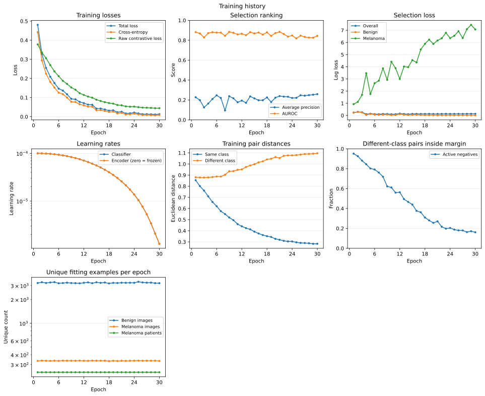
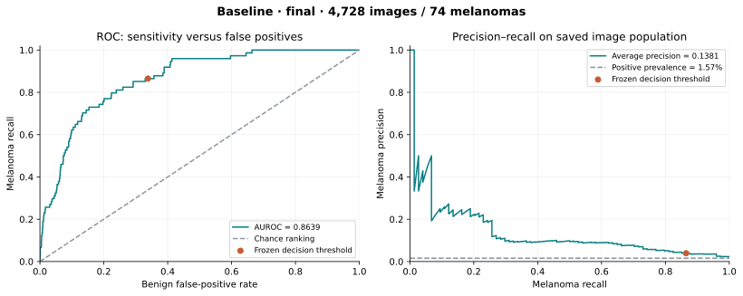
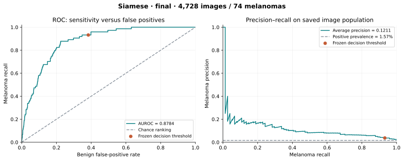
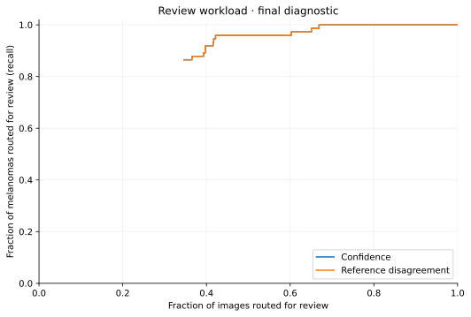
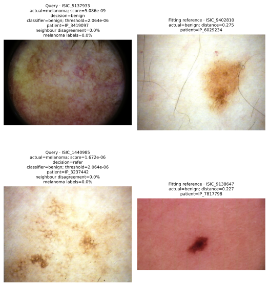
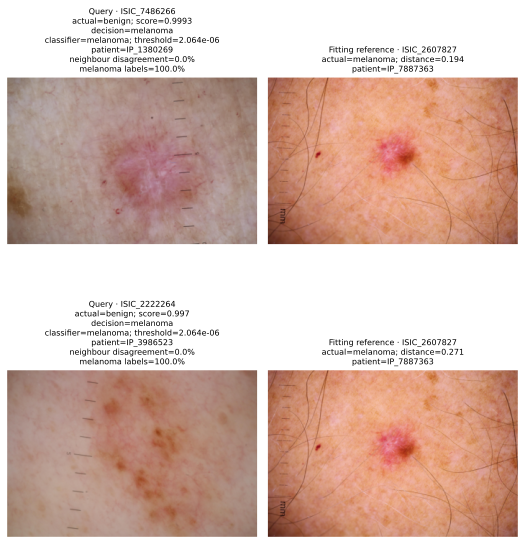
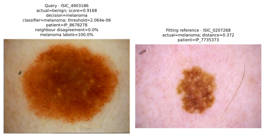

# ISIC 2020 Melanoma Triage with Siamese Metric Learning

## Introduction

This project investigates whether Siamese metric learning improves image-level melanoma triage compared with a classification-only convolutional neural network. The intended user is a reviewer assessing suspicious dermoscopic images. The engineering question is whether comparison with confirmed fitting references helps identify incorrect predictions and reduces human review workload at useful melanoma sensitivity and acceptable local computational cost.

Both models use ImageNet-initialised ResNet-18, which the teaching team has permitted. The baseline learns image labels; the Siamese model adds a contrastive objective on paired embeddings. The final frozen comparison includes 4,728 images from 288 patients, with 74 melanomas from 60 patients. Baseline and Siamese AP are 0.1381 and 0.1211. Extended referral captures the same 71 melanomas in both models, while the baseline reviews 101 fewer benign images. Conditional patient intervals do not establish an AP, AUROC or workload advantage. Reference disagreement adds no benefit over confidence-only referral. The evidence supports retaining the simpler baseline as the research reference and does not support autonomous benign clearing or clinical deployment.

## Feasibility Review

The compulsory tutor check-off is complete. The proposed user needs a locally runnable prototype that distinguishes melanoma from benign lesions and identifies uncertain cases for review. The scope is image classification and retrospective referral analysis; specialist diagnosis, clinical effectiveness and prospective deployment are outside the study.

The selected Hard-difficulty task uses ISIC 2020 and a shared PyTorch ResNet-18 encoder. Course concepts include convolutional feature extraction, shared-weight metric learning, contrastive and cross-entropy objectives, regularisation, imbalanced classification and held-out evaluation. A matched classification-only model provides the fallback and establishes whether metric learning adds value.

Five acceptance criteria guide the investigation:

1. Preserve zero patient overlap across fitting, selection, calibration and final roles.
2. Assess the task's approximate 0.80 test-accuracy target alongside per-class metrics, macro-F1, AUROC and melanoma PR curves.
3. Fit the binary rule to at least 90% calibration recall and the extended review policy to at least 95% calibration capture; report achieved held-out results separately.
4. Compare reference and confidence referral on the same patients, inspect three to five actual failures and provide an operational recommendation.
5. Complete a local pilot within two hours and below 24 GiB process RSS, then measure the full experiment's runtime, memory and inference cost.

Historical five-epoch ImageNet pilots completed in approximately 28 minutes with process peaks near 1.2 GiB, establishing initial local feasibility. The fuller study required approximately 2.6 hours per 30-epoch run; the pilot allowance was not a full-training deadline. Two full runs were budgeted at about six hours. Lazy loading and 224 × 224 RGB inputs limited memory demand.

The principal risks were only 337 fitting melanoma images, repeated minority exposure, optimistic selection results, overconfident errors and a reference policy that merely repeats the classifier. Frozen patient roles, separate calibration, a reserved final comparison and a classification-only fallback addressed these risks experimentally. The final results satisfy local execution and reporting criteria, while demonstrating limitations in detection and safe automatic clearing.

## Methodology

### Data, Preprocessing and Leakage Control

The [SIIM-ISIC 2020 dataset](https://doi.org/10.34970/2020-ds01), described by [Rotemberg et al.](https://doi.org/10.1038/s41597-021-00815-z), contains 33,126 labelled dermoscopic images from 2,056 patients, including 584 melanomas. All 425 published duplicate pairs share patient identity and label in the metadata audit. Whole-patient assignment keeps these duplicates together.

| Role | Patients | Images | Melanomas | Purpose |
| --- | ---: | ---: | ---: | --- |
| Fitting | 1,152 | 18,120 | 337 | Optimisation, pairs and gallery |
| Selection | 154 | 2,438 | 41 | Checkpoint and recipe choice |
| Calibration | 154 | 2,376 | 50 | Decision and referral cutoffs |
| Final | 288 | 4,728 | 74 | Frozen held-out comparison |
| Development | 308 | 5,464 | 82 | Previously examined population, excluded |

A deterministic recipe first partitions patients into 70% fitting-pool, 15% tuning and 15% development roles using seed 42. It reserves 20% of the fitting-pool patients for final evaluation using seed 20261007, then divides tuning patients equally between selection and calibration using seed 20261008. Each division stratifies patients by whether they have any melanoma. The manifest is frozen before the current comparisons. Image proportions differ from patient proportions because lesion counts vary.

Development patients were previously examined and are excluded. Final patients were used by a superseded historical model; the present models were newly trained only on the current fitting patients, without reusing that model's weights. The final set is a held-out retrospective population for these comparisons, not an independent external clinical cohort.

Images are EXIF-corrected, converted to RGB, bilinearly resized to a 256-pixel shorter side, centre-cropped to 224 × 224, scaled to [0, 1] and normalised with RGB mean (0.485, 0.456, 0.406) and standard deviation (0.229, 0.224, 0.225). Fitting additionally applies independent horizontal/vertical flips, rotation within ±45 degrees, translation up to 5% of each dimension, scale factors [0.9, 1.1] and brightness/contrast factors [0.9, 1.1]. Bilinear affine interpolation uses RGB-mean fill. The policy is identical for both classes; selection, calibration and final preprocessing are deterministic. [Perez et al.](https://arxiv.org/abs/1809.01442) motivate augmentation investigation, without establishing these magnitudes as optimal. Cropping and affine transforms can truncate peripheral lesions; lesion-preservation across the full augmented population has not been established.

### Architecture and Learning Objective

ResNet-18 maps each image to 512 features. A linear 512-to-2 classifier acts on raw features; an L2-normalised copy supplies the metric embedding. Embeddings are learned feature vectors whose distances are shaped by the fitting objective. Both members of a pair share the same encoder and classifier. Image-level prediction uses the classifier's melanoma softmax score, while reference retrieval is an additional diagnostic.


The implementation fixes Torchvision's ImageNet V1 initialisation and replaces its 1,000-class layer with an identity operation. A new binary head is trained with the encoder from epoch one. Shared-weight comparison follows the Siamese principle; the metric term follows [Hadsell et al.](https://doi.org/10.1109/CVPR.2006.100). For distance $d$ between normalised embeddings and matching-label indicator $s$, the joint objective is

$$
L = L_{\mathrm{CE}} + \lambda L_{\mathrm{contrastive}}, \qquad
L_{\mathrm{contrastive}} = \operatorname{mean}[s d^2 + (1-s)\max(0,m-d)^2].
$$

Cross-entropy supervises both image labels. The baseline uses $\lambda=0$ and Siamese uses $\lambda=0.1$, with margin $m=1$. The metric-trained encoder is the same encoder restored for prediction. [He et al.](https://arxiv.org/abs/1512.03385) and [Torchvision](https://docs.pytorch.org/vision/0.28/models/generated/torchvision.models.resnet18.html) provide the backbone; the project contribution is the controlled objective, sampling and referral investigation.

The task-sheet reference, [Koch et al.](https://www.cs.toronto.edu/~rsalakhu/papers/oneshot1.pdf), motivates shared-weight pair learning. Their one-shot verifier uses a learned weighted L1 comparison and sigmoid; this project uses Euclidean contrastive regularisation and a supervised melanoma classifier. It is a task-specific Siamese formulation rather than a reproduction of their verifier, and their character-recognition results do not establish melanoma performance.

### Sampling, Optimisation and Selection

Each epoch selects 4,096 cross-patient pairs, alternating same-class and different-class pairs. First labels are uniform; patients are sampled within class, then images within patient. Both objectives use the same pair identities and seeded shuffle stream. Fitting image exposure is approximately balanced, while evaluation retains natural prevalence. Ordinary cross-entropy therefore receives no additional inverse-frequency weights.

Training uses seed 42, AdamW, weight decay 0.0001, 16 pairs per batch, initial encoder/classifier learning rates 0.0001 and cosine decay towards 0.000001 over 30 epochs. This supplies 245,760 image presentations and 7,680 updates. An epoch is a sampling budget rather than a full dataset pass. The checkpoint with greatest selection melanoma average precision is retained. Average precision is the estimator used for PR-AUC, rather than trapezoidal integration.

Only 337 melanoma images represent 240 fitting patients. The balanced 30-epoch budget averages about 365 presentations per melanoma image. Actual coverage averages 335.3 melanoma images and 3,256.4 benign images per epoch; every melanoma patient appears in all 30 epochs. Exposure is unequal across images because sampling balances patients. Augmentation creates views of these cases, not independent patients.

### Calibration, Confidence and Reference Referral

Separate calibration patients choose a binary classifier threshold targeting 90% melanoma recall. The saved thresholds are `1.4540694e-6` for the baseline and `2.0640130e-6` for Siamese. Fixed-threshold 0.5 metrics are also reported. Softmax scores are ranking measures; balanced fitting does not establish probability calibration at natural prevalence, following the distinction discussed by [Guo et al.](https://proceedings.mlr.press/v70/guo17a.html).

The gallery contains 100 benign and 100 melanoma fitting images, one per patient per class, with the same identities in both models. Queries retrieve five references by Euclidean embedding distance. Reference disagreement is the fraction of neighbour labels opposing the binary classifier. Confidence uncertainty is negative absolute distance from the binary threshold. A balanced gallery's melanoma fraction is not a calibrated probability.

Both extended policies always review classifier-positive images. Additional negatives are ranked by confidence, or by reference disagreement with confidence breaking ties. Calibration cutoffs target at least 95% melanoma capture and include all cutoff ties. Both policies attain 48/50 calibration capture. The checkpoint's separate three-way score band is retained for example predictions; it is not the extended policy evaluated here. Capture means reaching review, not correct human diagnosis.

### Statistical and Final-Evaluation Protocol

Paired patient-cluster bootstrap intervals use 2,000 draws and bootstrap seed 42, stratified by whether a patient has any melanoma. Each draw retains all lesions from the sampled patients and evaluates both models on the same draw. This follows the cluster-resampling principle described by [Field and Welsh](https://doi.org/10.1111/j.1467-9868.2007.00593.x).

The 95% percentile intervals condition on this trained seed pair, its calibration rules and observed patient strata. They exclude training-seed and calibration uncertainty, and selection intervals do not correct model-selection optimism. Final scoring was authorised on 25 October 2026. Checkpoint hashes, preprocessing, fitting gallery and cutoffs were recorded before final inference. Final diagnostic cutoffs and gallery hashes exactly reproduced the frozen selection settings. No training, threshold change or alternative checkpoint selection followed final scoring.

## Development Experiments

All rows below use the current 512-feature ImageNet architecture, matched objectives and the same patient roles. Each cell gives selection AP/AUROC.

| Recipe | Baseline | Siamese |
| --- | ---: | ---: |
| Full fine-tuning, modest augmentation | 0.2840 / 0.8629 | 0.2666 / 0.8444 |
| Three-epoch warmup, lower encoder rate | 0.2233 / 0.8367 | 0.2321 / 0.8454 |
| Broader affine augmentation, full fine-tuning | 0.3164 / 0.8961 | 0.2587 / 0.8443 |

Staging changed warmup and encoder rate together, so their separate effects are not identified. It reduced AP for both objectives. Broader augmentation improved the baseline's AP by 0.0324 relative to the preceding full fine-tuning recipe. Its calibrated selection capture remained 39/41 while false positives fell from 1,456 to 870. Siamese AP changed by -0.0079; its false-positive reduction accompanied lower capture. These are single-seed recipe observations, not established effects of individual transforms.

Earlier random-initialisation 512-feature runs reached AP 0.0988/0.0944. The preceding 128-feature random-initialisation pair reached 0.0976/0.1036. An earlier ImageNet Siamese run with a 128-feature projection reached AP 0.3119 under a different architecture and recipe. These historical results motivated the investigation but do not isolate initialisation or projection effects. Their checkpoints are not supported by the current model definition and were not used for final evaluation.

The augmented baseline selects epoch 21 and Siamese epoch 30. At those checkpoints, benign/melanoma selection losses are 0.0168/5.6233 and 0.0114/7.0710. In the Siamese run, melanoma selection loss rises from 0.9292 at epoch one while benign loss falls from 0.2262. The overall loss nevertheless falls because benign images dominate selection. The class-specific records reveal poor minority confidence generalisation despite extensive fitting exposure.



Selection reference and confidence policies are identical within each model. The baseline reviews 49.88% and captures 40/41 melanomas; Siamese reviews 49.71% and captures 37/41. The paired selection AP difference is -0.0577 [-0.1256, 0.0113], which includes zero. The baseline was retained as the operational reference before final evaluation, with the matched Siamese model retained for the controlled comparison.

## Frozen Final Results

Final prevalence is 74/4,728 = 1.565%. All final images belong to patients outside current fitting, selection and calibration roles. Saved identities and labels match the manifest; independent recomputation matches the diagnostic reports. The selected-model comparison uses the same 288 final patients, including 60 with melanoma.

### Ranking Performance

| Metric, conditional 95% patient interval | Baseline | Siamese |
| --- | ---: | ---: |
| Melanoma AP | 0.1381 [0.0863, 0.2261] | 0.1211 [0.0816, 0.1950] |
| AUROC | 0.8639 [0.8218, 0.9030] | 0.8784 [0.8460, 0.9083] |

AP falls from selection 0.3164/0.2587 to final 0.1381/0.1211. This limits conclusions drawn from recipe selection. Small melanoma cohorts, model-selection optimism and cohort variation are possible contributors; their individual effects were not measured. Siamese has higher final AUROC but lower AP. Neither paired interval establishes a reliable ranking advantage.





The PR reference line is the natural melanoma prevalence. PR analysis exposes the false-positive burden in this imbalanced setting, as discussed by [Saito and Rehmsmeier](https://doi.org/10.1371/journal.pone.0118432). Marked operating points use the frozen binary thresholds.

### Conventional Threshold 0.5

| Final metric at 0.5 | Baseline | Siamese |
| --- | ---: | ---: |
| Accuracy | 97.95% | 97.99% |
| Macro-F1 | 0.5803 | 0.5425 |
| Benign precision | 98.63% | 98.53% |
| Benign recall | 99.29% | 99.44% |
| Benign F1 | 0.9896 | 0.9898 |
| Melanoma precision | 23.26% | 16.13% |
| Melanoma recall | 13.51% | 6.76% |
| Melanoma F1 | 0.1709 | 0.0952 |
| False positives | 33 | 26 |
| False negatives | 64 | 69 |
| True melanomas | 10 | 5 |

Both models exceed the approximate 0.80 accuracy target at this operating point, but detect only 10/74 and 5/74 melanomas. Always predicting benign achieves 98.43% accuracy and zero melanoma recall. The measured accuracy therefore does not establish useful screening.

### Calibration-Derived Binary Thresholds

| Final metric at the saved binary threshold | Baseline | Siamese |
| --- | ---: | ---: |
| Accuracy | 66.52% | 62.14% |
| Macro-F1 | 0.4352 | 0.4169 |
| Benign precision | 99.68% | 99.83% |
| Benign recall | 66.20% | 61.65% |
| Benign F1 | 0.7956 | 0.7622 |
| Melanoma precision | 3.91% | 3.72% |
| Melanoma recall | 86.49% | 93.24% |
| Melanoma F1 | 0.0748 | 0.0716 |
| False positives | 1573 | 1785 |
| False negatives | 10 | 5 |
| True melanomas | 64 | 69 |

The lower thresholds increase melanoma recall with a large benign false-positive burden. The 90% calibration recall target does not guarantee 90% final recall: baseline final recall is 86.49%, while Siamese achieves 93.24%. Metrics from these thresholds are not combined with the accuracy at 0.5.

### Extended Referral and the Engineering Dilemma

| Model and policy | Reviewed images | Melanomas captured | Benign reviewed | Melanomas cleared |
| --- | ---: | ---: | ---: | ---: |
| Baseline: Classifier flags | 34.62% (1637) | 64/74 | 1573 | 10 |
| Baseline: Extended referral | 48.03% (2271) | 71/74 | 2200 | 3 |
| Siamese: Classifier flags | 39.21% (1854) | 69/74 | 1785 | 5 |
| Siamese: Extended referral | 50.17% (2372) | 71/74 | 2301 | 3 |

Extended referral denotes either confidence-only or reference disagreement: their decisions and entire workload curves are identical within each model. Both models capture exactly the same 71 melanomas and clear the same three: `ISIC_3909039`, `ISIC_6982386` and `ISIC_7346228`. The baseline reviews 101 fewer benign images at this observed capture. It adds 634 reviews to its binary flags to capture seven more melanomas; Siamese adds 518 reviews to capture two more.

Every classifier-negative final image has five benign nearest references. Reference disagreement is constant at zero in that group, giving false-negative error-detection AUROC 0.5. Its overall error-detection AUROC near 0.98 mainly identifies false-positive flags already routed for review. It is not melanoma-classification AUROC and supplies no additional ranking signal to rescue false negatives. The reference policy falls back to the confidence tie-breaker, explaining the identical queues.



### Paired Differences and Uncertainty

Differences are Siamese minus baseline. Percentage-point units apply only where labelled.

| Final difference | Estimate [conditional 95% patient interval] |
| --- | ---: |
| Melanoma AP | -0.0170 [-0.0575, 0.0145] |
| AUROC | 0.0146 [-0.0128, 0.0410] |
| Binary melanoma recall, percentage points | 6.76 [-1.39, 15.39] |
| Referral workload, percentage points | 2.14 [-0.39, 4.66] |
| Referral capture, percentage points | 0.00 [0.00, 0.00] |

The workload interval includes zero, so 101 fewer reviews does not establish a general workload advantage. The zero-width capture difference follows identical melanoma capture decisions, not certainty about future patients. A single training seed and the absence of external validation remain material limitations.

## Five Current Failure Autopsies

These five selection errors concern the frozen augmented Siamese model and were selected before final scoring. They comprise one false negative and four false positives. Scores are compared with binary threshold `2.0640130e-6`; all retrieved references come from fitting patients. Each figure displays the nearest reference, while neighbour fractions use all five. Observations are hypotheses about failure triggers, not causal explanations or clinical diagnoses.

**1. `ISIC_5137933`: false negative, score 5.086e-09.** The image contains a pale pink/yellow field with subtle boundaries, fine red structures and a dark dermoscopic frame. All five references are benign, and neither review policy rescues the case. Low-contrast morphology and framing are plausible challenges; no intervention establishes their causal role. Agreement reinforces an incorrect benign decision.

**2. `ISIC_7486266`: false positive, score 0.9993.** A pink lesion with visible ruler markings and sparse hair retrieves five melanoma references. The nearest reference also has a pink central region. Broad colour similarity or imaging artifacts may contribute, but the evidence cannot distinguish them. Complete neighbour agreement does not validate the predicted diagnosis.



**3. `ISIC_2222264`: false positive, score 0.997.** The query shows diffuse, patchy brown pigmentation on a pale background. It retrieves melanoma references that vary substantially in colour and appearance. This illustrates visual class overlap and the limits of treating embedding proximity as an explanation; a specific pigment shortcut has not been established.

**4. `ISIC_5120795`: false positive, score 0.9545.** A brown lesion is shown with surrounding skin, ruler markings and hair. Reference composition and lesion scale differ. Framing and artifact sensitivity warrant controlled future investigation, while the current evidence only establishes the error and unanimous melanoma neighbours.



**5. `ISIC_4903186`: false positive, score 0.9168.** A strongly pigmented brown lesion occupies much of the frame. All five neighbours are melanoma references, including similarly pigmented lesions. Pigment and scale are plausible sources of benign–melanoma confusion. The case demonstrates that reference consensus can confidently repeat an incorrect class assignment.



Together, these autopsies show that retrieval can provide nearby fitting examples but has not supplied an independent safety check. No artifact-removal or lesion-cropping intervention was performed after final evaluation.

## Local Computational Feasibility

Both models contain 11,177,538 parameters and use Apple MPS. The classifier and embedding forward graphs are identical; the additional fitting objective changes weights rather than parameter count.

| Measurement | Baseline | Siamese |
| --- | ---: | ---: |
| Training command, hours | 2.68 | 2.57 |
| Training peak process RSS, GiB | 1.285 | 1.355 |
| Warm forward, 16-image batch, ms | 9.823 | 9.809 |
| Final diagnostic elapsed, s | 226.81 | 229.23 |
| Final query pipeline, images/s | 31.90 | 31.34 |
| Final diagnostic peak process RSS, GiB | 1.028 | 1.062 |
| Fitting-reference encoding, s | 5.22 | 4.97 |
| CPU reference query search, s | 0.00233 | 0.00210 |

Warm latency measures a preloaded 16-image forward batch after three warmups over ten measured batches, with accelerator synchronisation. It excludes JPEG decoding, preprocessing, transfers, softmax and reference search. Final query throughput includes loading, preprocessing, transfers, encoding and CPU neighbour search. Gallery construction/encoding and policy calibration are additional setup phases. The tiny search time applies to only 200 references and is not a general scaling claim. These are single-host measurements, not controlled architecture-speed benchmarks.

Process RSS is the operating system's process-lifetime high-water mark. Exact peak MPS allocation is unavailable; the 42.68 MiB final current-allocation snapshot excludes caches and driver memory and is not a peak. RSS and MPS allocation are not added together on unified memory. The measured process peaks satisfy the 24 GiB prototype criterion.

## Engineering Recommendation and Limitations

Retain the classification-only model as the simpler research reference. At the frozen extended policy, its observed final capture equals Siamese capture with 101 fewer benign reviews, while the conditional workload interval still includes zero. The investigation has not demonstrated an operational advantage from the contrastive objective or fitting-reference disagreement. Comparable parameter counts and forward costs do not compensate for the absence of measured referral benefit.

Neither model supports autonomous benign clearing. Approximately half of final images require review to capture 71/74 melanomas, and three melanomas remain outside the queue. Capture assumes referral, not measured human diagnostic accuracy. The substantial AP drop from selection, tiny operating thresholds, repeated minority exposure, one training seed and absence of external validation limit transferability. The final evaluation has been consumed; changing the model or policy would require a newly justified evaluation design rather than retuning against these final labels.

Future work could investigate loss design, lesion-preserving augmentation, additional independent melanoma cases and repeated training seeds. These are proposed studies, not measured gains. The present submission's conclusion is a bounded negative result about this Siamese/reference formulation under the frozen protocol.

## Reproducibility and Usage

### Environment and Data

Run commands from `PatternAnalysis-2026`. Pinned model dependencies are PyTorch 2.13.0, Torchvision 0.28.0, NumPy 2.5.1, Pillow 12.3.0, scikit-learn 1.9.0, PyYAML 6.0.3 and Matplotlib 3.11.1. A fixed seed supports reproducibility without guaranteeing bitwise equality across devices or software versions.

```bash
python3 -m venv .venv
source .venv/bin/activate
python -m pip install -r recognition/Siamese_ISIC2020_Melanoma_47472442/requirements.txt
```

Download and extract the labelled JPEGs and `ISIC_2020_Training_GroundTruth_v2.csv` from the linked ISIC dataset. The default loader searches repository `data/`, including subdirectories. Create the deterministic patient manifest once:

```bash
python -m recognition.Siamese_ISIC2020_Melanoma_47472442.protocol
```

The dedicated package contains `modules.py`, `dataset.py`, `train.py`, `predict.py` and this report. Additional modules implement configuration, frozen patient roles, reference diagnostics, saved-prediction comparison, SVG plots and common runtime helpers. YAML contains model/training settings; paths, run names, device and evaluation choices use CLI options. `auto` prefers CUDA, then MPS, then CPU. Datasets, checkpoints and generated run outputs remain under ignored `data/`; only selected report figures accompany source.

### Training Reproduction

These commands reproduce the selected recipe from ImageNet V1 and a new binary head. They do not resume a historical melanoma checkpoint. Existing run directories are refused; use new names when repeating them. Training never scores final patients.

```bash
python -m recognition.Siamese_ISIC2020_Melanoma_47472442.train \
  --config recognition/Siamese_ISIC2020_Melanoma_47472442/configs/baseline.yaml \
  --epochs 30 --seed 42 --run-name resnet18_baseline_imagenet_aug_30ep_seed42

python -m recognition.Siamese_ISIC2020_Melanoma_47472442.train \
  --config recognition/Siamese_ISIC2020_Melanoma_47472442/configs/siamese.yaml \
  --epochs 30 --seed 42 --run-name resnet18_siamese_imagenet_aug_30ep_seed42
```

Each run saves `effective_config.json`, `checkpoint.pt`, `metrics.json`, selection/calibration prediction CSVs and `training.svg`. Configurations, checkpoints and reports carry input identities and policy settings. Histories include training losses, AP/AUROC, both learning rates, overall/per-class selection loss, pair distances, active negatives and unique sampled coverage. The saved checkpoint contains encoder/classifier tensors, preprocessing, fitting patient identities, selected epoch and the calibration-derived rule.

### Prediction Example and Final Diagnostic Reproduction

Prediction creates the architecture without external weights and loads the complete checkpoint. It prints anonymous image/patient IDs, true label, score, binary prediction and three-way decision, and saves evaluation, score-distribution and failure-case artifacts. For example, the final baseline binary confusion counts are TN=3,081, FP=1,573, FN=10 and TP=64 under its saved calibrated threshold. The separate extended policy captures 71 melanomas.

The following commands demonstrate explicit final opt-in; they have already been executed for both models. To reproduce completed outputs without overwriting evidence, supply a new `--output-dir`. Repeating fixed inference is a reproduction step, not permission to tune final policies.

```bash
python -m recognition.Siamese_ISIC2020_Melanoma_47472442.predict \
  --checkpoint data/runs/resnet18_baseline_imagenet_aug_30ep_seed42/checkpoint.pt \
  --partition final --evaluate-final \
  --evaluation-note "Reproduce the frozen final comparison." \
  --output-dir data/reproductions/baseline_prediction

python -m recognition.Siamese_ISIC2020_Melanoma_47472442.diagnostics \
  --checkpoint data/runs/resnet18_siamese_imagenet_aug_30ep_seed42/checkpoint.pt \
  --partition final --evaluate-final \
  --evaluation-note "Reproduce the frozen final comparison." \
  --output-dir data/reproductions/siamese_diagnostics
```

Diagnostics save `evaluation.json`, query/gallery/neighbour CSVs, descriptive referral curves, embeddings and SVG evidence. The final comparison below reads those already generated standard run-directory diagnostics and performs no inference:

```bash
python -m recognition.Siamese_ISIC2020_Melanoma_47472442.compare \
  --baseline-runs data/runs/resnet18_baseline_imagenet_aug_30ep_seed42 \
  --siamese-runs data/runs/resnet18_siamese_imagenet_aug_30ep_seed42 \
  --partition final \
  --output-dir data/comparisons/reproduced_final_seed42
```

Comparison outputs include per-seed/summary CSVs, input hashes and `comparison.svg`. All compared patients, image labels, diagnostic settings, galleries and training settings must match. Bootstrap seed controls resampling rather than training. The source supports repeated paired seeds, but this report contains one trained seed pair.

### Regenerating Figures without Inference

All plot-generation functions are in `visualisation.py`. ROC/PR plots can be regenerated from saved diagnostic scores:

```bash
python -m recognition.Siamese_ISIC2020_Melanoma_47472442.visualisation \
  --run-dir data/runs/resnet18_baseline_imagenet_aug_30ep_seed42 \
  --predictions data/runs/resnet18_baseline_imagenet_aug_30ep_seed42/diagnostics/final/query_diagnostics.csv \
  --output recognition/Siamese_ISIC2020_Melanoma_47472442/figures/aug_baseline_final_roc_pr.svg
```

Architecture and selected autopsies also regenerate without loading a model:

```python
from pathlib import Path
from recognition.Siamese_ISIC2020_Melanoma_47472442.visualisation import (
    plot_model_architecture, plot_saved_reference_cases,
)

figures = Path("recognition/Siamese_ISIC2020_Melanoma_47472442/figures")
folder = Path("data/runs/resnet18_siamese_imagenet_aug_30ep_seed42/diagnostics/selection")
plot_model_architecture(figures / "architecture.svg")
plot_saved_reference_cases(
    folder, ["ISIC_5137933", "ISIC_7486266"], Path("data/train"),
    figures / "aug_siamese_cases_1.svg",
)
```

`plot_training_history` reads saved histories; `plot_referral_workload` and `plot_statistical_comparison` consume saved curve and summary rows. Significant-digit score labels preserve tiny thresholds rather than rendering them as rounded zeros. Report source and figures are submitted together; the README PDF export is the Turnitin report.

## Artificial Intelligence Usage Disclosure

OpenAI Codex assisted with data loading, code organisation, model/training scaffolding, plotting, reference/referral diagnostics, resource instrumentation, statistical comparison, literature review, experiment planning and report drafting. The author executed the training experiments, including the augmented pair. The author authorised Codex to complete inference, saved-result analysis and report preparation on 25 October 2026 while excluding a full training session.

Codex checked saved identities, ground-truth alignment and artifact hashes, independently recomputed metrics, inspected figures, and ran the frozen final diagnostics, prediction examples and paired patient comparison. Source verification included Ruff, Pyright and compilation; no unit-test suite was added. Historical authorised diagnostic execution is distinct from author-run training. No model or threshold was changed using final outcomes. Previous students' public submissions informed an external review of common mistakes; no student implementation was transplanted. The author remains responsible for reviewing every claim, understanding the loss and inference path, and defending the methodological choices. Clinical correctness and external generalisation have not been validated.

## References and Image Attribution

Dermoscopic images are from ISIC 2020 under CC BY-NC 4.0. Contributing institutions include Hospital Clínic de Barcelona, Medical University of Vienna, Memorial Sloan Kettering Cancer Center, Melanoma Institute Australia, The University of Queensland and University of Athens Medical School. Plots are generated from this project's saved artifacts; neighbour examples are fitting-only images with source identifiers.

1. ISIC. [SIIM-ISIC 2020 Challenge Dataset](https://doi.org/10.34970/2020-ds01), 2020.
2. Rotemberg et al. [A patient-centric dataset of images and metadata for identifying melanomas using clinical context](https://doi.org/10.1038/s41597-021-00815-z). *Scientific Data*, 2021.
3. Hadsell, Chopra and LeCun. [Dimensionality Reduction by Learning an Invariant Mapping](https://doi.org/10.1109/CVPR.2006.100). *CVPR*, 2006.
4. He et al. [Deep Residual Learning for Image Recognition](https://arxiv.org/abs/1512.03385). *CVPR*, 2016.
5. Guo et al. [On Calibration of Modern Neural Networks](https://proceedings.mlr.press/v70/guo17a.html). *ICML*, 2017.
6. Torchvision. [ResNet-18 API](https://docs.pytorch.org/vision/0.28/models/generated/torchvision.models.resnet18.html).
7. Field and Welsh. [Bootstrapping clustered data](https://doi.org/10.1111/j.1467-9868.2007.00593.x). *JRSS B*, 2007.
8. Saito and Rehmsmeier. [The Precision-Recall Plot Is More Informative than the ROC Plot When Evaluating Binary Classifiers on Imbalanced Datasets](https://doi.org/10.1371/journal.pone.0118432). *PLOS ONE*, 2015.
9. Perez et al. [Data Augmentation for Skin Lesion Analysis](https://arxiv.org/abs/1809.01442). *ISIC Workshop*, 2018.
10. Loshchilov and Hutter. [Decoupled Weight Decay Regularization](https://arxiv.org/abs/1711.05101). *ICLR*, 2019.
11. Koch, Zemel and Salakhutdinov. [Siamese Neural Networks for One-shot Image Recognition](https://www.cs.toronto.edu/~rsalakhu/papers/oneshot1.pdf). *ICML Deep Learning Workshop*, 2015.
